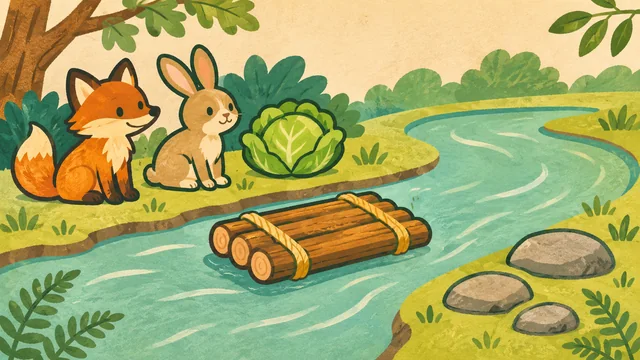
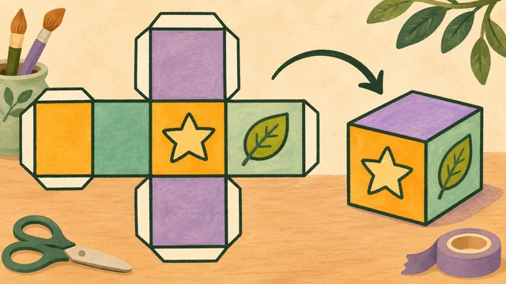
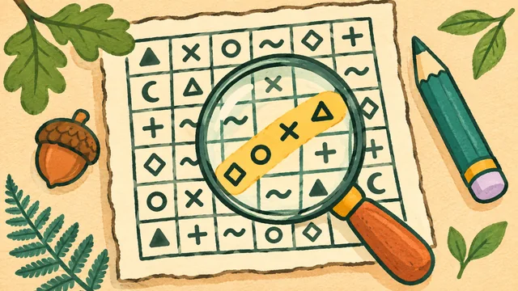
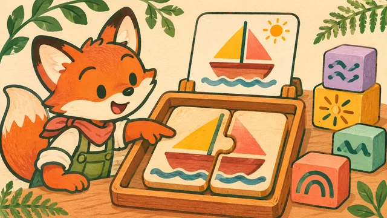
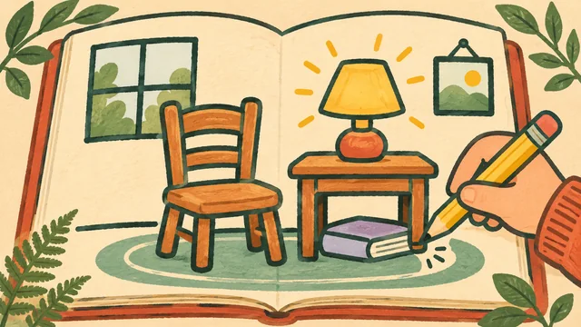
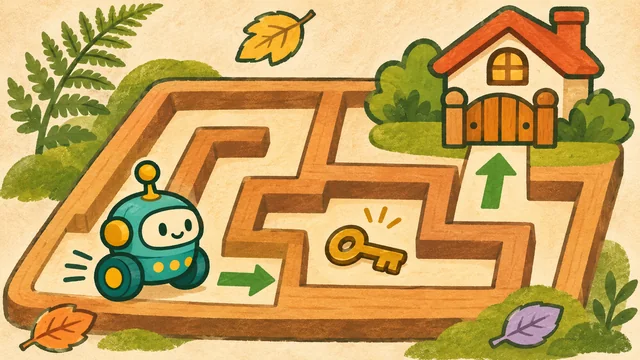

<!--
SPDX-FileCopyrightText: 2026 Milan Jankovec
SPDX-License-Identifier: EUPL-1.2
-->

# Junior Explorers

[Slovenčina](README.sk.md) · [English](README.en.md) · **Čeština** · [Deutsch](README.de.md) · [Polski](README.pl.md) · [Magyar](README.hu.md) · [Français](README.fr.md) · [Español](README.es.md) · [Italiano](README.it.md) · [Português](README.pt.md) · [Nederlands](README.nl.md) · [Română](README.ro.md) · [Українська](README.uk.md) · [Ελληνικά](README.el.md) · [Svenska](README.sv.md) · [简体中文](README.zh-Hans.md) · [繁體中文](README.zh-Hant.md) · [日本語](README.ja.md) · [한국어](README.ko.md) · [Bahasa Indonesia](README.id.md) · [Türkçe](README.tr.md) · [Tiếng Việt](README.vi.md) · [Português (Brasil)](README.pt-BR.md)

Junior Explorers je bezplatná vícejazyčná sbírka 75 her pro děti přibližně od 6 do 9 let. Vyber si z 23 jazyků rozhraní a tří obtížností. Výchozí je angličtina. Hraj myší, dotykem nebo klávesnicí. Tab přesouvá výběr, Enter nebo mezerník aktivuje ovládací prvek. Hry jsou v katalogu uspořádané podle kategorií.

Slovní lovec, Detektivní šifrovací dílna a Slabiková dílna mají české, slovenské a anglické slovníky. Při ostatních jazycích rozhraní používají anglická slova.

Odkaz na tisk u hry nebo v její kartě otevře pracovní list pro stejné zadání. Stránky s řešením jsou volitelné. V dialogu tisku vyber A4 nebo Uložit jako PDF. Tangram tiskni v měřítku 100 %.

## Hraní bez internetu

Stáhni a rozbal ZIP repozitáře nebo ho naklonuj přes Git. Dvojklikem otevři [index.html](../index.html) a přejdi k hrám a jejich pracovním listům. Web funguje bez připojení nebo místního serveru.

## Hraní online

Po publikování otevři [katalog v češtině](https://milanjankovec.github.io/junior-explorers/?lang=cs) na GitHub Pages.

## Hry

Rýmovací dvojice a Obrázková křížovka mají českou, slovenskou a anglickou sadu slov. V ostatních jazycích rozhraní používají anglickou sadu.

### Logika

<table role="presentation">
  <tr>
    <td align="center" valign="top"><a href="../games/smart-memory/index.html?lang=cs"> Chytré pexeso</a></td>
    <td align="center" valign="top"><a href="../games/tangram/index.html?lang=cs"> Geometrický tangram</a></td>
  </tr>
  <tr>
    <td align="center" valign="top"><a href="../games/pattern-builder/index.html?lang=cs"> Dokonči vzor</a></td>
    <td align="center" valign="top"><a href="../games/picture-sudoku/index.html?lang=cs"> Obrázkové sudoku</a></td>
  </tr>
  <tr>
    <td align="center" valign="top"><a href="../games/logic-detective/index.html?lang=cs"> Kdo jsem?</a></td>
    <td align="center" valign="top"><a href="../games/river-crossing/index.html?lang=cs"> Most přes řeku</a></td>
  </tr>
  <tr>
    <td align="center" valign="top"><a href="../games/island-bridges/index.html?lang=cs"> Mosty mezi ostrovy</a></td>
    <td align="center" valign="top"><a href="../games/parking-puzzle/index.html?lang=cs"> Zablokované parkoviště</a></td>
  </tr>
  <tr>
    <td align="center" valign="top"><a href="../games/one-stroke/index.html?lang=cs"> Jedním tahem</a></td>
    <td align="center" valign="top"><a href="../games/light-maze/index.html?lang=cs"> Světlo v bludišti</a></td>
  </tr>
  <tr>
    <td align="center" valign="top"><a href="../games/trip-planner/index.html?lang=cs"> Naplánuj výlet</a></td>
    <td align="center" valign="top"><a href="../games/nonograms/index.html?lang=cs"> Malované křížovky</a></td>
  </tr>
  <tr>
    <td align="center" valign="top"><a href="../games/campsite-tents/index.html?lang=cs"> Kemp pod stromy</a></td>
    <td align="center" valign="top"><a href="../games/cube-nets/index.html?lang=cs"> Rozložená kostka</a></td>
  </tr>
  <tr>
    <td align="center" valign="top"><a href="../games/property-circles/index.html?lang=cs"> Kruhy vlastností</a></td>
  </tr>
</table>

### Matematika

<table role="presentation">
  <tr>
    <td align="center" valign="top"><a href="../games/math-pixel-art/index.html?lang=cs"> Matematické pixelové malování</a></td>
    <td align="center" valign="top"><a href="../games/treasure-coordinates/index.html?lang=cs"> Lovci pokladů</a></td>
  </tr>
  <tr>
    <td align="center" valign="top"><a href="../games/clock-master/index.html?lang=cs"> Mistr času</a></td>
    <td align="center" valign="top"><a href="../games/little-shop/index.html?lang=cs"> Malý obchodník</a></td>
  </tr>
  <tr>
    <td align="center" valign="top"><a href="../games/number-pyramids/index.html?lang=cs"> Číselné pyramidy</a></td>
    <td align="center" valign="top"><a href="../games/balance-scales/index.html?lang=cs"> Vyvaž váhy</a></td>
  </tr>
  <tr>
    <td align="center" valign="top"><a href="../games/pizza-fractions/index.html?lang=cs"> Rozděl pizzu</a></td>
    <td align="center" valign="top"><a href="../games/garden-fence/index.html?lang=cs"> Oploť zahrádku</a></td>
  </tr>
  <tr>
    <td align="center" valign="top"><a href="../games/calendar-quest/index.html?lang=cs"> Kalendářní výprava</a></td>
    <td align="center" valign="top"><a href="../games/picture-graphs/index.html?lang=cs"> Obrázkový graf</a></td>
  </tr>
  <tr>
    <td align="center" valign="top"><a href="../games/cube-builder/index.html?lang=cs"> Stavitel z kostek</a></td>
    <td align="center" valign="top"><a href="../games/measurement-workshop/index.html?lang=cs"> Dílna měření</a></td>
  </tr>
  <tr>
    <td align="center" valign="top"><a href="../games/tens-factory/index.html?lang=cs"> Továrna na desítky</a></td>
    <td align="center" valign="top"><a href="../games/number-elevator/index.html?lang=cs"> Číselný výtah</a></td>
  </tr>
  <tr>
    <td align="center" valign="top"><a href="../games/water-jugs/index.html?lang=cs"> Nádoby a odměrky</a></td>
    <td align="center" valign="top"><a href="../games/multiplication-arrays/index.html?lang=cs"> Násobilkové obdélníky</a></td>
  </tr>
  <tr>
    <td align="center" valign="top"><a href="../games/chance-bag/index.html?lang=cs"> Sáček náhody</a></td>
    <td align="center" valign="top"><a href="../games/snack-buffet/index.html?lang=cs"> Svačinový bufet</a></td>
  </tr>
</table>

### Jazyk

<table role="presentation">
  <tr>
    <td align="center" valign="top"><a href="../games/secret-code/index.html?lang=cs"> Detektivní šifrovací dílna</a></td>
    <td align="center" valign="top"><a href="../games/story-sequence/index.html?lang=cs"> Časový detektiv</a></td>
  </tr>
  <tr>
    <td align="center" valign="top"><a href="../games/word-search/index.html?lang=cs"> Lovec slov</a></td>
    <td align="center" valign="top"><a href="../games/syllable-workshop/index.html?lang=cs"> Slabiková dílna</a></td>
  </tr>
  <tr>
    <td align="center" valign="top"><a href="../games/read-and-draw/index.html?lang=cs"> Čti a nakresli</a></td>
    <td align="center" valign="top"><a href="../games/rhyme-pairs/index.html?lang=cs"> Rýmovací dvojice</a></td>
  </tr>
  <tr>
    <td align="center" valign="top"><a href="../games/picture-crossword/index.html?lang=cs"> Obrázková křížovka</a></td>
    <td align="center" valign="top"><a href="../games/word-ladder/index.html?lang=cs"> Písmenkový žebřík</a></td>
  </tr>
  <tr>
    <td align="center" valign="top"><a href="../games/sentence-builder/index.html?lang=cs"> Poskládej větu</a></td>
  </tr>
</table>

### Příroda

<table role="presentation">
  <tr>
    <td align="center" valign="top"><a href="../games/eco-sort/index.html?lang=cs"> Záchranáři planety</a></td>
    <td align="center" valign="top"><a href="../games/animal-food/index.html?lang=cs"> Kdo co jí?</a></td>
  </tr>
  <tr>
    <td align="center" valign="top"><a href="../games/life-cycles/index.html?lang=cs"> Přírodní badatel</a></td>
    <td align="center" valign="top"><a href="../games/weather-lab/index.html?lang=cs"> Malý meteorolog</a></td>
  </tr>
  <tr>
    <td align="center" valign="top"><a href="../games/forest-tracks/index.html?lang=cs"> Stopy v lese</a></td>
    <td align="center" valign="top"><a href="../games/garden-experiment/index.html?lang=cs"> Zahradník na zkoušku</a></td>
  </tr>
  <tr>
    <td align="center" valign="top"><a href="../games/shadow-playground/index.html?lang=cs"> Stíny na hřišti</a></td>
    <td align="center" valign="top"><a href="../games/magnet-workshop/index.html?lang=cs"> Magnetická dílna</a></td>
  </tr>
  <tr>
    <td align="center" valign="top"><a href="../games/rain-flow/index.html?lang=cs"> Kam steče déšť?</a></td>
    <td align="center" valign="top"><a href="../games/float-or-sink/index.html?lang=cs"> Plave, nebo klesne?</a></td>
  </tr>
  <tr>
    <td align="center" valign="top"><a href="../games/day-and-night/index.html?lang=cs"> Den a noc</a></td>
    <td align="center" valign="top"><a href="../games/light-a-bulb/index.html?lang=cs"> Rozsviť žárovku</a></td>
  </tr>
</table>

### Programování

<table role="presentation">
  <tr>
    <td align="center" valign="top"><a href="../games/robot-maze/index.html?lang=cs"> Robotova cesta domů</a></td>
    <td align="center" valign="top"><a href="../games/spaceship-repair/index.html?lang=cs"> Oprav vesmírnou loď</a></td>
  </tr>
  <tr>
    <td align="center" valign="top"><a href="../games/debug-the-robot/index.html?lang=cs"> Robotův rozbitý program</a></td>
    <td align="center" valign="top"><a href="../games/traffic-program/index.html?lang=cs"> Semaforový program</a></td>
  </tr>
  <tr>
    <td align="center" valign="top"><a href="../games/event-house/index.html?lang=cs"> Kouzelný domeček</a></td>
    <td align="center" valign="top"><a href="../games/seed-counter/index.html?lang=cs"> Počítadlo semínek</a></td>
  </tr>
  <tr>
    <td align="center" valign="top"><a href="../games/stamp-printer/index.html?lang=cs"> Razítková tiskárna</a></td>
    <td align="center" valign="top"><a href="../games/parallel-workshop/index.html?lang=cs"> Dva v dílně</a></td>
  </tr>
  <tr>
    <td align="center" valign="top"><a href="../games/sorting-line/index.html?lang=cs"> Třídicí linka</a></td>
    <td align="center" valign="top"><a href="../games/ticket-machine/index.html?lang=cs"> Automat na lístky</a></td>
  </tr>
</table>

### Tvořivost

<table role="presentation">
  <tr>
    <td align="center" valign="top"><a href="../games/symmetry-studio/index.html?lang=cs"> Zrcadlový umělec</a></td>
    <td align="center" valign="top"><a href="../games/story-studio/index.html?lang=cs"> Pohádkový režisér</a></td>
  </tr>
  <tr>
    <td align="center" valign="top"><a href="../games/rhythm-master/index.html?lang=cs"> Rytmický mistr</a></td>
    <td align="center" valign="top"><a href="../games/scene-changes/index.html?lang=cs"> Co se změnilo?</a></td>
  </tr>
  <tr>
    <td align="center" valign="top"><a href="../games/musical-steps/index.html?lang=cs"> Hudební schůdky</a></td>
    <td align="center" valign="top"><a href="../games/frame-animation/index.html?lang=cs"> Animace po políčkách</a></td>
  </tr>
  <tr>
    <td align="center" valign="top"><a href="../games/layered-landscape/index.html?lang=cs"> Krajina z vrstev</a></td>
    <td align="center" valign="top"><a href="../games/stamp-patterns/index.html?lang=cs"> Vzorkovna razítek</a></td>
  </tr>
  <tr>
    <td align="center" valign="top"><a href="../games/paper-puppets/index.html?lang=cs"> Papírové loutky</a></td>
    <td align="center" valign="top"><a href="../games/expedition-badge/index.html?lang=cs"> Odznak výpravy</a></td>
  </tr>
  <tr>
    <td align="center" valign="top"><a href="../games/colour-lab/index.html?lang=cs"> Barevná laboratoř</a></td>
  </tr>
</table>

### Náhledy tisku

Kliknutím na obrázek zvětšíš první stránku pracovního listu každé hry. Ukázky jsou v angličtině s vypnutým zobrazením řešení.

## Soukromí a licence

Hraje se bez registrace, reklam, analytiky, placených funkcí a externích služeb. Prohlížeč může lokálně uložit jazyk, nastavení, dokončené hry a rozepsaný komiks. Hosting může zpracovávat běžné provozní záznamy.

© 2026 Milan Jankovec. Původní zdrojový kód je pod licencí [EUPL-1.2](../LICENSE).
