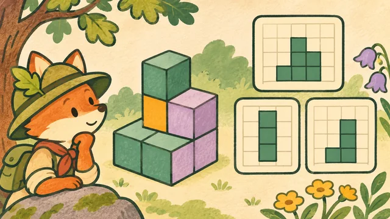
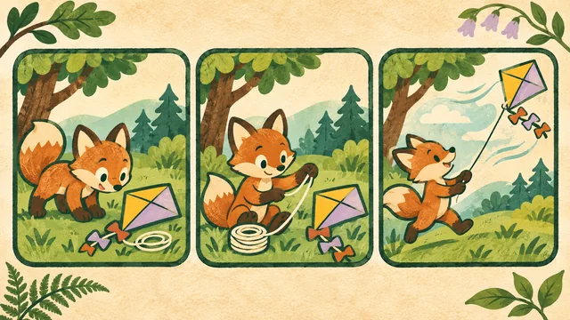
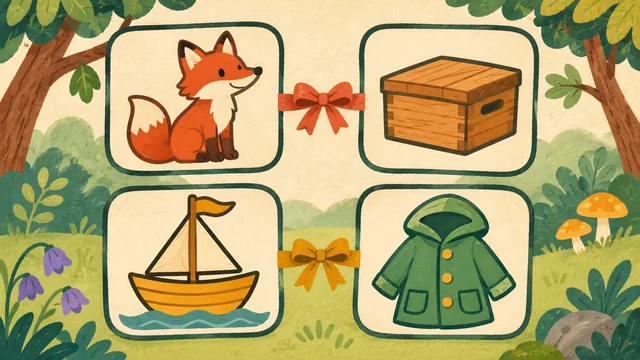
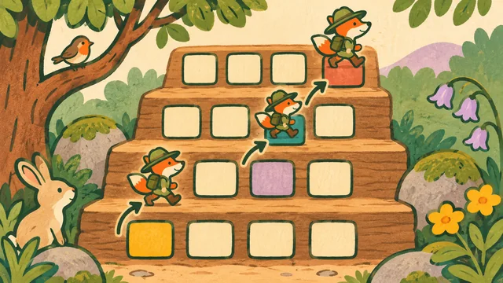
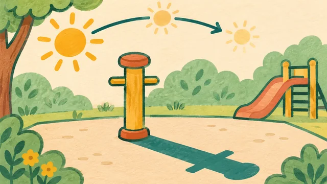
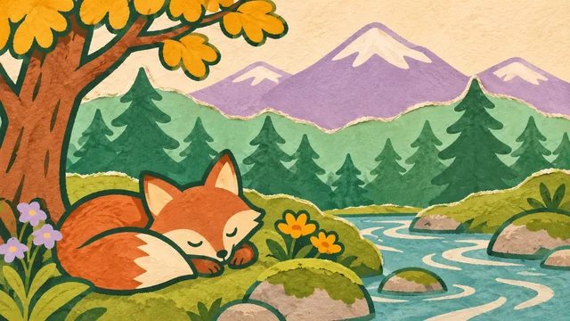
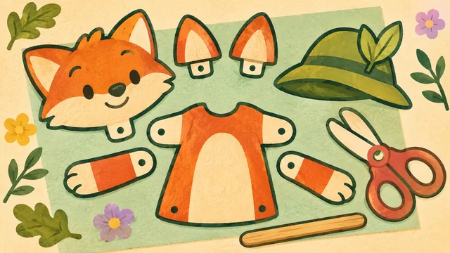

<!--
SPDX-FileCopyrightText: 2026 Milan Jankovec
SPDX-License-Identifier: EUPL-1.2
-->

# Junior Explorers

[Slovenčina](README.sk.md) · [English](README.en.md) · [Čeština](README.cs.md) · **Deutsch** · [Polski](README.pl.md) · [Magyar](README.hu.md) · [Français](README.fr.md) · [Español](README.es.md) · [Italiano](README.it.md) · [Português](README.pt.md) · [Nederlands](README.nl.md) · [Română](README.ro.md) · [Українська](README.uk.md) · [Ελληνικά](README.el.md) · [Svenska](README.sv.md) · [简体中文](README.zh-Hans.md) · [繁體中文](README.zh-Hant.md) · [日本語](README.ja.md) · [한국어](README.ko.md) · [Bahasa Indonesia](README.id.md) · [Türkçe](README.tr.md) · [Tiếng Việt](README.vi.md) · [Português (Brasil)](README.pt-BR.md)

Junior Explorers ist eine kostenlose, mehrsprachige Sammlung mit 75 Browserspielen für Kinder von etwa 6 bis 9 Jahren. Es gibt 23 Sprachen für die Benutzeroberfläche und drei Schwierigkeitsstufen. Standardmäßig ist Englisch eingestellt. Spiele mit Maus, Touchscreen oder Tastatur. Mit Tab wechselst du zwischen den Bedienelementen, mit der Eingabe- oder Leertaste wählst du sie aus. Im Katalog sind die Spiele nach Kategorien geordnet.

Wortjäger, Geheimcode Workshop und Silbenwerkstatt verwenden slowakische, tschechische und englische Wortlisten. Wenn du eine andere Sprache für die Benutzeroberfläche auswählst, verwenden diese Spiele die englische Wortliste.

Über den Drucklink im Spiel oder auf der Katalogkarte öffnest du ein Arbeitsblatt zur selben Aufgabe. Lösungsseiten sind optional. Wähle im Druckdialog des Browsers „Als PDF speichern“ oder drucke im Format A4. Drucke Tangram-Vorlagen in Originalgröße (100 %).

## Offline spielen

Lade die ZIP-Datei des Repositorys herunter und entpacke sie oder klone das Repository mit Git. Öffne [index.html](../index.html) per Doppelklick, um zu spielen oder Arbeitsblätter zu öffnen. Die Website läuft im Browser ohne Internetverbindung oder lokalen Server.

## Online spielen

Nach der Veröffentlichung findest du den [deutschsprachigen Katalog](https://milanjankovec.github.io/junior-explorers/?lang=de) auf GitHub Pages.

## Spiele

Für Reimpaare und Bilderkreuzworträtsel gibt es englische, slowakische und tschechische Wortsammlungen. In den übrigen Oberflächensprachen werden die englischen Wörter verwendet.

### Logik

<table role="presentation">
  <tr>
    <td align="center" valign="top"><a href="../games/smart-memory/index.html?lang=de"> Ein schlaues Gedächtnis</a></td>
    <td align="center" valign="top"><a href="../games/tangram/index.html?lang=de"> Tangram-Formen</a></td>
  </tr>
  <tr>
    <td align="center" valign="top"><a href="../games/pattern-builder/index.html?lang=de"> Vervollständigen Sie das Muster</a></td>
    <td align="center" valign="top"><a href="../games/picture-sudoku/index.html?lang=de"> Bild von Sudoku</a></td>
  </tr>
  <tr>
    <td align="center" valign="top"><a href="../games/logic-detective/index.html?lang=de"> Wer bin ich?</a></td>
    <td align="center" valign="top"><a href="../games/river-crossing/index.html?lang=de"> Überquerung des Flusses</a></td>
  </tr>
  <tr>
    <td align="center" valign="top"><a href="../games/island-bridges/index.html?lang=de"> Brücken zwischen Inseln</a></td>
    <td align="center" valign="top"><a href="../games/parking-puzzle/index.html?lang=de"> Parkplatz-Rätsel</a></td>
  </tr>
  <tr>
    <td align="center" valign="top"><a href="../games/one-stroke/index.html?lang=de"> In einem Zug</a></td>
    <td align="center" valign="top"><a href="../games/light-maze/index.html?lang=de"> Lichtlabyrinth</a></td>
  </tr>
  <tr>
    <td align="center" valign="top"><a href="../games/trip-planner/index.html?lang=de"> Plane den Ausflug</a></td>
    <td align="center" valign="top"><a href="../games/nonograms/index.html?lang=de"> Bilderrätsel mit Zahlen</a></td>
  </tr>
  <tr>
    <td align="center" valign="top"><a href="../games/campsite-tents/index.html?lang=de"> Zelte und Bäume</a></td>
    <td align="center" valign="top"><a href="../games/cube-nets/index.html?lang=de"> Würfelnetze</a></td>
  </tr>
  <tr>
    <td align="center" valign="top"><a href="../games/property-circles/index.html?lang=de"> Sortierkreise</a></td>
  </tr>
</table>

### Mathematik

<table role="presentation">
  <tr>
    <td align="center" valign="top"><a href="../games/math-pixel-art/index.html?lang=de"> Mathematik Pixel Art</a></td>
    <td align="center" valign="top"><a href="../games/treasure-coordinates/index.html?lang=de"> Schatzkoordinaten</a></td>
  </tr>
  <tr>
    <td align="center" valign="top"><a href="../games/clock-master/index.html?lang=de"> Uhrmeister</a></td>
    <td align="center" valign="top"><a href="../games/little-shop/index.html?lang=de"> Der kleine Ladenbesitzer</a></td>
  </tr>
  <tr>
    <td align="center" valign="top"><a href="../games/number-pyramids/index.html?lang=de"> Zahl der Pyramiden</a></td>
    <td align="center" valign="top"><a href="../games/balance-scales/index.html?lang=de"> Waage im Gleichgewicht</a></td>
  </tr>
  <tr>
    <td align="center" valign="top"><a href="../games/pizza-fractions/index.html?lang=de"> Brüche mit Pizza</a></td>
    <td align="center" valign="top"><a href="../games/garden-fence/index.html?lang=de"> Ein Zaun fürs Beet</a></td>
  </tr>
  <tr>
    <td align="center" valign="top"><a href="../games/calendar-quest/index.html?lang=de"> Detektivarbeit im Kalender</a></td>
    <td align="center" valign="top"><a href="../games/picture-graphs/index.html?lang=de"> Bilddiagramme</a></td>
  </tr>
  <tr>
    <td align="center" valign="top"><a href="../games/cube-builder/index.html?lang=de"> Würfelbauer</a></td>
    <td align="center" valign="top"><a href="../games/measurement-workshop/index.html?lang=de"> Messwerkstatt</a></td>
  </tr>
  <tr>
    <td align="center" valign="top"><a href="../games/tens-factory/index.html?lang=de"> Zehnerfabrik</a></td>
    <td align="center" valign="top"><a href="../games/number-elevator/index.html?lang=de"> Zahlenaufzug</a></td>
  </tr>
  <tr>
    <td align="center" valign="top"><a href="../games/water-jugs/index.html?lang=de"> Messkannen</a></td>
    <td align="center" valign="top"><a href="../games/multiplication-arrays/index.html?lang=de"> Rechtecke zum Multiplizieren</a></td>
  </tr>
  <tr>
    <td align="center" valign="top"><a href="../games/chance-bag/index.html?lang=de"> Glücksbeutel</a></td>
    <td align="center" valign="top"><a href="../games/snack-buffet/index.html?lang=de"> Pausenbuffet</a></td>
  </tr>
</table>

### Sprache

<table role="presentation">
  <tr>
    <td align="center" valign="top"><a href="../games/secret-code/index.html?lang=de"> Geheimcode Workshop</a></td>
    <td align="center" valign="top"><a href="../games/story-sequence/index.html?lang=de"> Zeitdetektiv</a></td>
  </tr>
  <tr>
    <td align="center" valign="top"><a href="../games/word-search/index.html?lang=de"> Wortjäger</a></td>
    <td align="center" valign="top"><a href="../games/syllable-workshop/index.html?lang=de"> Silbenwerkstatt</a></td>
  </tr>
  <tr>
    <td align="center" valign="top"><a href="../games/read-and-draw/index.html?lang=de"> Lies und zeichne</a></td>
    <td align="center" valign="top"><a href="../games/rhyme-pairs/index.html?lang=de"> Reimpaare</a></td>
  </tr>
  <tr>
    <td align="center" valign="top"><a href="../games/picture-crossword/index.html?lang=de"> Bilderkreuzworträtsel</a></td>
    <td align="center" valign="top"><a href="../games/word-ladder/index.html?lang=de"> Wortleiter</a></td>
  </tr>
  <tr>
    <td align="center" valign="top"><a href="../games/sentence-builder/index.html?lang=de"> Bau einen Satz</a></td>
  </tr>
</table>

### Natur

<table role="presentation">
  <tr>
    <td align="center" valign="top"><a href="../games/eco-sort/index.html?lang=de"> Rettungspartner</a></td>
    <td align="center" valign="top"><a href="../games/animal-food/index.html?lang=de"> Wer isst was?</a></td>
  </tr>
  <tr>
    <td align="center" valign="top"><a href="../games/life-cycles/index.html?lang=de"> Naturforscher</a></td>
    <td align="center" valign="top"><a href="../games/weather-lab/index.html?lang=de"> Der kleine Meteorologe</a></td>
  </tr>
  <tr>
    <td align="center" valign="top"><a href="../games/forest-tracks/index.html?lang=de"> Tierspuren im Wald</a></td>
    <td align="center" valign="top"><a href="../games/garden-experiment/index.html?lang=de"> Pflanzenexperiment</a></td>
  </tr>
  <tr>
    <td align="center" valign="top"><a href="../games/shadow-playground/index.html?lang=de"> Schatten auf dem Spielplatz</a></td>
    <td align="center" valign="top"><a href="../games/magnet-workshop/index.html?lang=de"> Magnetwerkstatt</a></td>
  </tr>
  <tr>
    <td align="center" valign="top"><a href="../games/rain-flow/index.html?lang=de"> Wohin fließt der Regen?</a></td>
    <td align="center" valign="top"><a href="../games/float-or-sink/index.html?lang=de"> Schwimmt es oder sinkt es?</a></td>
  </tr>
  <tr>
    <td align="center" valign="top"><a href="../games/day-and-night/index.html?lang=de"> Tag und Nacht</a></td>
    <td align="center" valign="top"><a href="../games/light-a-bulb/index.html?lang=de"> Bring die Lampe zum Leuchten</a></td>
  </tr>
</table>

### Programmieren

<table role="presentation">
  <tr>
    <td align="center" valign="top"><a href="../games/robot-maze/index.html?lang=de"> Roboter sind auf dem Heimweg</a></td>
    <td align="center" valign="top"><a href="../games/spaceship-repair/index.html?lang=de"> Reparatur von Raumschiffen</a></td>
  </tr>
  <tr>
    <td align="center" valign="top"><a href="../games/debug-the-robot/index.html?lang=de"> Debug des Roboters</a></td>
    <td align="center" valign="top"><a href="../games/traffic-program/index.html?lang=de"> Programmiere die Ampel</a></td>
  </tr>
  <tr>
    <td align="center" valign="top"><a href="../games/event-house/index.html?lang=de"> Magisches Ereignishaus</a></td>
    <td align="center" valign="top"><a href="../games/seed-counter/index.html?lang=de"> Samenzähler</a></td>
  </tr>
  <tr>
    <td align="center" valign="top"><a href="../games/stamp-printer/index.html?lang=de"> Stempeldrucker</a></td>
    <td align="center" valign="top"><a href="../games/parallel-workshop/index.html?lang=de"> Teamarbeit in der Werkstatt</a></td>
  </tr>
  <tr>
    <td align="center" valign="top"><a href="../games/sorting-line/index.html?lang=de"> Sortierband</a></td>
    <td align="center" valign="top"><a href="../games/ticket-machine/index.html?lang=de"> Fahrkartenautomat</a></td>
  </tr>
</table>

### Kreativität

<table role="presentation">
  <tr>
    <td align="center" valign="top"><a href="../games/symmetry-studio/index.html?lang=de"> Spiegelkünstler</a></td>
    <td align="center" valign="top"><a href="../games/story-studio/index.html?lang=de"> Story-Direktor</a></td>
  </tr>
  <tr>
    <td align="center" valign="top"><a href="../games/rhythm-master/index.html?lang=de"> Rhythmusmeister</a></td>
    <td align="center" valign="top"><a href="../games/scene-changes/index.html?lang=de"> Was hat sich verändert?</a></td>
  </tr>
  <tr>
    <td align="center" valign="top"><a href="../games/musical-steps/index.html?lang=de"> Tonleiter-Treppe</a></td>
    <td align="center" valign="top"><a href="../games/frame-animation/index.html?lang=de"> Bild-für-Bild-Animation</a></td>
  </tr>
  <tr>
    <td align="center" valign="top"><a href="../games/layered-landscape/index.html?lang=de"> Landschaft in Schichten</a></td>
    <td align="center" valign="top"><a href="../games/stamp-patterns/index.html?lang=de"> Stempelmuster</a></td>
  </tr>
  <tr>
    <td align="center" valign="top"><a href="../games/paper-puppets/index.html?lang=de"> Papierpuppen</a></td>
    <td align="center" valign="top"><a href="../games/expedition-badge/index.html?lang=de"> Expeditionsabzeichen</a></td>
  </tr>
  <tr>
    <td align="center" valign="top"><a href="../games/colour-lab/index.html?lang=de"> Farblabor</a></td>
  </tr>
</table>

### Druckvorschau

Klicke auf das Bild, um die erste Seite der Arbeitsblätter zu den einzelnen Spielen zu vergrößern. Die Beispiele sind auf Englisch und zeigen die Aufgaben ohne Lösungen.

## Datenschutz und Lizenz

Du kannst ohne Registrierung, Tracking, Werbung, Netzwerkdienste oder kostenpflichtige Funktionen spielen. Der Browser kann deine Sprache, Einstellungen, abgeschlossene Spiele und einen Comic-Entwurf auf deinem Gerät speichern. Der Hostinganbieter kann übliche Betriebsprotokolle verarbeiten.

© 2026 Milan Jankovec. Der ursprüngliche Quellcode steht unter der Lizenz [EUPL-1.2](../LICENSE).
