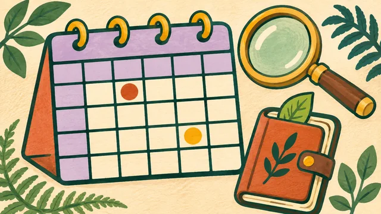
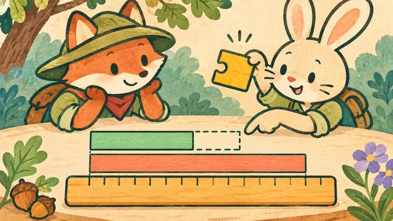
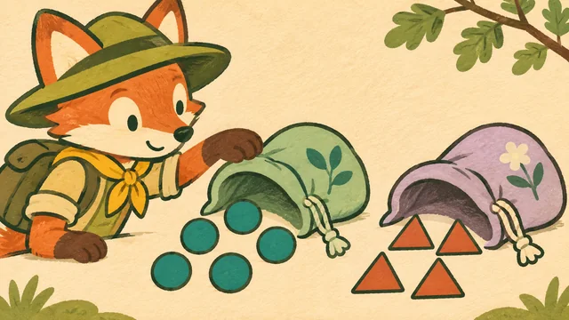

<!--
SPDX-FileCopyrightText: 2026 Milan Jankovec
SPDX-License-Identifier: EUPL-1.2
-->

# Junior Explorers

[Slovenčina](README.sk.md) · [English](README.en.md) · [Čeština](README.cs.md) · [Deutsch](README.de.md) · [Polski](README.pl.md) · [Magyar](README.hu.md) · [Français](README.fr.md) · [Español](README.es.md) · [Italiano](README.it.md) · [Português](README.pt.md) · [Nederlands](README.nl.md) · [Română](README.ro.md) · [Українська](README.uk.md) · **Ελληνικά** · [Svenska](README.sv.md) · [简体中文](README.zh-Hans.md) · [繁體中文](README.zh-Hant.md) · [日本語](README.ja.md) · [한국어](README.ko.md) · [Bahasa Indonesia](README.id.md) · [Türkçe](README.tr.md) · [Tiếng Việt](README.vi.md) · [Português (Brasil)](README.pt-BR.md)

Το Junior Explorers είναι μια δωρεάν, πολύγλωσση συλλογή 75 παιχνιδιών για το πρόγραμμα περιήγησης, για παιδιά ηλικίας περίπου 6–9 ετών. Το περιβάλλον είναι διαθέσιμο σε 23 γλώσσες και τα παιχνίδια έχουν τρία επίπεδα δυσκολίας. Η προεπιλεγμένη γλώσσα είναι τα αγγλικά. Μπορείς να παίξεις με το ποντίκι, με αφή ή με το πληκτρολόγιο. Το πλήκτρο Tab μετακινεί την εστίαση και το Enter ή το διάστημα ενεργοποιεί το επιλεγμένο στοιχείο. Τα παιχνίδια στον κατάλογο είναι οργανωμένα σε κατηγορίες.

Η αναζήτηση λέξεων, το εργαστήρι μυστικού κώδικα και το εργαστήρι συλλαβών χρησιμοποιούν λίστες λέξεων στα σλοβακικά, τα τσεχικά και τα αγγλικά. Όταν επιλέγεις άλλη γλώσσα για το περιβάλλον, αυτά τα παιχνίδια χρησιμοποιούν την αγγλική λίστα.

Με τον σύνδεσμο εκτύπωσης μέσα στο παιχνίδι ή στην κάρτα του στον κατάλογο ανοίγεις το φύλλο εργασίας της ίδιας άσκησης. Μπορείς να προσθέσεις σελίδες με τις απαντήσεις. Στο παράθυρο εκτύπωσης του προγράμματος περιήγησης, διάλεξε αποθήκευση ως PDF ή εκτύπωση σε χαρτί A4. Εκτύπωσε τα τάγκραμ σε κλίμακα 100%.

## Παιχνίδι χωρίς σύνδεση στο διαδίκτυο

Κατέβασε και αποσυμπίεσε το αρχείο ZIP του αποθετηρίου ή κλωνοποίησε το αποθετήριο με το Git. Κάνε διπλό κλικ στο [index.html](../index.html) για να ανοίξεις τα παιχνίδια και τα φύλλα εργασίας τους. Ο ιστότοπος λειτουργεί στο πρόγραμμα περιήγησης χωρίς σύνδεση στο διαδίκτυο ή τοπικό διακομιστή.

## Παιχνίδι στο διαδίκτυο

Μετά τη δημοσίευση, άνοιξε τον [κατάλογο στα ελληνικά](https://milanjankovec.github.io/junior-explorers/?lang=el) στο GitHub Pages.

## Παιχνίδια

Τα παιχνίδια Ζευγάρια με ρίμα και Σταυρόλεξο με εικόνες έχουν λίστες λέξεων στα αγγλικά, τα σλοβακικά και τα τσεχικά. Για τις υπόλοιπες γλώσσες του περιβάλλοντος, τα παιχνίδια χρησιμοποιούν την αγγλική λίστα.

### Λογική

<table role="presentation">
  <tr>
    <td align="center" valign="top"><a href="../games/smart-memory/index.html?lang=el"> Συπνή μνήμη</a></td>
    <td align="center" valign="top"><a href="../games/tangram/index.html?lang=el"> Τάγκραμ</a></td>
  </tr>
  <tr>
    <td align="center" valign="top"><a href="../games/pattern-builder/index.html?lang=el"> Τελειώστε το πρότυπο</a></td>
    <td align="center" valign="top"><a href="../games/picture-sudoku/index.html?lang=el"> Εικόνα Σουδόκου</a></td>
  </tr>
  <tr>
    <td align="center" valign="top"><a href="../games/logic-detective/index.html?lang=el"> Ποιος είμαι εγώ;</a></td>
    <td align="center" valign="top"><a href="../games/river-crossing/index.html?lang=el"> Περνάς ποταμού</a></td>
  </tr>
  <tr>
    <td align="center" valign="top"><a href="../games/island-bridges/index.html?lang=el"> Γέφυρες ανάμεσα στα νησιά</a></td>
    <td align="center" valign="top"><a href="../games/parking-puzzle/index.html?lang=el"> Γρίφος στο πάρκινγκ</a></td>
  </tr>
  <tr>
    <td align="center" valign="top"><a href="../games/one-stroke/index.html?lang=el"> Με μία γραμμή</a></td>
    <td align="center" valign="top"><a href="../games/light-maze/index.html?lang=el"> Φως στον λαβύρινθο</a></td>
  </tr>
  <tr>
    <td align="center" valign="top"><a href="../games/trip-planner/index.html?lang=el"> Οργάνωσε την εκδρομή</a></td>
    <td align="center" valign="top"><a href="../games/nonograms/index.html?lang=el"> Νονογράμματα</a></td>
  </tr>
  <tr>
    <td align="center" valign="top"><a href="../games/campsite-tents/index.html?lang=el"> Σκηνές και δέντρα</a></td>
    <td align="center" valign="top"><a href="../games/cube-nets/index.html?lang=el"> Αναπτύγματα του κύβου</a></td>
  </tr>
  <tr>
    <td align="center" valign="top"><a href="../games/property-circles/index.html?lang=el"> Κύκλοι ταξινόμησης</a></td>
  </tr>
</table>

### Μαθηματικά

<table role="presentation">
  <tr>
    <td align="center" valign="top"><a href="../games/math-pixel-art/index.html?lang=el"> Μαθηματική Πικέλες Τέχνη</a></td>
    <td align="center" valign="top"><a href="../games/treasure-coordinates/index.html?lang=el"> Συντονισμοί Κουστού</a></td>
  </tr>
  <tr>
    <td align="center" valign="top"><a href="../games/clock-master/index.html?lang=el"> Διοικητής ρολογιού</a></td>
    <td align="center" valign="top"><a href="../games/little-shop/index.html?lang=el"> Μικρός Εμπορεύτης</a></td>
  </tr>
  <tr>
    <td align="center" valign="top"><a href="../games/number-pyramids/index.html?lang=el"> Πυραμίδες αριθμού</a></td>
    <td align="center" valign="top"><a href="../games/balance-scales/index.html?lang=el"> Ισορρόπησε τη ζυγαριά</a></td>
  </tr>
  <tr>
    <td align="center" valign="top"><a href="../games/pizza-fractions/index.html?lang=el"> Κλάσματα με πίτσα</a></td>
    <td align="center" valign="top"><a href="../games/garden-fence/index.html?lang=el"> Περίφραξε τον κήπο</a></td>
  </tr>
  <tr>
    <td align="center" valign="top"><a href="../games/calendar-quest/index.html?lang=el"> Περιπέτεια στο ημερολόγιο</a></td>
    <td align="center" valign="top"><a href="../games/picture-graphs/index.html?lang=el"> Γραφήματα με εικόνες</a></td>
  </tr>
  <tr>
    <td align="center" valign="top"><a href="../games/cube-builder/index.html?lang=el"> Χτίσε με κύβους</a></td>
    <td align="center" valign="top"><a href="../games/measurement-workshop/index.html?lang=el"> Εργαστήρι μετρήσεων</a></td>
  </tr>
  <tr>
    <td align="center" valign="top"><a href="../games/tens-factory/index.html?lang=el"> Εργοστάσιο δεκάδων</a></td>
    <td align="center" valign="top"><a href="../games/number-elevator/index.html?lang=el"> Ασανσέρ αριθμών</a></td>
  </tr>
  <tr>
    <td align="center" valign="top"><a href="../games/water-jugs/index.html?lang=el"> Κανάτες μέτρησης</a></td>
    <td align="center" valign="top"><a href="../games/multiplication-arrays/index.html?lang=el"> Ορθογώνια πολλαπλασιασμού</a></td>
  </tr>
  <tr>
    <td align="center" valign="top"><a href="../games/chance-bag/index.html?lang=el"> Σακουλάκια πιθανοτήτων</a></td>
    <td align="center" valign="top"><a href="../games/snack-buffet/index.html?lang=el"> Μπουφές για κολατσιό</a></td>
  </tr>
</table>

### Γλώσσα

<table role="presentation">
  <tr>
    <td align="center" valign="top"><a href="../games/secret-code/index.html?lang=el"> Εργαστήριο Κώδικα Μυστικού</a></td>
    <td align="center" valign="top"><a href="../games/story-sequence/index.html?lang=el"> Ντετέκτιβ του Χρόνου</a></td>
  </tr>
  <tr>
    <td align="center" valign="top"><a href="../games/word-search/index.html?lang=el"> Χάντερ λέξεων</a></td>
    <td align="center" valign="top"><a href="../games/syllable-workshop/index.html?lang=el"> Εργαστήριο συλλαβών</a></td>
  </tr>
  <tr>
    <td align="center" valign="top"><a href="../games/read-and-draw/index.html?lang=el"> Διάβασε και ζωγράφισε</a></td>
    <td align="center" valign="top"><a href="../games/rhyme-pairs/index.html?lang=el"> Ζευγάρια με ρίμα</a></td>
  </tr>
  <tr>
    <td align="center" valign="top"><a href="../games/picture-crossword/index.html?lang=el"> Σταυρόλεξο με εικόνες</a></td>
    <td align="center" valign="top"><a href="../games/word-ladder/index.html?lang=el"> Σκάλα λέξεων</a></td>
  </tr>
  <tr>
    <td align="center" valign="top"><a href="../games/sentence-builder/index.html?lang=el"> Φτιάξε μια πρόταση</a></td>
  </tr>
</table>

### Φύση

<table role="presentation">
  <tr>
    <td align="center" valign="top"><a href="../games/eco-sort/index.html?lang=el"> Σωτηριασμοί Πλανητών</a></td>
    <td align="center" valign="top"><a href="../games/animal-food/index.html?lang=el"> Ποιος Τι Τρώει;</a></td>
  </tr>
  <tr>
    <td align="center" valign="top"><a href="../games/life-cycles/index.html?lang=el"> Εξερευνητής Φύσης</a></td>
    <td align="center" valign="top"><a href="../games/weather-lab/index.html?lang=el"> Μικρός Μετεωρολόγος</a></td>
  </tr>
  <tr>
    <td align="center" valign="top"><a href="../games/forest-tracks/index.html?lang=el"> Ίχνη στο δάσος</a></td>
    <td align="center" valign="top"><a href="../games/garden-experiment/index.html?lang=el"> Πείραμα στον κήπο</a></td>
  </tr>
  <tr>
    <td align="center" valign="top"><a href="../games/shadow-playground/index.html?lang=el"> Σκιές στην παιδική χαρά</a></td>
    <td align="center" valign="top"><a href="../games/magnet-workshop/index.html?lang=el"> Εργαστήρι μαγνητών</a></td>
  </tr>
  <tr>
    <td align="center" valign="top"><a href="../games/rain-flow/index.html?lang=el"> Πού πάει το νερό της βροχής;</a></td>
    <td align="center" valign="top"><a href="../games/float-or-sink/index.html?lang=el"> Επιπλέει ή βυθίζεται;</a></td>
  </tr>
  <tr>
    <td align="center" valign="top"><a href="../games/day-and-night/index.html?lang=el"> Μέρα και νύχτα</a></td>
    <td align="center" valign="top"><a href="../games/light-a-bulb/index.html?lang=el"> Άναψε ένα λαμπάκι</a></td>
  </tr>
</table>

### Προγραμματισμός

<table role="presentation">
  <tr>
    <td align="center" valign="top"><a href="../games/robot-maze/index.html?lang=el"> Τα ρομπότ γυρίζουν σπίτι</a></td>
    <td align="center" valign="top"><a href="../games/spaceship-repair/index.html?lang=el"> Επισκευή διαστημικού σκάφους</a></td>
  </tr>
  <tr>
    <td align="center" valign="top"><a href="../games/debug-the-robot/index.html?lang=el"> Αποσυντονίστε το ρομπότ</a></td>
    <td align="center" valign="top"><a href="../games/traffic-program/index.html?lang=el"> Προγραμμάτισε το φανάρι</a></td>
  </tr>
  <tr>
    <td align="center" valign="top"><a href="../games/event-house/index.html?lang=el"> Μαγικό σπίτι συμβάντων</a></td>
    <td align="center" valign="top"><a href="../games/seed-counter/index.html?lang=el"> Μετρητής σπόρων</a></td>
  </tr>
  <tr>
    <td align="center" valign="top"><a href="../games/stamp-printer/index.html?lang=el"> Εκτυπωτής με σφραγίδες</a></td>
    <td align="center" valign="top"><a href="../games/parallel-workshop/index.html?lang=el"> Ομαδική δουλειά στο εργαστήριο</a></td>
  </tr>
  <tr>
    <td align="center" valign="top"><a href="../games/sorting-line/index.html?lang=el"> Γραμμή ταξινόμησης</a></td>
    <td align="center" valign="top"><a href="../games/ticket-machine/index.html?lang=el"> Μηχάνημα εισιτηρίων</a></td>
  </tr>
</table>

### Δημιουργικότητα

<table role="presentation">
  <tr>
    <td align="center" valign="top"><a href="../games/symmetry-studio/index.html?lang=el"> Καλλιτέχνης καθρέφτης</a></td>
    <td align="center" valign="top"><a href="../games/story-studio/index.html?lang=el"> Διευθυντής ιστορίας</a></td>
  </tr>
  <tr>
    <td align="center" valign="top"><a href="../games/rhythm-master/index.html?lang=el"> Διοικητής Ρυθμού</a></td>
    <td align="center" valign="top"><a href="../games/scene-changes/index.html?lang=el"> Τι άλλαξε;</a></td>
  </tr>
  <tr>
    <td align="center" valign="top"><a href="../games/musical-steps/index.html?lang=el"> Μουσικά σκαλοπάτια</a></td>
    <td align="center" valign="top"><a href="../games/frame-animation/index.html?lang=el"> Κινούμενα σχέδια καρέ καρέ</a></td>
  </tr>
  <tr>
    <td align="center" valign="top"><a href="../games/layered-landscape/index.html?lang=el"> Τοπίο σε στρώσεις</a></td>
    <td align="center" valign="top"><a href="../games/stamp-patterns/index.html?lang=el"> Μοτίβα με σφραγίδες</a></td>
  </tr>
  <tr>
    <td align="center" valign="top"><a href="../games/paper-puppets/index.html?lang=el"> Χάρτινες μαριονέτες</a></td>
    <td align="center" valign="top"><a href="../games/expedition-badge/index.html?lang=el"> Σήμα αποστολής</a></td>
  </tr>
  <tr>
    <td align="center" valign="top"><a href="../games/colour-lab/index.html?lang=el"> Εργαστήριο χρωμάτων</a></td>
  </tr>
</table>

### Προεπισκόπηση εκτύπωσης

Κάνε κλικ στην εικόνα για να μεγαλώσεις την πρώτη σελίδα του φύλλου εργασίας για κάθε παιχνίδι. Τα παραδείγματα είναι στα αγγλικά, με τις σελίδες απαντήσεων κρυμμένες.

## Απόρρητο και άδεια

Παίζεις χωρίς εγγραφή, παρακολούθηση, διαφημίσεις, δικτυακές υπηρεσίες ή λειτουργίες επί πληρωμή. Το πρόγραμμα περιήγησης μπορεί να κρατήσει στη συσκευή τη γλώσσα, τις προτιμήσεις, τα ολοκληρωμένα παιχνίδια και το πρόχειρο κόμικ. Ο πάροχος φιλοξενίας μπορεί να επεξεργάζεται τα συνήθη αρχεία καταγραφής λειτουργίας.

© 2026 Milan Jankovec. Ο αρχικός πηγαίος κώδικας διατίθεται με την άδεια [EUPL-1.2](../LICENSE).
