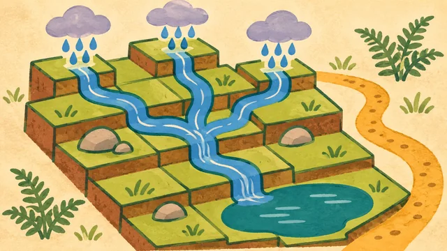
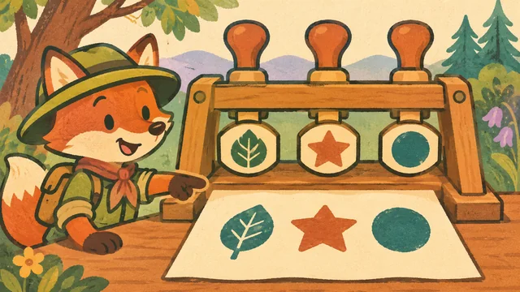
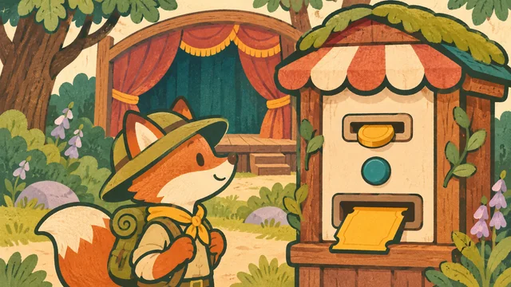
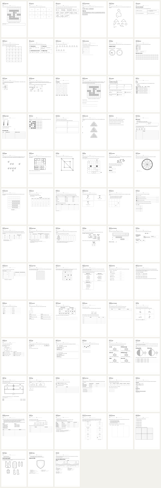

<!--
SPDX-FileCopyrightText: 2026 Milan Jankovec
SPDX-License-Identifier: EUPL-1.2
-->

# Junior Explorers

[Slovenčina](README.sk.md) · [English](README.en.md) · [Čeština](README.cs.md) · [Deutsch](README.de.md) · [Polski](README.pl.md) · [Magyar](README.hu.md) · [Français](README.fr.md) · **Español** · [Italiano](README.it.md) · [Português](README.pt.md) · [Nederlands](README.nl.md) · [Română](README.ro.md) · [Українська](README.uk.md) · [Ελληνικά](README.el.md) · [Svenska](README.sv.md) · [简体中文](README.zh-Hans.md) · [繁體中文](README.zh-Hant.md) · [日本語](README.ja.md) · [한국어](README.ko.md) · [Bahasa Indonesia](README.id.md) · [Türkçe](README.tr.md) · [Tiếng Việt](README.vi.md) · [Português (Brasil)](README.pt-BR.md)

Junior Explorers es una colección gratuita y multilingüe de 75 juegos para navegador pensados para niños de 6 a 9 años aproximadamente. Elige entre 23 idiomas de interfaz y tres niveles de dificultad. El idioma predeterminado es el inglés. Juega con el ratón, la pantalla táctil o el teclado. Usa Tab para desplazarte y pulsa Intro o la barra espaciadora para activar los controles. Explora el catálogo por categorías.

Caza de palabras, Taller de Código Secreto y Taller de sílabas tienen listas de palabras en eslovaco, checo e inglés. Si la interfaz está en otro idioma, estos juegos usan la lista en inglés.

Usa el enlace de impresión del juego o de su tarjeta en el catálogo para abrir una ficha del mismo desafío. Puedes incluir las páginas de soluciones. En el cuadro de impresión del navegador, elige «Guardar como PDF» o imprime en papel A4. Imprime los tangram a escala del 100 %.

## Jugar sin conexión

Descarga y descomprime el archivo ZIP del repositorio o clónalo con Git. Haz doble clic en [index.html](../index.html) para jugar o abrir las fichas de los juegos. El sitio funciona en el navegador sin conexión a Internet ni servidor local.

## Jugar en línea

Una vez publicado el sitio, abre el [catálogo en español](https://milanjankovec.github.io/junior-explorers/?lang=es) en GitHub Pages.

## Juegos

Parejas de rimas y Crucigrama ilustrado tienen listas de palabras en inglés, eslovaco y checo. Si la interfaz está en otro idioma, estos juegos usan la lista en inglés.

### Lógica

<table role="presentation">
  <tr>
    <td align="center" valign="top"><a href="../games/smart-memory/index.html?lang=es"> Memoria inteligente</a></td>
    <td align="center" valign="top"><a href="../games/tangram/index.html?lang=es"> Las formas de los tangramas</a></td>
  </tr>
  <tr>
    <td align="center" valign="top"><a href="../games/pattern-builder/index.html?lang=es"> Terminar el patrón</a></td>
    <td align="center" valign="top"><a href="../games/picture-sudoku/index.html?lang=es"> Imagen de Sudoku</a></td>
  </tr>
  <tr>
    <td align="center" valign="top"><a href="../games/logic-detective/index.html?lang=es"> ¿Quién soy yo?</a></td>
    <td align="center" valign="top"><a href="../games/river-crossing/index.html?lang=es"> Cruzando el río</a></td>
  </tr>
  <tr>
    <td align="center" valign="top"><a href="../games/island-bridges/index.html?lang=es"> Puentes entre islas</a></td>
    <td align="center" valign="top"><a href="../games/parking-puzzle/index.html?lang=es"> Aparcamiento bloqueado</a></td>
  </tr>
  <tr>
    <td align="center" valign="top"><a href="../games/one-stroke/index.html?lang=es"> De un solo trazo</a></td>
    <td align="center" valign="top"><a href="../games/light-maze/index.html?lang=es"> Laberinto de luz</a></td>
  </tr>
  <tr>
    <td align="center" valign="top"><a href="../games/trip-planner/index.html?lang=es"> Planea la excursión</a></td>
    <td align="center" valign="top"><a href="../games/nonograms/index.html?lang=es"> Nonogramas</a></td>
  </tr>
  <tr>
    <td align="center" valign="top"><a href="../games/campsite-tents/index.html?lang=es"> Tiendas y árboles</a></td>
    <td align="center" valign="top"><a href="../games/cube-nets/index.html?lang=es"> Desarrollos del cubo</a></td>
  </tr>
  <tr>
    <td align="center" valign="top"><a href="../games/property-circles/index.html?lang=es"> Círculos de clasificación</a></td>
  </tr>
</table>

### Matemáticas

<table role="presentation">
  <tr>
    <td align="center" valign="top"><a href="../games/math-pixel-art/index.html?lang=es"> Matemáticas El arte de los píxeles</a></td>
    <td align="center" valign="top"><a href="../games/treasure-coordinates/index.html?lang=es"> Coordenadas del tesoro</a></td>
  </tr>
  <tr>
    <td align="center" valign="top"><a href="../games/clock-master/index.html?lang=es"> Maestro del reloj</a></td>
    <td align="center" valign="top"><a href="../games/little-shop/index.html?lang=es"> El pequeño comerciante</a></td>
  </tr>
  <tr>
    <td align="center" valign="top"><a href="../games/number-pyramids/index.html?lang=es"> Pirámides de número</a></td>
    <td align="center" valign="top"><a href="../games/balance-scales/index.html?lang=es"> Equilibra la balanza</a></td>
  </tr>
  <tr>
    <td align="center" valign="top"><a href="../games/pizza-fractions/index.html?lang=es"> Fracciones con pizza</a></td>
    <td align="center" valign="top"><a href="../games/garden-fence/index.html?lang=es"> Valla el huerto</a></td>
  </tr>
  <tr>
    <td align="center" valign="top"><a href="../games/calendar-quest/index.html?lang=es"> Aventura en el calendario</a></td>
    <td align="center" valign="top"><a href="../games/picture-graphs/index.html?lang=es"> Gráficos con dibujos</a></td>
  </tr>
  <tr>
    <td align="center" valign="top"><a href="../games/cube-builder/index.html?lang=es"> Construye con cubos</a></td>
    <td align="center" valign="top"><a href="../games/measurement-workshop/index.html?lang=es"> Taller de medidas</a></td>
  </tr>
  <tr>
    <td align="center" valign="top"><a href="../games/tens-factory/index.html?lang=es"> Fábrica de decenas</a></td>
    <td align="center" valign="top"><a href="../games/number-elevator/index.html?lang=es"> Ascensor de números</a></td>
  </tr>
  <tr>
    <td align="center" valign="top"><a href="../games/water-jugs/index.html?lang=es"> Jarras medidoras</a></td>
    <td align="center" valign="top"><a href="../games/multiplication-arrays/index.html?lang=es"> Rectángulos de multiplicación</a></td>
  </tr>
  <tr>
    <td align="center" valign="top"><a href="../games/chance-bag/index.html?lang=es"> Bolsas de probabilidad</a></td>
    <td align="center" valign="top"><a href="../games/snack-buffet/index.html?lang=es"> Bufé de meriendas</a></td>
  </tr>
</table>

### Idioma

<table role="presentation">
  <tr>
    <td align="center" valign="top"><a href="../games/secret-code/index.html?lang=es"> Taller de Código Secreto</a></td>
    <td align="center" valign="top"><a href="../games/story-sequence/index.html?lang=es"> Detective del Tiempo</a></td>
  </tr>
  <tr>
    <td align="center" valign="top"><a href="../games/word-search/index.html?lang=es"> Caza de palabras</a></td>
    <td align="center" valign="top"><a href="../games/syllable-workshop/index.html?lang=es"> Taller de sílabas</a></td>
  </tr>
  <tr>
    <td align="center" valign="top"><a href="../games/read-and-draw/index.html?lang=es"> Lee y dibuja</a></td>
    <td align="center" valign="top"><a href="../games/rhyme-pairs/index.html?lang=es"> Parejas de rimas</a></td>
  </tr>
  <tr>
    <td align="center" valign="top"><a href="../games/picture-crossword/index.html?lang=es"> Crucigrama ilustrado</a></td>
    <td align="center" valign="top"><a href="../games/word-ladder/index.html?lang=es"> Escalera de palabras</a></td>
  </tr>
  <tr>
    <td align="center" valign="top"><a href="../games/sentence-builder/index.html?lang=es"> Construye una oración</a></td>
  </tr>
</table>

### Naturaleza

<table role="presentation">
  <tr>
    <td align="center" valign="top"><a href="../games/eco-sort/index.html?lang=es"> Salvadores del planeta</a></td>
    <td align="center" valign="top"><a href="../games/animal-food/index.html?lang=es"> ¿Quién come qué?</a></td>
  </tr>
  <tr>
    <td align="center" valign="top"><a href="../games/life-cycles/index.html?lang=es"> Explorador de la naturaleza</a></td>
    <td align="center" valign="top"><a href="../games/weather-lab/index.html?lang=es"> El pequeño meteorólogo</a></td>
  </tr>
  <tr>
    <td align="center" valign="top"><a href="../games/forest-tracks/index.html?lang=es"> Huellas en el bosque</a></td>
    <td align="center" valign="top"><a href="../games/garden-experiment/index.html?lang=es"> Experimento en el huerto</a></td>
  </tr>
  <tr>
    <td align="center" valign="top"><a href="../games/shadow-playground/index.html?lang=es"> Sombras en el parque</a></td>
    <td align="center" valign="top"><a href="../games/magnet-workshop/index.html?lang=es"> Taller de imanes</a></td>
  </tr>
  <tr>
    <td align="center" valign="top"><a href="../games/rain-flow/index.html?lang=es"> ¿Adónde va el agua de lluvia?</a></td>
    <td align="center" valign="top"><a href="../games/float-or-sink/index.html?lang=es"> ¿Flota o se hunde?</a></td>
  </tr>
  <tr>
    <td align="center" valign="top"><a href="../games/day-and-night/index.html?lang=es"> Día y noche</a></td>
    <td align="center" valign="top"><a href="../games/light-a-bulb/index.html?lang=es"> Enciende una bombilla</a></td>
  </tr>
</table>

### Programación

<table role="presentation">
  <tr>
    <td align="center" valign="top"><a href="../games/robot-maze/index.html?lang=es"> Robots en camino a casa</a></td>
    <td align="center" valign="top"><a href="../games/spaceship-repair/index.html?lang=es"> Reparar la nave espacial</a></td>
  </tr>
  <tr>
    <td align="center" valign="top"><a href="../games/debug-the-robot/index.html?lang=es"> Desarrolla el robot</a></td>
    <td align="center" valign="top"><a href="../games/traffic-program/index.html?lang=es"> Programa el semáforo</a></td>
  </tr>
  <tr>
    <td align="center" valign="top"><a href="../games/event-house/index.html?lang=es"> Casa de los eventos</a></td>
    <td align="center" valign="top"><a href="../games/seed-counter/index.html?lang=es"> Contador de semillas</a></td>
  </tr>
  <tr>
    <td align="center" valign="top"><a href="../games/stamp-printer/index.html?lang=es"> Impresora de sellos</a></td>
    <td align="center" valign="top"><a href="../games/parallel-workshop/index.html?lang=es"> Trabajo en equipo en el taller</a></td>
  </tr>
  <tr>
    <td align="center" valign="top"><a href="../games/sorting-line/index.html?lang=es"> Cinta de clasificación</a></td>
    <td align="center" valign="top"><a href="../games/ticket-machine/index.html?lang=es"> Máquina de billetes</a></td>
  </tr>
</table>

### Creatividad

<table role="presentation">
  <tr>
    <td align="center" valign="top"><a href="../games/symmetry-studio/index.html?lang=es"> Artista espejo</a></td>
    <td align="center" valign="top"><a href="../games/story-studio/index.html?lang=es"> Director de historia</a></td>
  </tr>
  <tr>
    <td align="center" valign="top"><a href="../games/rhythm-master/index.html?lang=es"> Maestro del ritmo</a></td>
    <td align="center" valign="top"><a href="../games/scene-changes/index.html?lang=es"> ¿Qué ha cambiado?</a></td>
  </tr>
  <tr>
    <td align="center" valign="top"><a href="../games/musical-steps/index.html?lang=es"> Escalones musicales</a></td>
    <td align="center" valign="top"><a href="../games/frame-animation/index.html?lang=es"> Animación fotograma a fotograma</a></td>
  </tr>
  <tr>
    <td align="center" valign="top"><a href="../games/layered-landscape/index.html?lang=es"> Paisaje por capas</a></td>
    <td align="center" valign="top"><a href="../games/stamp-patterns/index.html?lang=es"> Estampados con sellos</a></td>
  </tr>
  <tr>
    <td align="center" valign="top"><a href="../games/paper-puppets/index.html?lang=es"> Títeres de papel</a></td>
    <td align="center" valign="top"><a href="../games/expedition-badge/index.html?lang=es"> Insignia de expedición</a></td>
  </tr>
  <tr>
    <td align="center" valign="top"><a href="../games/colour-lab/index.html?lang=es"> Laboratorio de colores</a></td>
  </tr>
</table>

### Vistas previas de impresión

Haz clic en la imagen para ampliar la primera página de la ficha de cada juego. Los ejemplos están en inglés y las soluciones están ocultas.

## Privacidad y licencia

Juega sin registro, rastreadores, publicidad, servicios de red ni funciones de pago. El navegador puede guardar el idioma, las preferencias, los juegos completados y el borrador del cómic en tu dispositivo. El proveedor de alojamiento puede procesar los registros habituales de funcionamiento.

© 2026 Milan Jankovec. El código fuente original está bajo la licencia [EUPL-1.2](../LICENSE).
