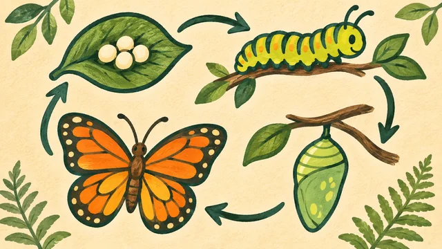
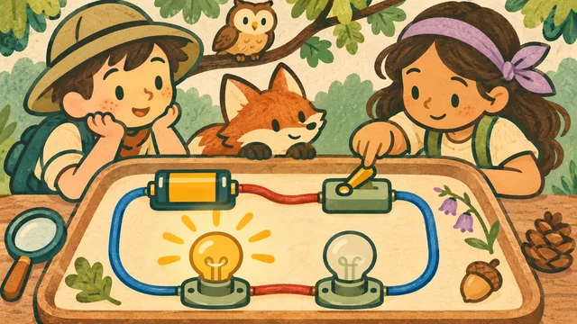

<!--
SPDX-FileCopyrightText: 2026 Milan Jankovec
SPDX-License-Identifier: EUPL-1.2
-->

# Junior Explorers

[Slovenčina](README.sk.md) · [English](README.en.md) · [Čeština](README.cs.md) · [Deutsch](README.de.md) · [Polski](README.pl.md) · [Magyar](README.hu.md) · **Français** · [Español](README.es.md) · [Italiano](README.it.md) · [Português](README.pt.md) · [Nederlands](README.nl.md) · [Română](README.ro.md) · [Українська](README.uk.md) · [Ελληνικά](README.el.md) · [Svenska](README.sv.md) · [简体中文](README.zh-Hans.md) · [繁體中文](README.zh-Hant.md) · [日本語](README.ja.md) · [한국어](README.ko.md) · [Bahasa Indonesia](README.id.md) · [Türkçe](README.tr.md) · [Tiếng Việt](README.vi.md) · [Português (Brasil)](README.pt-BR.md)

Junior Explorers est une collection gratuite et multilingue de 75 jeux pour navigateur, destinée aux enfants d’environ 6 à 9 ans. L’interface est disponible en 23 langues et les jeux proposent trois niveaux de difficulté. L’anglais est la langue par défaut. Joue à la souris, sur un écran tactile ou au clavier. Au clavier, utilise Tab pour naviguer, puis Entrée ou la barre d’espace pour activer une commande. Le catalogue présente les jeux par catégorie.

Chasseurs de mots, Atelier de code secret et Atelier des syllabes proposent des listes de mots en slovaque, en tchèque et en anglais. Lorsque l’interface est dans une autre langue, ces jeux utilisent leur liste de mots anglaise.

Le lien d’impression du jeu ou de sa carte dans le catalogue ouvre une fiche d’activités pour le même défi. Tu peux choisir d’inclure les pages de solutions. Dans la fenêtre d’impression de ton navigateur, sélectionne « Enregistrer au format PDF » ou imprime au format A4. Imprime les tangrams à l’échelle de 100 %.

## Jouer hors ligne

Télécharge et décompresse l’archive ZIP du dépôt ou clone le dépôt avec Git. Double-clique sur [index.html](../index.html) pour jouer ou ouvrir une fiche d’activités. Le site fonctionne dans ton navigateur sans connexion Internet ni serveur local.

## Jouer en ligne

Une fois le site publié, ouvre le [catalogue en français](https://milanjankovec.github.io/junior-explorers/?lang=fr) sur GitHub Pages.

## Jeux

Paires de rimes et Mots croisés en images proposent des listes de mots en anglais, en slovaque et en tchèque. Dans les autres langues de l’interface, ces jeux utilisent leur liste de mots anglaise.

### Logique

<table role="presentation">
  <tr>
    <td align="center" valign="top"><a href="../games/smart-memory/index.html?lang=fr"> Une mémoire intelligente</a></td>
    <td align="center" valign="top"><a href="../games/tangram/index.html?lang=fr"> Les formes des tangrammes</a></td>
  </tr>
  <tr>
    <td align="center" valign="top"><a href="../games/pattern-builder/index.html?lang=fr"> Finissez le modèle</a></td>
    <td align="center" valign="top"><a href="../games/picture-sudoku/index.html?lang=fr"> Le Sudoku</a></td>
  </tr>
  <tr>
    <td align="center" valign="top"><a href="../games/logic-detective/index.html?lang=fr"> Je suis qui ?</a></td>
    <td align="center" valign="top"><a href="../games/river-crossing/index.html?lang=fr"> Traverse du fleuve</a></td>
  </tr>
  <tr>
    <td align="center" valign="top"><a href="../games/island-bridges/index.html?lang=fr"> Des ponts entre les îles</a></td>
    <td align="center" valign="top"><a href="../games/parking-puzzle/index.html?lang=fr"> Parking bloqué</a></td>
  </tr>
  <tr>
    <td align="center" valign="top"><a href="../games/one-stroke/index.html?lang=fr"> D’un seul trait</a></td>
    <td align="center" valign="top"><a href="../games/light-maze/index.html?lang=fr"> Labyrinthe de lumière</a></td>
  </tr>
  <tr>
    <td align="center" valign="top"><a href="../games/trip-planner/index.html?lang=fr"> Prépare la sortie</a></td>
    <td align="center" valign="top"><a href="../games/nonograms/index.html?lang=fr"> Images à découvrir</a></td>
  </tr>
  <tr>
    <td align="center" valign="top"><a href="../games/campsite-tents/index.html?lang=fr"> Tentes et arbres</a></td>
    <td align="center" valign="top"><a href="../games/cube-nets/index.html?lang=fr"> Patrons du cube</a></td>
  </tr>
  <tr>
    <td align="center" valign="top"><a href="../games/property-circles/index.html?lang=fr"> Cercles de tri</a></td>
  </tr>
</table>

### Mathématiques

<table role="presentation">
  <tr>
    <td align="center" valign="top"><a href="../games/math-pixel-art/index.html?lang=fr"> Le calcul des pixel</a></td>
    <td align="center" valign="top"><a href="../games/treasure-coordinates/index.html?lang=fr"> Coordonnées du trésor</a></td>
  </tr>
  <tr>
    <td align="center" valign="top"><a href="../games/clock-master/index.html?lang=fr"> Maître de l'horloge</a></td>
    <td align="center" valign="top"><a href="../games/little-shop/index.html?lang=fr"> Le petit commerçant</a></td>
  </tr>
  <tr>
    <td align="center" valign="top"><a href="../games/number-pyramids/index.html?lang=fr"> Pyramides numériques</a></td>
    <td align="center" valign="top"><a href="../games/balance-scales/index.html?lang=fr"> Équilibre la balance</a></td>
  </tr>
  <tr>
    <td align="center" valign="top"><a href="../games/pizza-fractions/index.html?lang=fr"> Les fractions avec une pizza</a></td>
    <td align="center" valign="top"><a href="../games/garden-fence/index.html?lang=fr"> Clôture le potager</a></td>
  </tr>
  <tr>
    <td align="center" valign="top"><a href="../games/calendar-quest/index.html?lang=fr"> Enquête dans le calendrier</a></td>
    <td align="center" valign="top"><a href="../games/picture-graphs/index.html?lang=fr"> Graphiques en images</a></td>
  </tr>
  <tr>
    <td align="center" valign="top"><a href="../games/cube-builder/index.html?lang=fr"> Bâtisseur de cubes</a></td>
    <td align="center" valign="top"><a href="../games/measurement-workshop/index.html?lang=fr"> Atelier des mesures</a></td>
  </tr>
  <tr>
    <td align="center" valign="top"><a href="../games/tens-factory/index.html?lang=fr"> Usine des dizaines</a></td>
    <td align="center" valign="top"><a href="../games/number-elevator/index.html?lang=fr"> Ascenseur des nombres</a></td>
  </tr>
  <tr>
    <td align="center" valign="top"><a href="../games/water-jugs/index.html?lang=fr"> Pichets doseurs</a></td>
    <td align="center" valign="top"><a href="../games/multiplication-arrays/index.html?lang=fr"> Rectangles de multiplication</a></td>
  </tr>
  <tr>
    <td align="center" valign="top"><a href="../games/chance-bag/index.html?lang=fr"> Sacs à chances</a></td>
    <td align="center" valign="top"><a href="../games/snack-buffet/index.html?lang=fr"> Buffet du goûter</a></td>
  </tr>
</table>

### Langue

<table role="presentation">
  <tr>
    <td align="center" valign="top"><a href="../games/secret-code/index.html?lang=fr"> Atelier de code secret</a></td>
    <td align="center" valign="top"><a href="../games/story-sequence/index.html?lang=fr"> Détective du temps</a></td>
  </tr>
  <tr>
    <td align="center" valign="top"><a href="../games/word-search/index.html?lang=fr"> Chasseurs de mots</a></td>
    <td align="center" valign="top"><a href="../games/syllable-workshop/index.html?lang=fr"> Atelier des syllabes</a></td>
  </tr>
  <tr>
    <td align="center" valign="top"><a href="../games/read-and-draw/index.html?lang=fr"> Lis et dessine</a></td>
    <td align="center" valign="top"><a href="../games/rhyme-pairs/index.html?lang=fr"> Paires de rimes</a></td>
  </tr>
  <tr>
    <td align="center" valign="top"><a href="../games/picture-crossword/index.html?lang=fr"> Mots croisés en images</a></td>
    <td align="center" valign="top"><a href="../games/word-ladder/index.html?lang=fr"> Échelle de mots</a></td>
  </tr>
  <tr>
    <td align="center" valign="top"><a href="../games/sentence-builder/index.html?lang=fr"> Construis une phrase</a></td>
  </tr>
</table>

### Nature

<table role="presentation">
  <tr>
    <td align="center" valign="top"><a href="../games/eco-sort/index.html?lang=fr"> Les sauveurs de la planète</a></td>
    <td align="center" valign="top"><a href="../games/animal-food/index.html?lang=fr"> Qui mange quoi ?</a></td>
  </tr>
  <tr>
    <td align="center" valign="top"><a href="../games/life-cycles/index.html?lang=fr"> Explorateur de la nature</a></td>
    <td align="center" valign="top"><a href="../games/weather-lab/index.html?lang=fr"> Petit météorologue</a></td>
  </tr>
  <tr>
    <td align="center" valign="top"><a href="../games/forest-tracks/index.html?lang=fr"> Traces d’animaux en forêt</a></td>
    <td align="center" valign="top"><a href="../games/garden-experiment/index.html?lang=fr"> Expérience au jardin</a></td>
  </tr>
  <tr>
    <td align="center" valign="top"><a href="../games/shadow-playground/index.html?lang=fr"> Ombres dans la cour</a></td>
    <td align="center" valign="top"><a href="../games/magnet-workshop/index.html?lang=fr"> Atelier des aimants</a></td>
  </tr>
  <tr>
    <td align="center" valign="top"><a href="../games/rain-flow/index.html?lang=fr"> Où va l’eau de pluie ?</a></td>
    <td align="center" valign="top"><a href="../games/float-or-sink/index.html?lang=fr"> Ça flotte ou ça coule ?</a></td>
  </tr>
  <tr>
    <td align="center" valign="top"><a href="../games/day-and-night/index.html?lang=fr"> Le jour et la nuit</a></td>
    <td align="center" valign="top"><a href="../games/light-a-bulb/index.html?lang=fr"> Allume une ampoule</a></td>
  </tr>
</table>

### Programmation

<table role="presentation">
  <tr>
    <td align="center" valign="top"><a href="../games/robot-maze/index.html?lang=fr"> Les robots rentrent chez eux</a></td>
    <td align="center" valign="top"><a href="../games/spaceship-repair/index.html?lang=fr"> Réparation de vaisseaux spatiaux</a></td>
  </tr>
  <tr>
    <td align="center" valign="top"><a href="../games/debug-the-robot/index.html?lang=fr"> Débogage du robot</a></td>
    <td align="center" valign="top"><a href="../games/traffic-program/index.html?lang=fr"> Programme les feux tricolores</a></td>
  </tr>
  <tr>
    <td align="center" valign="top"><a href="../games/event-house/index.html?lang=fr"> Maison des événements</a></td>
    <td align="center" valign="top"><a href="../games/seed-counter/index.html?lang=fr"> Compteur de graines</a></td>
  </tr>
  <tr>
    <td align="center" valign="top"><a href="../games/stamp-printer/index.html?lang=fr"> Imprimante à tampons</a></td>
    <td align="center" valign="top"><a href="../games/parallel-workshop/index.html?lang=fr"> Atelier en équipe</a></td>
  </tr>
  <tr>
    <td align="center" valign="top"><a href="../games/sorting-line/index.html?lang=fr"> Chaîne de tri</a></td>
    <td align="center" valign="top"><a href="../games/ticket-machine/index.html?lang=fr"> Distributeur de billets</a></td>
  </tr>
</table>

### Créativité

<table role="presentation">
  <tr>
    <td align="center" valign="top"><a href="../games/symmetry-studio/index.html?lang=fr"> Artiste miroir</a></td>
    <td align="center" valign="top"><a href="../games/story-studio/index.html?lang=fr"> Directeur de l'histoire</a></td>
  </tr>
  <tr>
    <td align="center" valign="top"><a href="../games/rhythm-master/index.html?lang=fr"> Maître du rythme</a></td>
    <td align="center" valign="top"><a href="../games/scene-changes/index.html?lang=fr"> Qu’est-ce qui a changé ?</a></td>
  </tr>
  <tr>
    <td align="center" valign="top"><a href="../games/musical-steps/index.html?lang=fr"> Escalier musical</a></td>
    <td align="center" valign="top"><a href="../games/frame-animation/index.html?lang=fr"> Animation image par image</a></td>
  </tr>
  <tr>
    <td align="center" valign="top"><a href="../games/layered-landscape/index.html?lang=fr"> Paysage en couches</a></td>
    <td align="center" valign="top"><a href="../games/stamp-patterns/index.html?lang=fr"> Motifs au tampon</a></td>
  </tr>
  <tr>
    <td align="center" valign="top"><a href="../games/paper-puppets/index.html?lang=fr"> Marionnettes en papier</a></td>
    <td align="center" valign="top"><a href="../games/expedition-badge/index.html?lang=fr"> Insigne d’expédition</a></td>
  </tr>
  <tr>
    <td align="center" valign="top"><a href="../games/colour-lab/index.html?lang=fr"> Laboratoire des couleurs</a></td>
  </tr>
</table>

### Aperçus avant impression

Clique sur l’image pour agrandir l’aperçu de la première page de la fiche de chaque jeu. Les exemples sont en anglais et les solutions sont masquées.

## Confidentialité et licence

Joue sans inscription, traceurs, publicités, services réseau ni fonctions payantes. Le navigateur peut conserver ta langue, tes préférences, les jeux terminés et le brouillon de ta bande dessinée sur ton appareil. L’hébergeur peut traiter des journaux techniques courants.

© 2026 Milan Jankovec. Le code source d’origine est sous licence [EUPL-1.2](../LICENSE).
