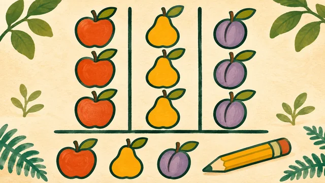
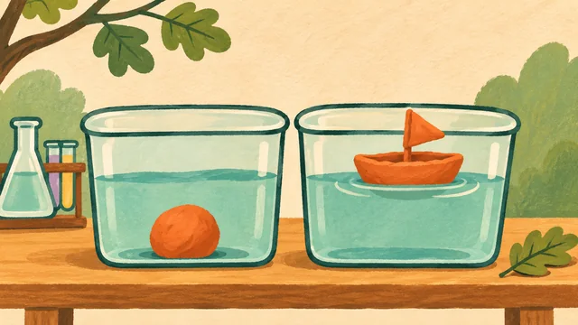
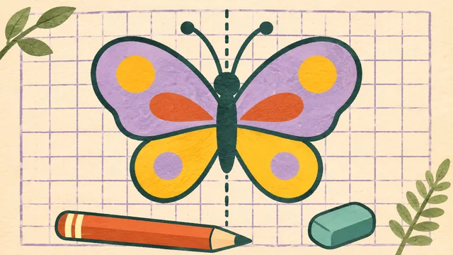
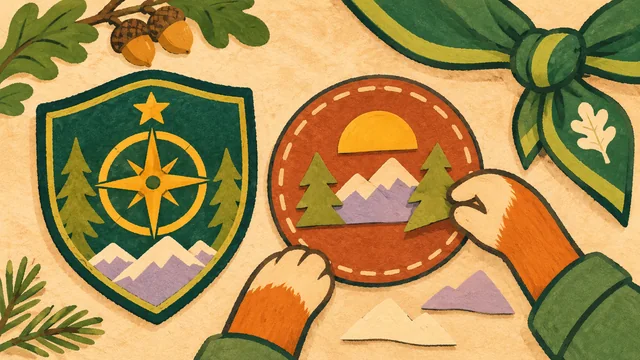

<!--
SPDX-FileCopyrightText: 2026 Milan Jankovec
SPDX-License-Identifier: EUPL-1.2
-->

# Junior Explorers

[Slovenčina](README.sk.md) · [English](README.en.md) · [Čeština](README.cs.md) · [Deutsch](README.de.md) · [Polski](README.pl.md) · **Magyar** · [Français](README.fr.md) · [Español](README.es.md) · [Italiano](README.it.md) · [Português](README.pt.md) · [Nederlands](README.nl.md) · [Română](README.ro.md) · [Українська](README.uk.md) · [Ελληνικά](README.el.md) · [Svenska](README.sv.md) · [简体中文](README.zh-Hans.md) · [繁體中文](README.zh-Hant.md) · [日本語](README.ja.md) · [한국어](README.ko.md) · [Bahasa Indonesia](README.id.md) · [Türkçe](README.tr.md) · [Tiếng Việt](README.vi.md) · [Português (Brasil)](README.pt-BR.md)

A Junior Explorers 75 ingyenes, böngészőben játszható játék többnyelvű gyűjteménye, elsősorban 6–9 éves gyerekeknek. A kezelőfelület 23 nyelven érhető el, és három nehézségi szint közül választhatsz. Az alapértelmezett nyelv az angol. Játszhatsz egérrel, érintéssel vagy billentyűzettel. A Tab billentyűvel lépkedhetsz az elemek között, az Enterrel vagy a szóközzel pedig aktiválhatod a kijelölt elemet. A katalógusban kategóriák szerint böngészheted a játékokat.

A szókereső, a titkos kódos játék és a Szótagműhely szlovák, cseh és angol szólistákat használ. A kezelőfelület többi nyelvén ezek a játékok az angol szólistát használják.

A játék vagy a katalóguskártya nyomtatási hivatkozása ugyanahhoz a feladathoz nyit meg egy feladatlapot. A megoldásokat külön oldalon is kérheted. A böngésző nyomtatási ablakában válaszd a mentést PDF-ként, vagy nyomtass A4-es papírra. A tangramokat 100%-os méretben nyomtasd.

## Játék internet nélkül

Töltsd le és csomagold ki a kódtár ZIP-fájlját, vagy klónozd a kódtárat Gittel. Kattints duplán az [index.html](../index.html) fájlra a játékok és feladatlapjaik megnyitásához. Az oldal internetkapcsolat és helyi kiszolgáló nélkül is működik a böngésződben.

## Játék online

A közzététel után a GitHub Pages felületén megnyithatod a [magyar nyelvű katalógust](https://milanjankovec.github.io/junior-explorers/?lang=hu).

## Játékok

A Rímpárokhoz és a Képes keresztrejtvényhez angol, szlovák és cseh szólisták tartoznak. A kezelőfelület többi nyelvén ezek a játékok az angol szólistát használják.

### Logika

<table role="presentation">
  <tr>
    <td align="center" valign="top"><a href="../games/smart-memory/index.html?lang=hu"> Okos memória</a></td>
    <td align="center" valign="top"><a href="../games/tangram/index.html?lang=hu"> Tangram formák</a></td>
  </tr>
  <tr>
    <td align="center" valign="top"><a href="../games/pattern-builder/index.html?lang=hu"> Készítsd a mintát</a></td>
    <td align="center" valign="top"><a href="../games/picture-sudoku/index.html?lang=hu"> Szín Sudoku</a></td>
  </tr>
  <tr>
    <td align="center" valign="top"><a href="../games/logic-detective/index.html?lang=hu"> - Ki vagyok én?</a></td>
    <td align="center" valign="top"><a href="../games/river-crossing/index.html?lang=hu"> A folyó átkelés</a></td>
  </tr>
  <tr>
    <td align="center" valign="top"><a href="../games/island-bridges/index.html?lang=hu"> Hidak a szigetek között</a></td>
    <td align="center" valign="top"><a href="../games/parking-puzzle/index.html?lang=hu"> Parkolós fejtörő</a></td>
  </tr>
  <tr>
    <td align="center" valign="top"><a href="../games/one-stroke/index.html?lang=hu"> Egy vonallal</a></td>
    <td align="center" valign="top"><a href="../games/light-maze/index.html?lang=hu"> Fénylabirintus</a></td>
  </tr>
  <tr>
    <td align="center" valign="top"><a href="../games/trip-planner/index.html?lang=hu"> Tervezd meg a kirándulást</a></td>
    <td align="center" valign="top"><a href="../games/nonograms/index.html?lang=hu"> Képrejtvény számokkal</a></td>
  </tr>
  <tr>
    <td align="center" valign="top"><a href="../games/campsite-tents/index.html?lang=hu"> Sátrak és fák</a></td>
    <td align="center" valign="top"><a href="../games/cube-nets/index.html?lang=hu"> Kockahálók</a></td>
  </tr>
  <tr>
    <td align="center" valign="top"><a href="../games/property-circles/index.html?lang=hu"> Válogatókörök</a></td>
  </tr>
</table>

### Matematika

<table role="presentation">
  <tr>
    <td align="center" valign="top"><a href="../games/math-pixel-art/index.html?lang=hu"> Matematika Pixel Art</a></td>
    <td align="center" valign="top"><a href="../games/treasure-coordinates/index.html?lang=hu"> Kártyák koordinátái</a></td>
  </tr>
  <tr>
    <td align="center" valign="top"><a href="../games/clock-master/index.html?lang=hu"> Órásmester</a></td>
    <td align="center" valign="top"><a href="../games/little-shop/index.html?lang=hu"> A kis boltvezető</a></td>
  </tr>
  <tr>
    <td align="center" valign="top"><a href="../games/number-pyramids/index.html?lang=hu"> Számpárpiramiddal</a></td>
    <td align="center" valign="top"><a href="../games/balance-scales/index.html?lang=hu"> Egyensúlyban a mérleg</a></td>
  </tr>
  <tr>
    <td align="center" valign="top"><a href="../games/pizza-fractions/index.html?lang=hu"> Törtek pizzával</a></td>
    <td align="center" valign="top"><a href="../games/garden-fence/index.html?lang=hu"> Kerítsd körbe az ágyást</a></td>
  </tr>
  <tr>
    <td align="center" valign="top"><a href="../games/calendar-quest/index.html?lang=hu"> Naptári nyomozás</a></td>
    <td align="center" valign="top"><a href="../games/picture-graphs/index.html?lang=hu"> Képes diagramok</a></td>
  </tr>
  <tr>
    <td align="center" valign="top"><a href="../games/cube-builder/index.html?lang=hu"> Kockaépítő</a></td>
    <td align="center" valign="top"><a href="../games/measurement-workshop/index.html?lang=hu"> Mérőműhely</a></td>
  </tr>
  <tr>
    <td align="center" valign="top"><a href="../games/tens-factory/index.html?lang=hu"> Tízesgyár</a></td>
    <td align="center" valign="top"><a href="../games/number-elevator/index.html?lang=hu"> Számlift</a></td>
  </tr>
  <tr>
    <td align="center" valign="top"><a href="../games/water-jugs/index.html?lang=hu"> Mérőkancsók</a></td>
    <td align="center" valign="top"><a href="../games/multiplication-arrays/index.html?lang=hu"> Szorzótéglalapok</a></td>
  </tr>
  <tr>
    <td align="center" valign="top"><a href="../games/chance-bag/index.html?lang=hu"> Esélyzsákok</a></td>
    <td align="center" valign="top"><a href="../games/snack-buffet/index.html?lang=hu"> Uzsonnabüfé</a></td>
  </tr>
</table>

### Nyelv

<table role="presentation">
  <tr>
    <td align="center" valign="top"><a href="../games/secret-code/index.html?lang=hu"> Titkos kódok workshop</a></td>
    <td align="center" valign="top"><a href="../games/story-sequence/index.html?lang=hu"> Az idő nyomozója.</a></td>
  </tr>
  <tr>
    <td align="center" valign="top"><a href="../games/word-search/index.html?lang=hu"> Szótvadász</a></td>
    <td align="center" valign="top"><a href="../games/syllable-workshop/index.html?lang=hu"> Szótagműhely</a></td>
  </tr>
  <tr>
    <td align="center" valign="top"><a href="../games/read-and-draw/index.html?lang=hu"> Olvass és rajzolj</a></td>
    <td align="center" valign="top"><a href="../games/rhyme-pairs/index.html?lang=hu"> Rímpárok</a></td>
  </tr>
  <tr>
    <td align="center" valign="top"><a href="../games/picture-crossword/index.html?lang=hu"> Képes keresztrejtvény</a></td>
    <td align="center" valign="top"><a href="../games/word-ladder/index.html?lang=hu"> Szólétra</a></td>
  </tr>
  <tr>
    <td align="center" valign="top"><a href="../games/sentence-builder/index.html?lang=hu"> Rakj össze egy mondatot</a></td>
  </tr>
</table>

### Természet

<table role="presentation">
  <tr>
    <td align="center" valign="top"><a href="../games/eco-sort/index.html?lang=hu"> A bolygó mentői</a></td>
    <td align="center" valign="top"><a href="../games/animal-food/index.html?lang=hu"> Ki mit eszik?</a></td>
  </tr>
  <tr>
    <td align="center" valign="top"><a href="../games/life-cycles/index.html?lang=hu"> A természetfelderítő</a></td>
    <td align="center" valign="top"><a href="../games/weather-lab/index.html?lang=hu"> Kis Meteorológus</a></td>
  </tr>
  <tr>
    <td align="center" valign="top"><a href="../games/forest-tracks/index.html?lang=hu"> Állatnyomok az erdőben</a></td>
    <td align="center" valign="top"><a href="../games/garden-experiment/index.html?lang=hu"> Kísérlet a kertben</a></td>
  </tr>
  <tr>
    <td align="center" valign="top"><a href="../games/shadow-playground/index.html?lang=hu"> Árnyékok a játszótéren</a></td>
    <td align="center" valign="top"><a href="../games/magnet-workshop/index.html?lang=hu"> Mágnesműhely</a></td>
  </tr>
  <tr>
    <td align="center" valign="top"><a href="../games/rain-flow/index.html?lang=hu"> Merre folyik az esővíz?</a></td>
    <td align="center" valign="top"><a href="../games/float-or-sink/index.html?lang=hu"> Úszik vagy elsüllyed?</a></td>
  </tr>
  <tr>
    <td align="center" valign="top"><a href="../games/day-and-night/index.html?lang=hu"> Nappal és éjszaka</a></td>
    <td align="center" valign="top"><a href="../games/light-a-bulb/index.html?lang=hu"> Gyújtsd meg az izzót</a></td>
  </tr>
</table>

### Programozás

<table role="presentation">
  <tr>
    <td align="center" valign="top"><a href="../games/robot-maze/index.html?lang=hu"> Robotok hazafelé</a></td>
    <td align="center" valign="top"><a href="../games/spaceship-repair/index.html?lang=hu"> Űrhajójavítás</a></td>
  </tr>
  <tr>
    <td align="center" valign="top"><a href="../games/debug-the-robot/index.html?lang=hu"> A robot hibáztatása</a></td>
    <td align="center" valign="top"><a href="../games/traffic-program/index.html?lang=hu"> Programozd a jelzőlámpát</a></td>
  </tr>
  <tr>
    <td align="center" valign="top"><a href="../games/event-house/index.html?lang=hu"> Varázslatos eseményház</a></td>
    <td align="center" valign="top"><a href="../games/seed-counter/index.html?lang=hu"> Magszámláló</a></td>
  </tr>
  <tr>
    <td align="center" valign="top"><a href="../games/stamp-printer/index.html?lang=hu"> Bélyegzőnyomda</a></td>
    <td align="center" valign="top"><a href="../games/parallel-workshop/index.html?lang=hu"> Csapatmunka a műhelyben</a></td>
  </tr>
  <tr>
    <td align="center" valign="top"><a href="../games/sorting-line/index.html?lang=hu"> Válogatószalag</a></td>
    <td align="center" valign="top"><a href="../games/ticket-machine/index.html?lang=hu"> Jegyautomata</a></td>
  </tr>
</table>

### Kreativitás

<table role="presentation">
  <tr>
    <td align="center" valign="top"><a href="../games/symmetry-studio/index.html?lang=hu"> A tükörművészek</a></td>
    <td align="center" valign="top"><a href="../games/story-studio/index.html?lang=hu"> Sztori rendező</a></td>
  </tr>
  <tr>
    <td align="center" valign="top"><a href="../games/rhythm-master/index.html?lang=hu"> Ritmusmester</a></td>
    <td align="center" valign="top"><a href="../games/scene-changes/index.html?lang=hu"> Mi változott?</a></td>
  </tr>
  <tr>
    <td align="center" valign="top"><a href="../games/musical-steps/index.html?lang=hu"> Zenei lépcsők</a></td>
    <td align="center" valign="top"><a href="../games/frame-animation/index.html?lang=hu"> Képkockás animáció</a></td>
  </tr>
  <tr>
    <td align="center" valign="top"><a href="../games/layered-landscape/index.html?lang=hu"> Réteges tájkép</a></td>
    <td align="center" valign="top"><a href="../games/stamp-patterns/index.html?lang=hu"> Pecsétminták</a></td>
  </tr>
  <tr>
    <td align="center" valign="top"><a href="../games/paper-puppets/index.html?lang=hu"> Papírbábok</a></td>
    <td align="center" valign="top"><a href="../games/expedition-badge/index.html?lang=hu"> Expedíciós jelvény</a></td>
  </tr>
  <tr>
    <td align="center" valign="top"><a href="../games/colour-lab/index.html?lang=hu"> Színlabor</a></td>
  </tr>
</table>

### Nyomtatási előnézet

Kattints a képre a játékokhoz tartozó feladatlapok első oldalának nagyításához. A példák angol nyelvűek, és a megoldások nem jelennek meg.

## Adatvédelem és licenc

A játékhoz nem kell regisztrálnod, és nincsenek benne követőkódok, hirdetések, hálózati szolgáltatások vagy fizetős funkciók. A böngésző az eszközödön tárolhatja a nyelvválasztásodat, a beállításaidat, a befejezett játékokat és a készülő képregényt. A tárhelyszolgáltató kezelheti a szokásos működési naplókat.

© 2026 Milan Jankovec. Az eredeti forráskód az [EUPL-1.2](../LICENSE) licenc alatt érhető el.
