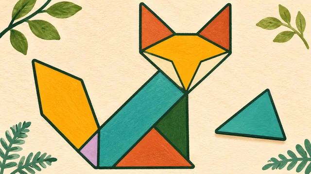
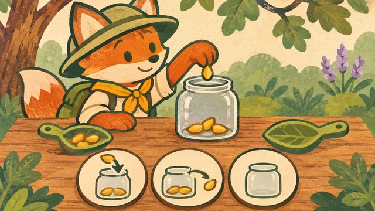

<!--
SPDX-FileCopyrightText: 2026 Milan Jankovec
SPDX-License-Identifier: EUPL-1.2
-->

# Junior Explorers

[Slovenčina](README.sk.md) · [English](README.en.md) · [Čeština](README.cs.md) · [Deutsch](README.de.md) · [Polski](README.pl.md) · [Magyar](README.hu.md) · [Français](README.fr.md) · [Español](README.es.md) · [Italiano](README.it.md) · [Português](README.pt.md) · [Nederlands](README.nl.md) · [Română](README.ro.md) · [Українська](README.uk.md) · [Ελληνικά](README.el.md) · [Svenska](README.sv.md) · [简体中文](README.zh-Hans.md) · [繁體中文](README.zh-Hant.md) · [日本語](README.ja.md) · [한국어](README.ko.md) · **Bahasa Indonesia** · [Türkçe](README.tr.md) · [Tiếng Việt](README.vi.md) · [Português (Brasil)](README.pt-BR.md)

Junior Explorers adalah kumpulan gratis 75 permainan browser multibahasa untuk anak usia sekitar 6–9 tahun. Tersedia 23 pilihan bahasa antarmuka dan tiga tingkat kesulitan. Bahasa bawaan adalah bahasa Inggris. Kamu bisa bermain dengan tetikus, layar sentuh, atau papan ketik. Tekan Tab untuk berpindah, lalu Enter atau Spasi untuk mengaktifkan pilihan. Jelajahi permainan berdasarkan kategori.

Penggemar Kata, Lokakarya Kode Rahasia, dan Bengkel Suku Kata memiliki daftar kata dalam bahasa Slowakia, Ceko, dan Inggris. Jika kamu memilih bahasa antarmuka lain, permainan ini menggunakan daftar kata bahasa Inggris.

Pilih tautan cetak di dalam permainan atau pada kartunya di katalog untuk membuka lembar kerja dengan soal yang sama. Halaman jawaban bisa disertakan jika diperlukan. Pilih Simpan sebagai PDF di jendela cetak browser atau gunakan kertas A4. Cetak tangram pada skala 100%.

## Bermain tanpa internet

Unduh dan ekstrak berkas ZIP repositori ini, atau klon repositorinya dengan Git. Klik dua kali [index.html](../index.html) untuk bermain atau membuka lembar kerja tiap permainan. Situs ini bisa digunakan tanpa koneksi internet atau server lokal.

## Bermain daring

Setelah dipublikasikan, buka [katalog berbahasa Indonesia](https://milanjankovec.github.io/junior-explorers/?lang=id) di GitHub Pages.

## Permainan

Pasangan Kata Berima dan Teka-Teki Silang Bergambar memiliki set kata dalam bahasa Inggris, Slowakia, dan Ceko. Jika kamu memilih bahasa antarmuka lain, kedua permainan ini menggunakan set kata bahasa Inggris.

### Logika

<table role="presentation">
  <tr>
    <td align="center" valign="top"><a href="../games/smart-memory/index.html?lang=id"> Memori yang cerdas</a></td>
    <td align="center" valign="top"><a href="../games/tangram/index.html?lang=id"> Bentuk Tangram</a></td>
  </tr>
  <tr>
    <td align="center" valign="top"><a href="../games/pattern-builder/index.html?lang=id"> Selesailah Pola</a></td>
    <td align="center" valign="top"><a href="../games/picture-sudoku/index.html?lang=id"> Gambar Sudoku</a></td>
  </tr>
  <tr>
    <td align="center" valign="top"><a href="../games/logic-detective/index.html?lang=id"> Siapa aku?</a></td>
    <td align="center" valign="top"><a href="../games/river-crossing/index.html?lang=id"> Pembagian Sungai</a></td>
  </tr>
  <tr>
    <td align="center" valign="top"><a href="../games/island-bridges/index.html?lang=id"> Jembatan Antarpulau</a></td>
    <td align="center" valign="top"><a href="../games/parking-puzzle/index.html?lang=id"> Teka-Teki Parkir</a></td>
  </tr>
  <tr>
    <td align="center" valign="top"><a href="../games/one-stroke/index.html?lang=id"> Satu Goresan</a></td>
    <td align="center" valign="top"><a href="../games/light-maze/index.html?lang=id"> Labirin Cahaya</a></td>
  </tr>
  <tr>
    <td align="center" valign="top"><a href="../games/trip-planner/index.html?lang=id"> Rencanakan Perjalanan</a></td>
    <td align="center" valign="top"><a href="../games/nonograms/index.html?lang=id"> Teka-teki Nonogram</a></td>
  </tr>
  <tr>
    <td align="center" valign="top"><a href="../games/campsite-tents/index.html?lang=id"> Tenda dan Pohon</a></td>
    <td align="center" valign="top"><a href="../games/cube-nets/index.html?lang=id"> Jaring-jaring Kubus</a></td>
  </tr>
  <tr>
    <td align="center" valign="top"><a href="../games/property-circles/index.html?lang=id"> Lingkaran Pengelompokan</a></td>
  </tr>
</table>

### Matematika

<table role="presentation">
  <tr>
    <td align="center" valign="top"><a href="../games/math-pixel-art/index.html?lang=id"> Matematika Seni Pixel</a></td>
    <td align="center" valign="top"><a href="../games/treasure-coordinates/index.html?lang=id"> Koordinat Harta</a></td>
  </tr>
  <tr>
    <td align="center" valign="top"><a href="../games/clock-master/index.html?lang=id"> Master Jam</a></td>
    <td align="center" valign="top"><a href="../games/little-shop/index.html?lang=id"> Toko kecil</a></td>
  </tr>
  <tr>
    <td align="center" valign="top"><a href="../games/number-pyramids/index.html?lang=id"> Piramida Nomor</a></td>
    <td align="center" valign="top"><a href="../games/balance-scales/index.html?lang=id"> Seimbangkan Timbangan</a></td>
  </tr>
  <tr>
    <td align="center" valign="top"><a href="../games/pizza-fractions/index.html?lang=id"> Pecahan dengan Piza</a></td>
    <td align="center" valign="top"><a href="../games/garden-fence/index.html?lang=id"> Pagari Kebun</a></td>
  </tr>
  <tr>
    <td align="center" valign="top"><a href="../games/calendar-quest/index.html?lang=id"> Petualangan Kalender</a></td>
    <td align="center" valign="top"><a href="../games/picture-graphs/index.html?lang=id"> Diagram Gambar</a></td>
  </tr>
  <tr>
    <td align="center" valign="top"><a href="../games/cube-builder/index.html?lang=id"> Pembangun Kubus</a></td>
    <td align="center" valign="top"><a href="../games/measurement-workshop/index.html?lang=id"> Bengkel Pengukuran</a></td>
  </tr>
  <tr>
    <td align="center" valign="top"><a href="../games/tens-factory/index.html?lang=id"> Pabrik Puluhan</a></td>
    <td align="center" valign="top"><a href="../games/number-elevator/index.html?lang=id"> Lift Angka</a></td>
  </tr>
  <tr>
    <td align="center" valign="top"><a href="../games/water-jugs/index.html?lang=id"> Teko Ukur</a></td>
    <td align="center" valign="top"><a href="../games/multiplication-arrays/index.html?lang=id"> Persegi Panjang Perkalian</a></td>
  </tr>
  <tr>
    <td align="center" valign="top"><a href="../games/chance-bag/index.html?lang=id"> Kantong Peluang</a></td>
    <td align="center" valign="top"><a href="../games/snack-buffet/index.html?lang=id"> Prasmanan Camilan</a></td>
  </tr>
</table>

### Bahasa

<table role="presentation">
  <tr>
    <td align="center" valign="top"><a href="../games/secret-code/index.html?lang=id"> Lokakarya Kode Rahasia</a></td>
    <td align="center" valign="top"><a href="../games/story-sequence/index.html?lang=id"> Detektif Waktu</a></td>
  </tr>
  <tr>
    <td align="center" valign="top"><a href="../games/word-search/index.html?lang=id"> Penggemar Kata</a></td>
    <td align="center" valign="top"><a href="../games/syllable-workshop/index.html?lang=id"> Bengkel Suku Kata</a></td>
  </tr>
  <tr>
    <td align="center" valign="top"><a href="../games/read-and-draw/index.html?lang=id"> Baca dan Gambar</a></td>
    <td align="center" valign="top"><a href="../games/rhyme-pairs/index.html?lang=id"> Pasangan Kata Berima</a></td>
  </tr>
  <tr>
    <td align="center" valign="top"><a href="../games/picture-crossword/index.html?lang=id"> Teka-Teki Silang Bergambar</a></td>
    <td align="center" valign="top"><a href="../games/word-ladder/index.html?lang=id"> Tangga Kata</a></td>
  </tr>
  <tr>
    <td align="center" valign="top"><a href="../games/sentence-builder/index.html?lang=id"> Susun Kalimat</a></td>
  </tr>
</table>

### Alam

<table role="presentation">
  <tr>
    <td align="center" valign="top"><a href="../games/eco-sort/index.html?lang=id"> Penyelamat Planet</a></td>
    <td align="center" valign="top"><a href="../games/animal-food/index.html?lang=id"> Siapa Yang Makan Apa?</a></td>
  </tr>
  <tr>
    <td align="center" valign="top"><a href="../games/life-cycles/index.html?lang=id"> Penjelajah Alam</a></td>
    <td align="center" valign="top"><a href="../games/weather-lab/index.html?lang=id"> Ahli Meteorologi Kecil</a></td>
  </tr>
  <tr>
    <td align="center" valign="top"><a href="../games/forest-tracks/index.html?lang=id"> Jejak di Hutan</a></td>
    <td align="center" valign="top"><a href="../games/garden-experiment/index.html?lang=id"> Percobaan di Kebun</a></td>
  </tr>
  <tr>
    <td align="center" valign="top"><a href="../games/shadow-playground/index.html?lang=id"> Bayangan di Taman Bermain</a></td>
    <td align="center" valign="top"><a href="../games/magnet-workshop/index.html?lang=id"> Bengkel Magnet</a></td>
  </tr>
  <tr>
    <td align="center" valign="top"><a href="../games/rain-flow/index.html?lang=id"> Ke Mana Air Hujan Mengalir?</a></td>
    <td align="center" valign="top"><a href="../games/float-or-sink/index.html?lang=id"> Mengapung atau Tenggelam?</a></td>
  </tr>
  <tr>
    <td align="center" valign="top"><a href="../games/day-and-night/index.html?lang=id"> Siang dan Malam</a></td>
    <td align="center" valign="top"><a href="../games/light-a-bulb/index.html?lang=id"> Nyalakan Lampu</a></td>
  </tr>
</table>

### Pemrograman

<table role="presentation">
  <tr>
    <td align="center" valign="top"><a href="../games/robot-maze/index.html?lang=id"> Robot Berjalan Kemari</a></td>
    <td align="center" valign="top"><a href="../games/spaceship-repair/index.html?lang=id"> Perbaikan Kapal Angkasa</a></td>
  </tr>
  <tr>
    <td align="center" valign="top"><a href="../games/debug-the-robot/index.html?lang=id"> Debug Robot</a></td>
    <td align="center" valign="top"><a href="../games/traffic-program/index.html?lang=id"> Programkan Lampu Lalu Lintas</a></td>
  </tr>
  <tr>
    <td align="center" valign="top"><a href="../games/event-house/index.html?lang=id"> Rumah Peristiwa Ajaib</a></td>
    <td align="center" valign="top"><a href="../games/seed-counter/index.html?lang=id"> Penghitung Biji</a></td>
  </tr>
  <tr>
    <td align="center" valign="top"><a href="../games/stamp-printer/index.html?lang=id"> Pencetak Stempel</a></td>
    <td align="center" valign="top"><a href="../games/parallel-workshop/index.html?lang=id"> Kerja Tim di Bengkel</a></td>
  </tr>
  <tr>
    <td align="center" valign="top"><a href="../games/sorting-line/index.html?lang=id"> Jalur Pengurutan</a></td>
    <td align="center" valign="top"><a href="../games/ticket-machine/index.html?lang=id"> Mesin Tiket</a></td>
  </tr>
</table>

### Kreativitas

<table role="presentation">
  <tr>
    <td align="center" valign="top"><a href="../games/symmetry-studio/index.html?lang=id"> Penari Cermin</a></td>
    <td align="center" valign="top"><a href="../games/story-studio/index.html?lang=id"> Sutradara Cerita</a></td>
  </tr>
  <tr>
    <td align="center" valign="top"><a href="../games/rhythm-master/index.html?lang=id"> Master ritme</a></td>
    <td align="center" valign="top"><a href="../games/scene-changes/index.html?lang=id"> Apa yang Berubah?</a></td>
  </tr>
  <tr>
    <td align="center" valign="top"><a href="../games/musical-steps/index.html?lang=id"> Tangga Nada</a></td>
    <td align="center" valign="top"><a href="../games/frame-animation/index.html?lang=id"> Animasi Bingkai demi Bingkai</a></td>
  </tr>
  <tr>
    <td align="center" valign="top"><a href="../games/layered-landscape/index.html?lang=id"> Pemandangan Berlapis</a></td>
    <td align="center" valign="top"><a href="../games/stamp-patterns/index.html?lang=id"> Pola Stempel</a></td>
  </tr>
  <tr>
    <td align="center" valign="top"><a href="../games/paper-puppets/index.html?lang=id"> Boneka Kertas</a></td>
    <td align="center" valign="top"><a href="../games/expedition-badge/index.html?lang=id"> Lencana Ekspedisi</a></td>
  </tr>
  <tr>
    <td align="center" valign="top"><a href="../games/colour-lab/index.html?lang=id"> Lab Warna</a></td>
  </tr>
</table>

### Pratinjau cetak

Klik gambar untuk memperbesar halaman pertama lembar kerja setiap permainan. Contoh ditampilkan dalam bahasa Inggris tanpa halaman jawaban.

## Privasi dan lisensi

Kamu bisa bermain tanpa mendaftar dan tanpa pelacak, iklan, layanan jaringan, atau fitur berbayar. Browser dapat menyimpan pilihan bahasa, pengaturan, permainan yang sudah diselesaikan, dan draf komik di perangkat. Penyedia hosting dapat memproses log operasional standar.

© 2026 Milan Jankovec. Kode sumber asli dilisensikan dengan [EUPL-1.2](../LICENSE).
