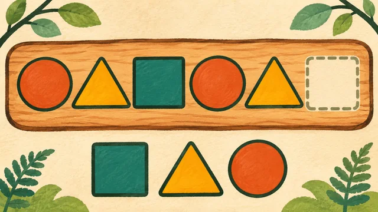
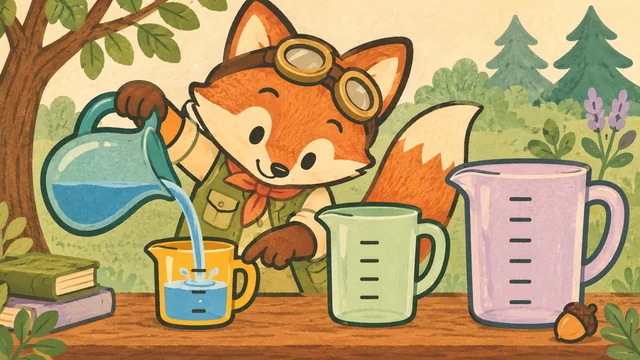
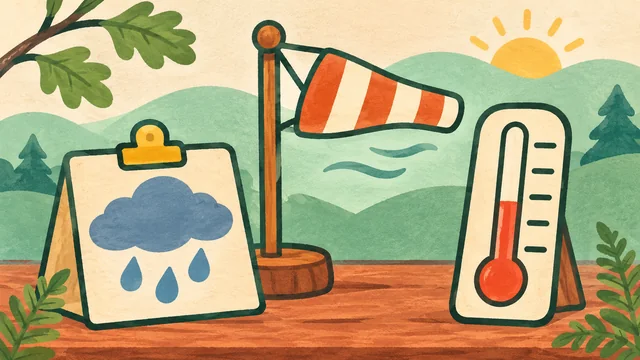
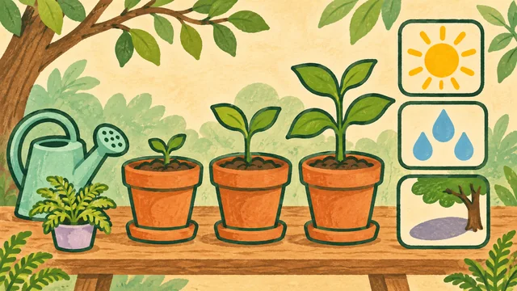

<!--
SPDX-FileCopyrightText: 2026 Milan Jankovec
SPDX-License-Identifier: EUPL-1.2
-->

# Junior Explorers

[Slovenčina](README.sk.md) · [English](README.en.md) · [Čeština](README.cs.md) · [Deutsch](README.de.md) · [Polski](README.pl.md) · [Magyar](README.hu.md) · [Français](README.fr.md) · [Español](README.es.md) · **Italiano** · [Português](README.pt.md) · [Nederlands](README.nl.md) · [Română](README.ro.md) · [Українська](README.uk.md) · [Ελληνικά](README.el.md) · [Svenska](README.sv.md) · [简体中文](README.zh-Hans.md) · [繁體中文](README.zh-Hant.md) · [日本語](README.ja.md) · [한국어](README.ko.md) · [Bahasa Indonesia](README.id.md) · [Türkçe](README.tr.md) · [Tiếng Việt](README.vi.md) · [Português (Brasil)](README.pt-BR.md)

Junior Explorers è una raccolta gratuita e multilingue di 75 giochi per browser, pensata per bambini dai 6 ai 9 anni circa. Puoi scegliere tra 23 lingue dell’interfaccia e tre livelli di difficoltà. La lingua predefinita è l’inglese. Gioca con il mouse, lo schermo tattile o la tastiera. Usa Tab per passare da un controllo all’altro e Invio o la barra spaziatrice per attivarlo. Nel catalogo i giochi sono suddivisi per categoria.

Cacciatore di parole, Workshop di codici segreti e Laboratorio di sillabe usano elenchi di parole in slovacco, ceco e inglese. Se scegli un’altra lingua per l’interfaccia, questi giochi usano l’elenco in inglese.

Il collegamento per la stampa, nel gioco o sulla scheda del catalogo, apre una scheda di attività per la stessa sfida. Puoi scegliere se includere le pagine con le soluzioni. Nella finestra di stampa del browser puoi selezionare «Salva come PDF» oppure stampare in formato A4. Stampa i tangram in scala al 100%.

## Giocare offline

Scarica ed estrai l’archivio ZIP del repository oppure clona il repository con Git. Fai doppio clic su [index.html](../index.html) per giocare o aprire le schede dei giochi. Il sito funziona nel browser senza connessione Internet né server locale.

## Giocare online

Dopo la pubblicazione, apri il [catalogo in italiano](https://milanjankovec.github.io/junior-explorers/?lang=it) su GitHub Pages.

## Giochi

Coppie in rima e Cruciverba illustrato hanno elenchi di parole in inglese, slovacco e ceco. Se l’interfaccia è in un’altra lingua, usano l’elenco in inglese.

### Logica

<table role="presentation">
  <tr>
    <td align="center" valign="top"><a href="../games/smart-memory/index.html?lang=it"> Memoria intelligente</a></td>
    <td align="center" valign="top"><a href="../games/tangram/index.html?lang=it"> Forma di tangramma</a></td>
  </tr>
  <tr>
    <td align="center" valign="top"><a href="../games/pattern-builder/index.html?lang=it"> Finisci il modello</a></td>
    <td align="center" valign="top"><a href="../games/picture-sudoku/index.html?lang=it"> Immagine Sudoku</a></td>
  </tr>
  <tr>
    <td align="center" valign="top"><a href="../games/logic-detective/index.html?lang=it"> - Chi sono io?</a></td>
    <td align="center" valign="top"><a href="../games/river-crossing/index.html?lang=it"> Trascorso del fiume</a></td>
  </tr>
  <tr>
    <td align="center" valign="top"><a href="../games/island-bridges/index.html?lang=it"> Ponti tra le isole</a></td>
    <td align="center" valign="top"><a href="../games/parking-puzzle/index.html?lang=it"> Parcheggio bloccato</a></td>
  </tr>
  <tr>
    <td align="center" valign="top"><a href="../games/one-stroke/index.html?lang=it"> In un solo tratto</a></td>
    <td align="center" valign="top"><a href="../games/light-maze/index.html?lang=it"> Labirinto di luce</a></td>
  </tr>
  <tr>
    <td align="center" valign="top"><a href="../games/trip-planner/index.html?lang=it"> Organizza la gita</a></td>
    <td align="center" valign="top"><a href="../games/nonograms/index.html?lang=it"> Nonogrammi</a></td>
  </tr>
  <tr>
    <td align="center" valign="top"><a href="../games/campsite-tents/index.html?lang=it"> Tende e alberi</a></td>
    <td align="center" valign="top"><a href="../games/cube-nets/index.html?lang=it"> Sviluppi del cubo</a></td>
  </tr>
  <tr>
    <td align="center" valign="top"><a href="../games/property-circles/index.html?lang=it"> Cerchi di classificazione</a></td>
  </tr>
</table>

### Matematica

<table role="presentation">
  <tr>
    <td align="center" valign="top"><a href="../games/math-pixel-art/index.html?lang=it"> Matematica Pixel Art</a></td>
    <td align="center" valign="top"><a href="../games/treasure-coordinates/index.html?lang=it"> Coordinate del tesoro</a></td>
  </tr>
  <tr>
    <td align="center" valign="top"><a href="../games/clock-master/index.html?lang=it"> Clock Master</a></td>
    <td align="center" valign="top"><a href="../games/little-shop/index.html?lang=it"> Piccolo Negoziatore</a></td>
  </tr>
  <tr>
    <td align="center" valign="top"><a href="../games/number-pyramids/index.html?lang=it"> Numero delle piramidi</a></td>
    <td align="center" valign="top"><a href="../games/balance-scales/index.html?lang=it"> Equilibra la bilancia</a></td>
  </tr>
  <tr>
    <td align="center" valign="top"><a href="../games/pizza-fractions/index.html?lang=it"> Frazioni con la pizza</a></td>
    <td align="center" valign="top"><a href="../games/garden-fence/index.html?lang=it"> Recinta l’orto</a></td>
  </tr>
  <tr>
    <td align="center" valign="top"><a href="../games/calendar-quest/index.html?lang=it"> Avventura nel calendario</a></td>
    <td align="center" valign="top"><a href="../games/picture-graphs/index.html?lang=it"> Grafici con figure</a></td>
  </tr>
  <tr>
    <td align="center" valign="top"><a href="../games/cube-builder/index.html?lang=it"> Costruisci con i cubi</a></td>
    <td align="center" valign="top"><a href="../games/measurement-workshop/index.html?lang=it"> Laboratorio delle misure</a></td>
  </tr>
  <tr>
    <td align="center" valign="top"><a href="../games/tens-factory/index.html?lang=it"> Fabbrica delle decine</a></td>
    <td align="center" valign="top"><a href="../games/number-elevator/index.html?lang=it"> Ascensore dei numeri</a></td>
  </tr>
  <tr>
    <td align="center" valign="top"><a href="../games/water-jugs/index.html?lang=it"> Brocche graduate</a></td>
    <td align="center" valign="top"><a href="../games/multiplication-arrays/index.html?lang=it"> Rettangoli della moltiplicazione</a></td>
  </tr>
  <tr>
    <td align="center" valign="top"><a href="../games/chance-bag/index.html?lang=it"> Sacchetti della probabilità</a></td>
    <td align="center" valign="top"><a href="../games/snack-buffet/index.html?lang=it"> Buffet della merenda</a></td>
  </tr>
</table>

### Lingua

<table role="presentation">
  <tr>
    <td align="center" valign="top"><a href="../games/secret-code/index.html?lang=it"> Workshop di codici segreti</a></td>
    <td align="center" valign="top"><a href="../games/story-sequence/index.html?lang=it"> Detective del tempo</a></td>
  </tr>
  <tr>
    <td align="center" valign="top"><a href="../games/word-search/index.html?lang=it"> Cacciatore di parole</a></td>
    <td align="center" valign="top"><a href="../games/syllable-workshop/index.html?lang=it"> Laboratorio di sillabe</a></td>
  </tr>
  <tr>
    <td align="center" valign="top"><a href="../games/read-and-draw/index.html?lang=it"> Leggi e disegna</a></td>
    <td align="center" valign="top"><a href="../games/rhyme-pairs/index.html?lang=it"> Coppie in rima</a></td>
  </tr>
  <tr>
    <td align="center" valign="top"><a href="../games/picture-crossword/index.html?lang=it"> Cruciverba illustrato</a></td>
    <td align="center" valign="top"><a href="../games/word-ladder/index.html?lang=it"> Scala di parole</a></td>
  </tr>
  <tr>
    <td align="center" valign="top"><a href="../games/sentence-builder/index.html?lang=it"> Costruisci una frase</a></td>
  </tr>
</table>

### Natura

<table role="presentation">
  <tr>
    <td align="center" valign="top"><a href="../games/eco-sort/index.html?lang=it"> Salvatori del pianeta</a></td>
    <td align="center" valign="top"><a href="../games/animal-food/index.html?lang=it"> Chi mangia cosa?</a></td>
  </tr>
  <tr>
    <td align="center" valign="top"><a href="../games/life-cycles/index.html?lang=it"> Nature Explorer</a></td>
    <td align="center" valign="top"><a href="../games/weather-lab/index.html?lang=it"> Piccolo meteorologo</a></td>
  </tr>
  <tr>
    <td align="center" valign="top"><a href="../games/forest-tracks/index.html?lang=it"> Orme nel bosco</a></td>
    <td align="center" valign="top"><a href="../games/garden-experiment/index.html?lang=it"> Esperimento nell’orto</a></td>
  </tr>
  <tr>
    <td align="center" valign="top"><a href="../games/shadow-playground/index.html?lang=it"> Ombre al parco giochi</a></td>
    <td align="center" valign="top"><a href="../games/magnet-workshop/index.html?lang=it"> Laboratorio dei magneti</a></td>
  </tr>
  <tr>
    <td align="center" valign="top"><a href="../games/rain-flow/index.html?lang=it"> Dove va l’acqua piovana?</a></td>
    <td align="center" valign="top"><a href="../games/float-or-sink/index.html?lang=it"> Galleggia o affonda?</a></td>
  </tr>
  <tr>
    <td align="center" valign="top"><a href="../games/day-and-night/index.html?lang=it"> Giorno e notte</a></td>
    <td align="center" valign="top"><a href="../games/light-a-bulb/index.html?lang=it"> Accendi una lampadina</a></td>
  </tr>
</table>

### Programmazione

<table role="presentation">
  <tr>
    <td align="center" valign="top"><a href="../games/robot-maze/index.html?lang=it"> Robot torna a casa</a></td>
    <td align="center" valign="top"><a href="../games/spaceship-repair/index.html?lang=it"> Riparazione della nave spaziale</a></td>
  </tr>
  <tr>
    <td align="center" valign="top"><a href="../games/debug-the-robot/index.html?lang=it"> Debug il robot</a></td>
    <td align="center" valign="top"><a href="../games/traffic-program/index.html?lang=it"> Programma il semaforo</a></td>
  </tr>
  <tr>
    <td align="center" valign="top"><a href="../games/event-house/index.html?lang=it"> La casa degli eventi</a></td>
    <td align="center" valign="top"><a href="../games/seed-counter/index.html?lang=it"> Contatore di semi</a></td>
  </tr>
  <tr>
    <td align="center" valign="top"><a href="../games/stamp-printer/index.html?lang=it"> Stampante a timbri</a></td>
    <td align="center" valign="top"><a href="../games/parallel-workshop/index.html?lang=it"> Lavoro di squadra in officina</a></td>
  </tr>
  <tr>
    <td align="center" valign="top"><a href="../games/sorting-line/index.html?lang=it"> Nastro di smistamento</a></td>
    <td align="center" valign="top"><a href="../games/ticket-machine/index.html?lang=it"> Distributore di biglietti</a></td>
  </tr>
</table>

### Creatività

<table role="presentation">
  <tr>
    <td align="center" valign="top"><a href="../games/symmetry-studio/index.html?lang=it"> Artista dello specchio</a></td>
    <td align="center" valign="top"><a href="../games/story-studio/index.html?lang=it"> Direttore Storia</a></td>
  </tr>
  <tr>
    <td align="center" valign="top"><a href="../games/rhythm-master/index.html?lang=it"> Maestro del ritmo</a></td>
    <td align="center" valign="top"><a href="../games/scene-changes/index.html?lang=it"> Che cosa è cambiato?</a></td>
  </tr>
  <tr>
    <td align="center" valign="top"><a href="../games/musical-steps/index.html?lang=it"> Gradini musicali</a></td>
    <td align="center" valign="top"><a href="../games/frame-animation/index.html?lang=it"> Animazione fotogramma per fotogramma</a></td>
  </tr>
  <tr>
    <td align="center" valign="top"><a href="../games/layered-landscape/index.html?lang=it"> Paesaggio a strati</a></td>
    <td align="center" valign="top"><a href="../games/stamp-patterns/index.html?lang=it"> Motivi con i timbri</a></td>
  </tr>
  <tr>
    <td align="center" valign="top"><a href="../games/paper-puppets/index.html?lang=it"> Burattini di carta</a></td>
    <td align="center" valign="top"><a href="../games/expedition-badge/index.html?lang=it"> Distintivo della spedizione</a></td>
  </tr>
  <tr>
    <td align="center" valign="top"><a href="../games/colour-lab/index.html?lang=it"> Laboratorio dei colori</a></td>
  </tr>
</table>

### Anteprime di stampa

Fai clic sull’immagine per ingrandire la prima pagina della scheda di ogni gioco. Gli esempi sono in inglese e le soluzioni sono nascoste.

## Privacy e licenza

Gioca senza registrazione, tracciamento, pubblicità, servizi di rete o funzioni a pagamento. Il browser può salvare sul dispositivo la lingua, le preferenze, i giochi completati e la bozza del fumetto. Il fornitore di hosting può trattare i normali registri operativi.

© 2026 Milan Jankovec. Il codice sorgente originale è distribuito con licenza [EUPL-1.2](../LICENSE).
