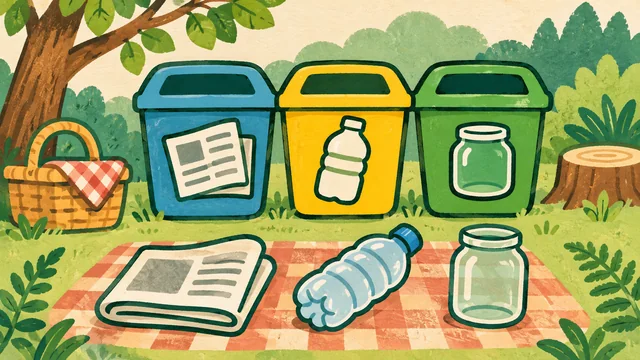
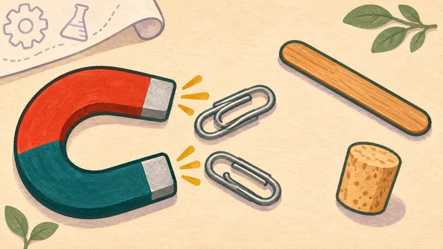

<!--
SPDX-FileCopyrightText: 2026 Milan Jankovec
SPDX-License-Identifier: EUPL-1.2
-->

# Junior Explorers

[Slovenčina](README.sk.md) · [English](README.en.md) · [Čeština](README.cs.md) · [Deutsch](README.de.md) · [Polski](README.pl.md) · [Magyar](README.hu.md) · [Français](README.fr.md) · [Español](README.es.md) · [Italiano](README.it.md) · [Português](README.pt.md) · [Nederlands](README.nl.md) · [Română](README.ro.md) · [Українська](README.uk.md) · [Ελληνικά](README.el.md) · [Svenska](README.sv.md) · [简体中文](README.zh-Hans.md) · [繁體中文](README.zh-Hant.md) · **日本語** · [한국어](README.ko.md) · [Bahasa Indonesia](README.id.md) · [Türkçe](README.tr.md) · [Tiếng Việt](README.vi.md) · [Português (Brasil)](README.pt-BR.md)

Junior Explorers は、6〜9 歳くらいの子ども向けの無料の多言語ブラウザーゲーム集です。75 本のゲームがあり、画面の表示言語は 23 言語、難易度は 3 段階から選べます。初期設定は英語です。マウス、タッチ、キーボードで遊べます。キーボードでは Tab キーで移動し、Enter キーまたはスペースキーで操作します。ゲームはカテゴリー別に探せます。

「ワードハンター」「秘密コード ワークショップ」「音節の工房」では、スロバキア語、チェコ語、英語の単語リストを使います。それ以外の表示言語を選ぶと、英語の単語リストが使われます。

ゲーム画面や一覧のカードにある印刷リンクを選ぶと、その問題のワークシートが開きます。解答ページを付けるかどうかは選べます。ブラウザーの印刷画面で「PDF に保存」を選ぶか、A4 用紙に印刷してください。タングラムは倍率 100% で印刷します。

## オフラインで遊ぶ

このリポジトリの ZIP ファイルをダウンロードして展開するか、Git でクローンします。[index.html](../index.html) をダブルクリックすると、ゲームで遊んだり、各ゲームのワークシートを開いたりできます。インターネット接続やローカルサーバーは不要です。

## オンラインで遊ぶ

公開後は、GitHub Pages の[日本語のゲーム一覧](https://milanjankovec.github.io/junior-explorers/?lang=ja)を開いて遊べます。

## ゲーム

「韻をふむペア」と「絵のクロスワード」には、英語、スロバキア語、チェコ語の単語セットがあります。それ以外の表示言語を選ぶと、英語の単語セットが使われます。

### 論理

<table role="presentation">
  <tr>
    <td align="center" valign="top"><a href="../games/smart-memory/index.html?lang=ja"> 賢い記憶</a></td>
    <td align="center" valign="top"><a href="../games/tangram/index.html?lang=ja"> タンガラム形</a></td>
  </tr>
  <tr>
    <td align="center" valign="top"><a href="../games/pattern-builder/index.html?lang=ja"> 模様 を 完成 さ せ</a></td>
    <td align="center" valign="top"><a href="../games/picture-sudoku/index.html?lang=ja"> 絵の具</a></td>
  </tr>
  <tr>
    <td align="center" valign="top"><a href="../games/logic-detective/index.html?lang=ja"> 私は誰だ?</a></td>
    <td align="center" valign="top"><a href="../games/river-crossing/index.html?lang=ja"> 川を渡る</a></td>
  </tr>
  <tr>
    <td align="center" valign="top"><a href="../games/island-bridges/index.html?lang=ja"> 島に橋をかけよう</a></td>
    <td align="center" valign="top"><a href="../games/parking-puzzle/index.html?lang=ja"> 駐車場パズル</a></td>
  </tr>
  <tr>
    <td align="center" valign="top"><a href="../games/one-stroke/index.html?lang=ja"> 一筆書き</a></td>
    <td align="center" valign="top"><a href="../games/light-maze/index.html?lang=ja"> 光の迷路</a></td>
  </tr>
  <tr>
    <td align="center" valign="top"><a href="../games/trip-planner/index.html?lang=ja"> お出かけ計画</a></td>
    <td align="center" valign="top"><a href="../games/nonograms/index.html?lang=ja"> お絵かきロジック</a></td>
  </tr>
  <tr>
    <td align="center" valign="top"><a href="../games/campsite-tents/index.html?lang=ja"> テントと木</a></td>
    <td align="center" valign="top"><a href="../games/cube-nets/index.html?lang=ja"> 立方体の展開図</a></td>
  </tr>
  <tr>
    <td align="center" valign="top"><a href="../games/property-circles/index.html?lang=ja"> 輪で分けよう</a></td>
  </tr>
</table>

### 算数

<table role="presentation">
  <tr>
    <td align="center" valign="top"><a href="../games/math-pixel-art/index.html?lang=ja"> 数学 ピクセル アート</a></td>
    <td align="center" valign="top"><a href="../games/treasure-coordinates/index.html?lang=ja"> 宝物 の 調整</a></td>
  </tr>
  <tr>
    <td align="center" valign="top"><a href="../games/clock-master/index.html?lang=ja"> 時計師</a></td>
    <td align="center" valign="top"><a href="../games/little-shop/index.html?lang=ja"> 小さな店長</a></td>
  </tr>
  <tr>
    <td align="center" valign="top"><a href="../games/number-pyramids/index.html?lang=ja"> 数字ピラミッド</a></td>
    <td align="center" valign="top"><a href="../games/balance-scales/index.html?lang=ja"> てんびんをつり合わせよう</a></td>
  </tr>
  <tr>
    <td align="center" valign="top"><a href="../games/pizza-fractions/index.html?lang=ja"> ピザの分数</a></td>
    <td align="center" valign="top"><a href="../games/garden-fence/index.html?lang=ja"> 庭に柵をつくろう</a></td>
  </tr>
  <tr>
    <td align="center" valign="top"><a href="../games/calendar-quest/index.html?lang=ja"> カレンダー探検</a></td>
    <td align="center" valign="top"><a href="../games/picture-graphs/index.html?lang=ja"> 絵グラフ</a></td>
  </tr>
  <tr>
    <td align="center" valign="top"><a href="../games/cube-builder/index.html?lang=ja"> 立方体を組み立てよう</a></td>
    <td align="center" valign="top"><a href="../games/measurement-workshop/index.html?lang=ja"> 長さをはかろう</a></td>
  </tr>
  <tr>
    <td align="center" valign="top"><a href="../games/tens-factory/index.html?lang=ja"> 十のまとまり工場</a></td>
    <td align="center" valign="top"><a href="../games/number-elevator/index.html?lang=ja"> 数のエレベーター</a></td>
  </tr>
  <tr>
    <td align="center" valign="top"><a href="../games/water-jugs/index.html?lang=ja"> 水をはかろう</a></td>
    <td align="center" valign="top"><a href="../games/multiplication-arrays/index.html?lang=ja"> かけ算の長方形</a></td>
  </tr>
  <tr>
    <td align="center" valign="top"><a href="../games/chance-bag/index.html?lang=ja"> 確率のふくろ</a></td>
    <td align="center" valign="top"><a href="../games/snack-buffet/index.html?lang=ja"> おやつビュッフェ</a></td>
  </tr>
</table>

### 言語

<table role="presentation">
  <tr>
    <td align="center" valign="top"><a href="../games/secret-code/index.html?lang=ja"> 秘密コード ワークショップ</a></td>
    <td align="center" valign="top"><a href="../games/story-sequence/index.html?lang=ja"> タイムディテクトिव</a></td>
  </tr>
  <tr>
    <td align="center" valign="top"><a href="../games/word-search/index.html?lang=ja"> ワードハンター</a></td>
    <td align="center" valign="top"><a href="../games/syllable-workshop/index.html?lang=ja"> 音節の工房</a></td>
  </tr>
  <tr>
    <td align="center" valign="top"><a href="../games/read-and-draw/index.html?lang=ja"> 読んで描こう</a></td>
    <td align="center" valign="top"><a href="../games/rhyme-pairs/index.html?lang=ja"> 韻をふむペア</a></td>
  </tr>
  <tr>
    <td align="center" valign="top"><a href="../games/picture-crossword/index.html?lang=ja"> 絵のクロスワード</a></td>
    <td align="center" valign="top"><a href="../games/word-ladder/index.html?lang=ja"> ことばのはしご</a></td>
  </tr>
  <tr>
    <td align="center" valign="top"><a href="../games/sentence-builder/index.html?lang=ja"> 文を作ろう</a></td>
  </tr>
</table>

### 自然

<table role="presentation">
  <tr>
    <td align="center" valign="top"><a href="../games/eco-sort/index.html?lang=ja"> 惑星救助隊</a></td>
    <td align="center" valign="top"><a href="../games/animal-food/index.html?lang=ja"> 誰が何を食べる?</a></td>
  </tr>
  <tr>
    <td align="center" valign="top"><a href="../games/life-cycles/index.html?lang=ja"> 自然探検家</a></td>
    <td align="center" valign="top"><a href="../games/weather-lab/index.html?lang=ja"> 小気象学者</a></td>
  </tr>
  <tr>
    <td align="center" valign="top"><a href="../games/forest-tracks/index.html?lang=ja"> 森の足あと</a></td>
    <td align="center" valign="top"><a href="../games/garden-experiment/index.html?lang=ja"> 庭の実験</a></td>
  </tr>
  <tr>
    <td align="center" valign="top"><a href="../games/shadow-playground/index.html?lang=ja"> 遊び場のかげ</a></td>
    <td align="center" valign="top"><a href="../games/magnet-workshop/index.html?lang=ja"> 磁石の工房</a></td>
  </tr>
  <tr>
    <td align="center" valign="top"><a href="../games/rain-flow/index.html?lang=ja"> 雨水はどこへ行く？</a></td>
    <td align="center" valign="top"><a href="../games/float-or-sink/index.html?lang=ja"> 浮く？沈む？</a></td>
  </tr>
  <tr>
    <td align="center" valign="top"><a href="../games/day-and-night/index.html?lang=ja"> 昼と夜</a></td>
    <td align="center" valign="top"><a href="../games/light-a-bulb/index.html?lang=ja"> 豆電球をつけよう</a></td>
  </tr>
</table>

### プログラミング

<table role="presentation">
  <tr>
    <td align="center" valign="top"><a href="../games/robot-maze/index.html?lang=ja"> ロボットが帰国する</a></td>
    <td align="center" valign="top"><a href="../games/spaceship-repair/index.html?lang=ja"> 宇宙船の修理</a></td>
  </tr>
  <tr>
    <td align="center" valign="top"><a href="../games/debug-the-robot/index.html?lang=ja"> ロボットをデバッグする</a></td>
    <td align="center" valign="top"><a href="../games/traffic-program/index.html?lang=ja"> 信号機のプログラム</a></td>
  </tr>
  <tr>
    <td align="center" valign="top"><a href="../games/event-house/index.html?lang=ja"> ふしぎなできごとの家</a></td>
    <td align="center" valign="top"><a href="../games/seed-counter/index.html?lang=ja"> たねカウンター</a></td>
  </tr>
  <tr>
    <td align="center" valign="top"><a href="../games/stamp-printer/index.html?lang=ja"> スタンプ印刷機</a></td>
    <td align="center" valign="top"><a href="../games/parallel-workshop/index.html?lang=ja"> 工房でチームワーク</a></td>
  </tr>
  <tr>
    <td align="center" valign="top"><a href="../games/sorting-line/index.html?lang=ja"> 仕分けライン</a></td>
    <td align="center" valign="top"><a href="../games/ticket-machine/index.html?lang=ja"> きっぷ販売機</a></td>
  </tr>
</table>

### 創造力

<table role="presentation">
  <tr>
    <td align="center" valign="top"><a href="../games/symmetry-studio/index.html?lang=ja"> 鏡画家</a></td>
    <td align="center" valign="top"><a href="../games/story-studio/index.html?lang=ja"> ストーリーディレクター</a></td>
  </tr>
  <tr>
    <td align="center" valign="top"><a href="../games/rhythm-master/index.html?lang=ja"> リズムマスター</a></td>
    <td align="center" valign="top"><a href="../games/scene-changes/index.html?lang=ja"> どこが変わった？</a></td>
  </tr>
  <tr>
    <td align="center" valign="top"><a href="../games/musical-steps/index.html?lang=ja"> 音の階段</a></td>
    <td align="center" valign="top"><a href="../games/frame-animation/index.html?lang=ja"> コマ撮りアニメ</a></td>
  </tr>
  <tr>
    <td align="center" valign="top"><a href="../games/layered-landscape/index.html?lang=ja"> 重ねて作る風景</a></td>
    <td align="center" valign="top"><a href="../games/stamp-patterns/index.html?lang=ja"> スタンプのもよう</a></td>
  </tr>
  <tr>
    <td align="center" valign="top"><a href="../games/paper-puppets/index.html?lang=ja"> 紙の人形</a></td>
    <td align="center" valign="top"><a href="../games/expedition-badge/index.html?lang=ja"> 探検バッジ</a></td>
  </tr>
  <tr>
    <td align="center" valign="top"><a href="../games/colour-lab/index.html?lang=ja"> 色の実験室</a></td>
  </tr>
</table>

### 印刷プレビュー

画像をクリックすると、各ゲームのワークシートの最初のページを拡大できます。見本は英語で、解答ページは含まれていません。

## プライバシーとライセンス

登録、トラッカー、広告、ネットワークサービス、有料機能なしで遊べます。表示言語、設定、クリアしたゲーム、マンガの下書きは、ブラウザーが端末に保存する場合があります。ホスティング事業者は、一般的な運用ログを処理する場合があります。

© 2026 Milan Jankovec。オリジナルのソースコードは [EUPL-1.2](../LICENSE) で公開されています。
