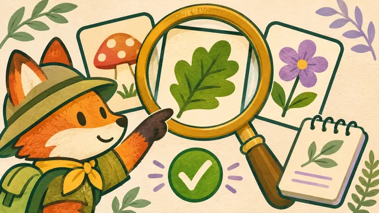
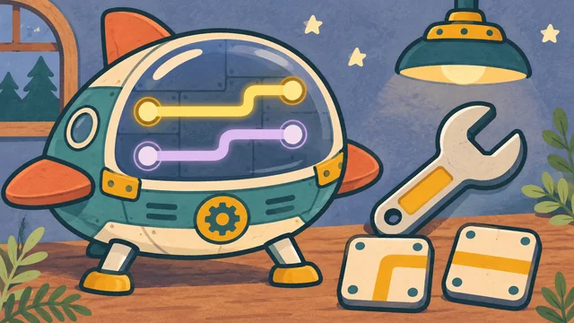

<!--
SPDX-FileCopyrightText: 2026 Milan Jankovec
SPDX-License-Identifier: EUPL-1.2
-->

# Junior Explorers

[Slovenčina](README.sk.md) · [English](README.en.md) · [Čeština](README.cs.md) · [Deutsch](README.de.md) · [Polski](README.pl.md) · [Magyar](README.hu.md) · [Français](README.fr.md) · [Español](README.es.md) · [Italiano](README.it.md) · [Português](README.pt.md) · [Nederlands](README.nl.md) · [Română](README.ro.md) · [Українська](README.uk.md) · [Ελληνικά](README.el.md) · [Svenska](README.sv.md) · [简体中文](README.zh-Hans.md) · [繁體中文](README.zh-Hant.md) · [日本語](README.ja.md) · **한국어** · [Bahasa Indonesia](README.id.md) · [Türkçe](README.tr.md) · [Tiếng Việt](README.vi.md) · [Português (Brasil)](README.pt-BR.md)

Junior Explorers는 6~9세 어린이를 위한 무료 다국어 브라우저 게임 모음으로, 75가지 게임이 들어 있습니다. 화면 언어는 23가지, 난이도는 3단계 중에서 선택할 수 있습니다. 기본 언어는 영어입니다. 마우스, 터치 화면, 키보드로 플레이할 수 있습니다. 키보드에서는 Tab 키로 이동하고 Enter 키 또는 스페이스바로 선택한 항목을 조작합니다. 게임은 주제별로 찾아볼 수 있습니다.

「워드 헌터」, 「비밀 코드 워크샵」, 「음절 공방」에는 슬로바키아어, 체코어, 영어 낱말 모음이 있습니다. 그 밖의 화면 언어를 선택하면 영어 낱말 모음을 사용합니다.

게임 화면이나 목록의 게임 카드에서 인쇄 링크를 누르면 같은 문제의 활동지를 열 수 있습니다. 정답 페이지는 원하는 경우에만 인쇄합니다. 브라우저의 인쇄 창에서 ‘PDF로 저장’을 선택하거나 A4 용지에 인쇄하세요. 칠교놀이는 배율을 100%로 설정해 인쇄하세요.

## 오프라인에서 플레이하기

이 저장소의 ZIP 파일을 내려받아 압축을 풀거나 Git으로 복제하세요. [index.html](../index.html)을 두 번 클릭하면 게임을 하거나 각 게임의 활동지를 열 수 있습니다. 인터넷에 연결하거나 로컬 서버를 실행할 필요가 없습니다.

## 온라인에서 플레이하기

게시 후에는 GitHub Pages의 [한국어 게임 목록](https://milanjankovec.github.io/junior-explorers/?lang=ko)을 열어 플레이할 수 있습니다.

## 게임

「운율 짝 맞추기」와 「그림 낱말 퍼즐」에는 영어, 슬로바키아어, 체코어 낱말 모음이 있습니다. 그 밖의 화면 언어를 선택하면 영어 낱말 모음을 사용합니다.

### 논리

<table role="presentation">
  <tr>
    <td align="center" valign="top"><a href="../games/smart-memory/index.html?lang=ko"> 똑똑한 기억력</a></td>
    <td align="center" valign="top"><a href="../games/tangram/index.html?lang=ko"> 타그람 모양</a></td>
  </tr>
  <tr>
    <td align="center" valign="top"><a href="../games/pattern-builder/index.html?lang=ko"> 패턴 을 완성 하라</a></td>
    <td align="center" valign="top"><a href="../games/picture-sudoku/index.html?lang=ko"> 사진: 수도쿠</a></td>
  </tr>
  <tr>
    <td align="center" valign="top"><a href="../games/logic-detective/index.html?lang=ko"> 내가 누구야?</a></td>
    <td align="center" valign="top"><a href="../games/river-crossing/index.html?lang=ko"> 강 건너</a></td>
  </tr>
  <tr>
    <td align="center" valign="top"><a href="../games/island-bridges/index.html?lang=ko"> 섬에 다리 놓기</a></td>
    <td align="center" valign="top"><a href="../games/parking-puzzle/index.html?lang=ko"> 주차 퍼즐</a></td>
  </tr>
  <tr>
    <td align="center" valign="top"><a href="../games/one-stroke/index.html?lang=ko"> 한붓그리기</a></td>
    <td align="center" valign="top"><a href="../games/light-maze/index.html?lang=ko"> 빛의 미로</a></td>
  </tr>
  <tr>
    <td align="center" valign="top"><a href="../games/trip-planner/index.html?lang=ko"> 나들이 계획</a></td>
    <td align="center" valign="top"><a href="../games/nonograms/index.html?lang=ko"> 네모로직</a></td>
  </tr>
  <tr>
    <td align="center" valign="top"><a href="../games/campsite-tents/index.html?lang=ko"> 텐트와 나무</a></td>
    <td align="center" valign="top"><a href="../games/cube-nets/index.html?lang=ko"> 정육면체 전개도</a></td>
  </tr>
  <tr>
    <td align="center" valign="top"><a href="../games/property-circles/index.html?lang=ko"> 분류 원</a></td>
  </tr>
</table>

### 수학

<table role="presentation">
  <tr>
    <td align="center" valign="top"><a href="../games/math-pixel-art/index.html?lang=ko"> 수학 픽셀 예술</a></td>
    <td align="center" valign="top"><a href="../games/treasure-coordinates/index.html?lang=ko"> 보물 조율</a></td>
  </tr>
  <tr>
    <td align="center" valign="top"><a href="../games/clock-master/index.html?lang=ko"> 시계 마스터</a></td>
    <td align="center" valign="top"><a href="../games/little-shop/index.html?lang=ko"> 작은 상점</a></td>
  </tr>
  <tr>
    <td align="center" valign="top"><a href="../games/number-pyramids/index.html?lang=ko"> 숫자 피라미드</a></td>
    <td align="center" valign="top"><a href="../games/balance-scales/index.html?lang=ko"> 저울을 맞춰요</a></td>
  </tr>
  <tr>
    <td align="center" valign="top"><a href="../games/pizza-fractions/index.html?lang=ko"> 피자 분수</a></td>
    <td align="center" valign="top"><a href="../games/garden-fence/index.html?lang=ko"> 정원에 울타리 치기</a></td>
  </tr>
  <tr>
    <td align="center" valign="top"><a href="../games/calendar-quest/index.html?lang=ko"> 달력 탐험</a></td>
    <td align="center" valign="top"><a href="../games/picture-graphs/index.html?lang=ko"> 그림그래프</a></td>
  </tr>
  <tr>
    <td align="center" valign="top"><a href="../games/cube-builder/index.html?lang=ko"> 정육면체 쌓기</a></td>
    <td align="center" valign="top"><a href="../games/measurement-workshop/index.html?lang=ko"> 길이 재기 공방</a></td>
  </tr>
  <tr>
    <td align="center" valign="top"><a href="../games/tens-factory/index.html?lang=ko"> 십진수 공장</a></td>
    <td align="center" valign="top"><a href="../games/number-elevator/index.html?lang=ko"> 숫자 엘리베이터</a></td>
  </tr>
  <tr>
    <td align="center" valign="top"><a href="../games/water-jugs/index.html?lang=ko"> 물의 양 재기</a></td>
    <td align="center" valign="top"><a href="../games/multiplication-arrays/index.html?lang=ko"> 곱셈 직사각형</a></td>
  </tr>
  <tr>
    <td align="center" valign="top"><a href="../games/chance-bag/index.html?lang=ko"> 확률 주머니</a></td>
    <td align="center" valign="top"><a href="../games/snack-buffet/index.html?lang=ko"> 간식 뷔페</a></td>
  </tr>
</table>

### 언어

<table role="presentation">
  <tr>
    <td align="center" valign="top"><a href="../games/secret-code/index.html?lang=ko"> 비밀 코드 워크샵</a></td>
    <td align="center" valign="top"><a href="../games/story-sequence/index.html?lang=ko"> 시간 탐정</a></td>
  </tr>
  <tr>
    <td align="center" valign="top"><a href="../games/word-search/index.html?lang=ko"> 워드 헌터</a></td>
    <td align="center" valign="top"><a href="../games/syllable-workshop/index.html?lang=ko"> 음절 공방</a></td>
  </tr>
  <tr>
    <td align="center" valign="top"><a href="../games/read-and-draw/index.html?lang=ko"> 읽고 그려요</a></td>
    <td align="center" valign="top"><a href="../games/rhyme-pairs/index.html?lang=ko"> 운율 짝 맞추기</a></td>
  </tr>
  <tr>
    <td align="center" valign="top"><a href="../games/picture-crossword/index.html?lang=ko"> 그림 낱말 퍼즐</a></td>
    <td align="center" valign="top"><a href="../games/word-ladder/index.html?lang=ko"> 낱말 사다리</a></td>
  </tr>
  <tr>
    <td align="center" valign="top"><a href="../games/sentence-builder/index.html?lang=ko"> 문장 만들기</a></td>
  </tr>
</table>

### 자연

<table role="presentation">
  <tr>
    <td align="center" valign="top"><a href="../games/eco-sort/index.html?lang=ko"> 행성 구제자</a></td>
    <td align="center" valign="top"><a href="../games/animal-food/index.html?lang=ko"> 누가 무엇을 먹는가?</a></td>
  </tr>
  <tr>
    <td align="center" valign="top"><a href="../games/life-cycles/index.html?lang=ko"> 자연 탐사</a></td>
    <td align="center" valign="top"><a href="../games/weather-lab/index.html?lang=ko"> 작은 기상학자</a></td>
  </tr>
  <tr>
    <td align="center" valign="top"><a href="../games/forest-tracks/index.html?lang=ko"> 숲속 발자국</a></td>
    <td align="center" valign="top"><a href="../games/garden-experiment/index.html?lang=ko"> 정원 실험</a></td>
  </tr>
  <tr>
    <td align="center" valign="top"><a href="../games/shadow-playground/index.html?lang=ko"> 놀이터의 그림자</a></td>
    <td align="center" valign="top"><a href="../games/magnet-workshop/index.html?lang=ko"> 자석 공방</a></td>
  </tr>
  <tr>
    <td align="center" valign="top"><a href="../games/rain-flow/index.html?lang=ko"> 빗물은 어디로 갈까요?</a></td>
    <td align="center" valign="top"><a href="../games/float-or-sink/index.html?lang=ko"> 뜰까요, 가라앉을까요?</a></td>
  </tr>
  <tr>
    <td align="center" valign="top"><a href="../games/day-and-night/index.html?lang=ko"> 낮과 밤</a></td>
    <td align="center" valign="top"><a href="../games/light-a-bulb/index.html?lang=ko"> 전구를 켜요</a></td>
  </tr>
</table>

### 코딩

<table role="presentation">
  <tr>
    <td align="center" valign="top"><a href="../games/robot-maze/index.html?lang=ko"> 로봇이 집으로 돌아갑니다</a></td>
    <td align="center" valign="top"><a href="../games/spaceship-repair/index.html?lang=ko"> 우주선 수리</a></td>
  </tr>
  <tr>
    <td align="center" valign="top"><a href="../games/debug-the-robot/index.html?lang=ko"> 로봇을 디버깅</a></td>
    <td align="center" valign="top"><a href="../games/traffic-program/index.html?lang=ko"> 신호등 프로그램</a></td>
  </tr>
  <tr>
    <td align="center" valign="top"><a href="../games/event-house/index.html?lang=ko"> 마법 사건의 집</a></td>
    <td align="center" valign="top"><a href="../games/seed-counter/index.html?lang=ko"> 씨앗 계수기</a></td>
  </tr>
  <tr>
    <td align="center" valign="top"><a href="../games/stamp-printer/index.html?lang=ko"> 도장 프린터</a></td>
    <td align="center" valign="top"><a href="../games/parallel-workshop/index.html?lang=ko"> 작업장의 협동</a></td>
  </tr>
  <tr>
    <td align="center" valign="top"><a href="../games/sorting-line/index.html?lang=ko"> 정렬 작업대</a></td>
    <td align="center" valign="top"><a href="../games/ticket-machine/index.html?lang=ko"> 표 판매기</a></td>
  </tr>
</table>

### 창의력

<table role="presentation">
  <tr>
    <td align="center" valign="top"><a href="../games/symmetry-studio/index.html?lang=ko"> 거울 예술가가</a></td>
    <td align="center" valign="top"><a href="../games/story-studio/index.html?lang=ko"> 스토리 감독</a></td>
  </tr>
  <tr>
    <td align="center" valign="top"><a href="../games/rhythm-master/index.html?lang=ko"> 리듬 마스터</a></td>
    <td align="center" valign="top"><a href="../games/scene-changes/index.html?lang=ko"> 무엇이 달라졌나요?</a></td>
  </tr>
  <tr>
    <td align="center" valign="top"><a href="../games/musical-steps/index.html?lang=ko"> 음계 계단</a></td>
    <td align="center" valign="top"><a href="../games/frame-animation/index.html?lang=ko"> 한 장씩 만드는 애니메이션</a></td>
  </tr>
  <tr>
    <td align="center" valign="top"><a href="../games/layered-landscape/index.html?lang=ko"> 겹겹이 쌓는 풍경</a></td>
    <td align="center" valign="top"><a href="../games/stamp-patterns/index.html?lang=ko"> 도장 무늬</a></td>
  </tr>
  <tr>
    <td align="center" valign="top"><a href="../games/paper-puppets/index.html?lang=ko"> 종이 인형</a></td>
    <td align="center" valign="top"><a href="../games/expedition-badge/index.html?lang=ko"> 탐험대 배지</a></td>
  </tr>
  <tr>
    <td align="center" valign="top"><a href="../games/colour-lab/index.html?lang=ko"> 색깔 실험실</a></td>
  </tr>
</table>

### 인쇄 미리보기

이미지를 클릭하면 각 게임 활동지의 첫 페이지를 확대해 볼 수 있습니다. 예시는 영어로 되어 있으며 정답 페이지는 표시하지 않습니다.

## 개인정보 보호 및 라이선스

가입, 추적기, 광고, 네트워크 서비스, 유료 기능 없이 플레이할 수 있습니다. 브라우저는 선택한 언어, 설정, 완료한 게임, 만화 초안을 기기에 저장할 수 있습니다. 호스팅 제공업체는 일반적인 운영 로그를 처리할 수 있습니다.

© 2026 Milan Jankovec. 원본 소스 코드는 [EUPL-1.2](../LICENSE) 라이선스를 따릅니다.
