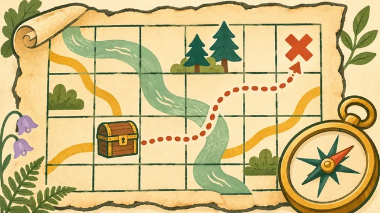
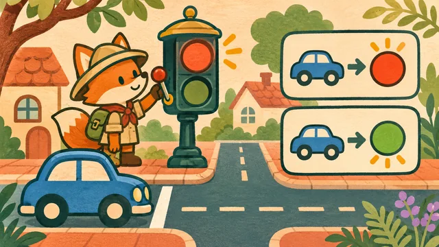
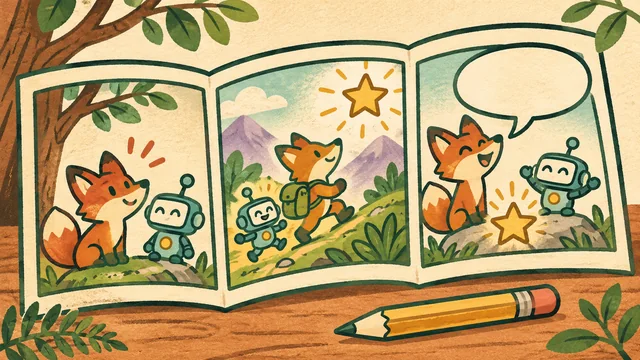

<!--
SPDX-FileCopyrightText: 2026 Milan Jankovec
SPDX-License-Identifier: EUPL-1.2
-->

# Junior Explorers

[Slovenčina](README.sk.md) · [English](README.en.md) · [Čeština](README.cs.md) · [Deutsch](README.de.md) · [Polski](README.pl.md) · [Magyar](README.hu.md) · [Français](README.fr.md) · [Español](README.es.md) · [Italiano](README.it.md) · [Português](README.pt.md) · **Nederlands** · [Română](README.ro.md) · [Українська](README.uk.md) · [Ελληνικά](README.el.md) · [Svenska](README.sv.md) · [简体中文](README.zh-Hans.md) · [繁體中文](README.zh-Hant.md) · [日本語](README.ja.md) · [한국어](README.ko.md) · [Bahasa Indonesia](README.id.md) · [Türkçe](README.tr.md) · [Tiếng Việt](README.vi.md) · [Português (Brasil)](README.pt-BR.md)

Junior Explorers is een gratis, meertalige verzameling van 75 browserspellen voor kinderen van ongeveer 6 tot 9 jaar. De interface is beschikbaar in 23 talen en er zijn drie moeilijkheidsniveaus. Engels is de standaardtaal. Speel met de muis, het aanraakscherm of het toetsenbord. Gebruik Tab om van bedieningsknop te wisselen en Enter of de spatiebalk om een knop te activeren. In de catalogus staan de spellen per categorie.

Word Hunter, Secret Code Workshop en Lettergreepatelier gebruiken Slowaakse, Tsjechische en Engelse woordenlijsten. Als je een andere taal voor de interface kiest, gebruiken deze spellen de Engelse woordenlijst.

Via de afdruklink in het spel of op de kaart in de catalogus open je een werkblad bij dezelfde opdracht. Je kunt de antwoordbladen erbij kiezen. Selecteer ‘Opslaan als pdf’ in het afdrukvenster van je browser of druk af op A4-formaat. Druk tangrams af op ware grootte (100%).

## Offline spelen

Download het ZIP-archief van de repository en pak het uit of kloon de repository met Git. Dubbelklik op [index.html](../index.html) om te spelen of werkbladen bij de spellen te openen. De website werkt in je browser zonder internetverbinding of lokale server.

## Online spelen

Open na publicatie de [Nederlandstalige catalogus](https://milanjankovec.github.io/junior-explorers/?lang=nl) op GitHub Pages.

## Spellen

Rijmparen en Kruiswoordpuzzel met plaatjes hebben Engelse, Slowaakse en Tsjechische woordenlijsten. Kies je een andere taal voor de interface, dan gebruiken deze spellen de Engelse woordenlijst.

### Logica

<table role="presentation">
  <tr>
    <td align="center" valign="top"><a href="../games/smart-memory/index.html?lang=nl"> Slimme geheugen</a></td>
    <td align="center" valign="top"><a href="../games/tangram/index.html?lang=nl"> Tangramvormen</a></td>
  </tr>
  <tr>
    <td align="center" valign="top"><a href="../games/pattern-builder/index.html?lang=nl"> Voltooid het patroon</a></td>
    <td align="center" valign="top"><a href="../games/picture-sudoku/index.html?lang=nl"> Foto van Sudoku</a></td>
  </tr>
  <tr>
    <td align="center" valign="top"><a href="../games/logic-detective/index.html?lang=nl"> Wie ben ik?</a></td>
    <td align="center" valign="top"><a href="../games/river-crossing/index.html?lang=nl"> Rivier overschrijding</a></td>
  </tr>
  <tr>
    <td align="center" valign="top"><a href="../games/island-bridges/index.html?lang=nl"> Bruggen tussen eilanden</a></td>
    <td align="center" valign="top"><a href="../games/parking-puzzle/index.html?lang=nl"> Vast op de parkeerplaats</a></td>
  </tr>
  <tr>
    <td align="center" valign="top"><a href="../games/one-stroke/index.html?lang=nl"> In één pennenstreek</a></td>
    <td align="center" valign="top"><a href="../games/light-maze/index.html?lang=nl"> Lichtdoolhof</a></td>
  </tr>
  <tr>
    <td align="center" valign="top"><a href="../games/trip-planner/index.html?lang=nl"> Plan het uitstapje</a></td>
    <td align="center" valign="top"><a href="../games/nonograms/index.html?lang=nl"> Japanse beeldpuzzels</a></td>
  </tr>
  <tr>
    <td align="center" valign="top"><a href="../games/campsite-tents/index.html?lang=nl"> Tenten en bomen</a></td>
    <td align="center" valign="top"><a href="../games/cube-nets/index.html?lang=nl"> Uitslagen van de kubus</a></td>
  </tr>
  <tr>
    <td align="center" valign="top"><a href="../games/property-circles/index.html?lang=nl"> Sorteercirkels</a></td>
  </tr>
</table>

### Rekenen

<table role="presentation">
  <tr>
    <td align="center" valign="top"><a href="../games/math-pixel-art/index.html?lang=nl"> Wiskunde Pixel Art</a></td>
    <td align="center" valign="top"><a href="../games/treasure-coordinates/index.html?lang=nl"> Schatskoppunten</a></td>
  </tr>
  <tr>
    <td align="center" valign="top"><a href="../games/clock-master/index.html?lang=nl"> Uurmeester</a></td>
    <td align="center" valign="top"><a href="../games/little-shop/index.html?lang=nl"> Kleine winkelmeester</a></td>
  </tr>
  <tr>
    <td align="center" valign="top"><a href="../games/number-pyramids/index.html?lang=nl"> Nummerspiramiden</a></td>
    <td align="center" valign="top"><a href="../games/balance-scales/index.html?lang=nl"> Weegschaal in balans</a></td>
  </tr>
  <tr>
    <td align="center" valign="top"><a href="../games/pizza-fractions/index.html?lang=nl"> Breuken met pizza</a></td>
    <td align="center" valign="top"><a href="../games/garden-fence/index.html?lang=nl"> Een hek om de tuin</a></td>
  </tr>
  <tr>
    <td align="center" valign="top"><a href="../games/calendar-quest/index.html?lang=nl"> Kalenderspeurtocht</a></td>
    <td align="center" valign="top"><a href="../games/picture-graphs/index.html?lang=nl"> Grafieken met plaatjes</a></td>
  </tr>
  <tr>
    <td align="center" valign="top"><a href="../games/cube-builder/index.html?lang=nl"> Kubusbouwer</a></td>
    <td align="center" valign="top"><a href="../games/measurement-workshop/index.html?lang=nl"> Meetwerkplaats</a></td>
  </tr>
  <tr>
    <td align="center" valign="top"><a href="../games/tens-factory/index.html?lang=nl"> Tientallenfabriek</a></td>
    <td align="center" valign="top"><a href="../games/number-elevator/index.html?lang=nl"> Getallenlift</a></td>
  </tr>
  <tr>
    <td align="center" valign="top"><a href="../games/water-jugs/index.html?lang=nl"> Meetkannen</a></td>
    <td align="center" valign="top"><a href="../games/multiplication-arrays/index.html?lang=nl"> Vermenigvuldigrechthoeken</a></td>
  </tr>
  <tr>
    <td align="center" valign="top"><a href="../games/chance-bag/index.html?lang=nl"> Kansenzakjes</a></td>
    <td align="center" valign="top"><a href="../games/snack-buffet/index.html?lang=nl"> Tussendoortjesbuffet</a></td>
  </tr>
</table>

### Taal

<table role="presentation">
  <tr>
    <td align="center" valign="top"><a href="../games/secret-code/index.html?lang=nl"> Secret Code Workshop</a></td>
    <td align="center" valign="top"><a href="../games/story-sequence/index.html?lang=nl"> Tijd rechercheur</a></td>
  </tr>
  <tr>
    <td align="center" valign="top"><a href="../games/word-search/index.html?lang=nl"> Word Hunter</a></td>
    <td align="center" valign="top"><a href="../games/syllable-workshop/index.html?lang=nl"> Lettergreepatelier</a></td>
  </tr>
  <tr>
    <td align="center" valign="top"><a href="../games/read-and-draw/index.html?lang=nl"> Lees en teken</a></td>
    <td align="center" valign="top"><a href="../games/rhyme-pairs/index.html?lang=nl"> Rijmparen</a></td>
  </tr>
  <tr>
    <td align="center" valign="top"><a href="../games/picture-crossword/index.html?lang=nl"> Kruiswoordpuzzel met plaatjes</a></td>
    <td align="center" valign="top"><a href="../games/word-ladder/index.html?lang=nl"> Woordladder</a></td>
  </tr>
  <tr>
    <td align="center" valign="top"><a href="../games/sentence-builder/index.html?lang=nl"> Bouw een zin</a></td>
  </tr>
</table>

### Natuur

<table role="presentation">
  <tr>
    <td align="center" valign="top"><a href="../games/eco-sort/index.html?lang=nl"> Planetenredders</a></td>
    <td align="center" valign="top"><a href="../games/animal-food/index.html?lang=nl"> Wie eet wat?</a></td>
  </tr>
  <tr>
    <td align="center" valign="top"><a href="../games/life-cycles/index.html?lang=nl"> Nature Explorer</a></td>
    <td align="center" valign="top"><a href="../games/weather-lab/index.html?lang=nl"> Kleine meteoroloog</a></td>
  </tr>
  <tr>
    <td align="center" valign="top"><a href="../games/forest-tracks/index.html?lang=nl"> Dierensporen in het bos</a></td>
    <td align="center" valign="top"><a href="../games/garden-experiment/index.html?lang=nl"> Proefje in de tuin</a></td>
  </tr>
  <tr>
    <td align="center" valign="top"><a href="../games/shadow-playground/index.html?lang=nl"> Schaduwen op de speelplaats</a></td>
    <td align="center" valign="top"><a href="../games/magnet-workshop/index.html?lang=nl"> Magneetwerkplaats</a></td>
  </tr>
  <tr>
    <td align="center" valign="top"><a href="../games/rain-flow/index.html?lang=nl"> Waar stroomt de regen heen?</a></td>
    <td align="center" valign="top"><a href="../games/float-or-sink/index.html?lang=nl"> Drijft het of zinkt het?</a></td>
  </tr>
  <tr>
    <td align="center" valign="top"><a href="../games/day-and-night/index.html?lang=nl"> Dag en nacht</a></td>
    <td align="center" valign="top"><a href="../games/light-a-bulb/index.html?lang=nl"> Laat een lampje branden</a></td>
  </tr>
</table>

### Programmeren

<table role="presentation">
  <tr>
    <td align="center" valign="top"><a href="../games/robot-maze/index.html?lang=nl"> Robots naar huis</a></td>
    <td align="center" valign="top"><a href="../games/spaceship-repair/index.html?lang=nl"> Ruimteschip reparatie</a></td>
  </tr>
  <tr>
    <td align="center" valign="top"><a href="../games/debug-the-robot/index.html?lang=nl"> Debug de robot</a></td>
    <td align="center" valign="top"><a href="../games/traffic-program/index.html?lang=nl"> Programmeer het stoplicht</a></td>
  </tr>
  <tr>
    <td align="center" valign="top"><a href="../games/event-house/index.html?lang=nl"> Magisch gebeurtenishuis</a></td>
    <td align="center" valign="top"><a href="../games/seed-counter/index.html?lang=nl"> Zadenteller</a></td>
  </tr>
  <tr>
    <td align="center" valign="top"><a href="../games/stamp-printer/index.html?lang=nl"> Stempelprinter</a></td>
    <td align="center" valign="top"><a href="../games/parallel-workshop/index.html?lang=nl"> Samen in de werkplaats</a></td>
  </tr>
  <tr>
    <td align="center" valign="top"><a href="../games/sorting-line/index.html?lang=nl"> Sorteerband</a></td>
    <td align="center" valign="top"><a href="../games/ticket-machine/index.html?lang=nl"> Kaartjesautomaat</a></td>
  </tr>
</table>

### Creativiteit

<table role="presentation">
  <tr>
    <td align="center" valign="top"><a href="../games/symmetry-studio/index.html?lang=nl"> Spiegelkunstenaar</a></td>
    <td align="center" valign="top"><a href="../games/story-studio/index.html?lang=nl"> Verhaal directeur</a></td>
  </tr>
  <tr>
    <td align="center" valign="top"><a href="../games/rhythm-master/index.html?lang=nl"> Ritme Meester</a></td>
    <td align="center" valign="top"><a href="../games/scene-changes/index.html?lang=nl"> Wat is er veranderd?</a></td>
  </tr>
  <tr>
    <td align="center" valign="top"><a href="../games/musical-steps/index.html?lang=nl"> Muziektrap</a></td>
    <td align="center" valign="top"><a href="../games/frame-animation/index.html?lang=nl"> Animatie beeld voor beeld</a></td>
  </tr>
  <tr>
    <td align="center" valign="top"><a href="../games/layered-landscape/index.html?lang=nl"> Landschap in lagen</a></td>
    <td align="center" valign="top"><a href="../games/stamp-patterns/index.html?lang=nl"> Stempelpatronen</a></td>
  </tr>
  <tr>
    <td align="center" valign="top"><a href="../games/paper-puppets/index.html?lang=nl"> Papieren poppen</a></td>
    <td align="center" valign="top"><a href="../games/expedition-badge/index.html?lang=nl"> Expeditiebadge</a></td>
  </tr>
  <tr>
    <td align="center" valign="top"><a href="../games/colour-lab/index.html?lang=nl"> Kleurenlab</a></td>
  </tr>
</table>

### Afdrukvoorbeelden

Klik op de afbeelding om de eerste pagina van het werkblad bij elk spel te vergroten. De voorbeelden zijn in het Engels en de oplossingen zijn verborgen.

## Privacy en licentie

Speel zonder registratie, trackers, advertenties, netwerkdiensten of betaalde functies. Je browser kan je taalkeuze, voorkeuren, voltooide spellen en een conceptstrip op je apparaat bewaren. De hostingprovider kan gangbare operationele logbestanden verwerken.

© 2026 Milan Jankovec. De oorspronkelijke broncode valt onder de [EUPL-1.2-licentie](../LICENSE).
