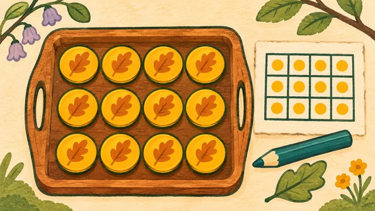
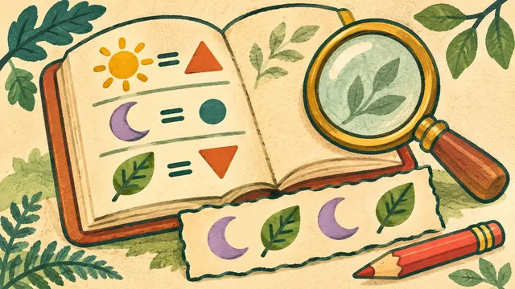

<!--
SPDX-FileCopyrightText: 2026 Milan Jankovec
SPDX-License-Identifier: EUPL-1.2
-->

# Junior Explorers

[Slovenčina](README.sk.md) · [English](README.en.md) · [Čeština](README.cs.md) · [Deutsch](README.de.md) · **Polski** · [Magyar](README.hu.md) · [Français](README.fr.md) · [Español](README.es.md) · [Italiano](README.it.md) · [Português](README.pt.md) · [Nederlands](README.nl.md) · [Română](README.ro.md) · [Українська](README.uk.md) · [Ελληνικά](README.el.md) · [Svenska](README.sv.md) · [简体中文](README.zh-Hans.md) · [繁體中文](README.zh-Hant.md) · [日本語](README.ja.md) · [한국어](README.ko.md) · [Bahasa Indonesia](README.id.md) · [Türkçe](README.tr.md) · [Tiếng Việt](README.vi.md) · [Português (Brasil)](README.pt-BR.md)

Junior Explorers to bezpłatna, wielojęzyczna kolekcja 75 gier przeglądarkowych dla dzieci w wieku około 6–9 lat. Do wyboru są 23 języki interfejsu i trzy poziomy trudności. Domyślnym językiem jest angielski. Możesz grać myszą, dotykiem lub klawiaturą. Klawisz Tab przenosi fokus, a Enter lub spacja uruchamia wybrany element. Gry są uporządkowane w katalogu według kategorii.

Łowca słów, Szkoła sekretnego kodu i Warsztat sylab korzystają ze słowackich, czeskich i angielskich zestawów słów. W pozostałych językach interfejsu te gry korzystają z zestawów angielskich.

Otwórz arkusz do tego samego zadania za pomocą odnośnika do druku w grze lub na jej karcie w katalogu. Możesz dołączyć strony z rozwiązaniami. W oknie drukowania przeglądarki wybierz opcję Zapisz jako PDF lub wydrukuj na papierze A4. Tangramy drukuj w skali 100%.

## Graj bez internetu

Pobierz archiwum ZIP repozytorium i rozpakuj je lub sklonuj repozytorium za pomocą Gita. Kliknij dwukrotnie [index.html](../index.html), aby otworzyć gry i ich arkusze zadań. Strona działa w przeglądarce bez połączenia z internetem i bez lokalnego serwera.

## Graj online

Po publikacji otwórz [katalog po polsku](https://milanjankovec.github.io/junior-explorers/?lang=pl) w GitHub Pages.

## Gry

Pary rymów i Krzyżówka obrazkowa mają angielskie, słowackie i czeskie zestawy słów. W pozostałych językach interfejsu te gry korzystają z zestawów angielskich.

### Logika

<table role="presentation">
  <tr>
    <td align="center" valign="top"><a href="../games/smart-memory/index.html?lang=pl"> Inteligentna pamięć</a></td>
    <td align="center" valign="top"><a href="../games/tangram/index.html?lang=pl"> Kształty tangramów</a></td>
  </tr>
  <tr>
    <td align="center" valign="top"><a href="../games/pattern-builder/index.html?lang=pl"> Skończ wzór</a></td>
    <td align="center" valign="top"><a href="../games/picture-sudoku/index.html?lang=pl"> Zdjęcie Sudoku</a></td>
  </tr>
  <tr>
    <td align="center" valign="top"><a href="../games/logic-detective/index.html?lang=pl"> - Kim jestem?</a></td>
    <td align="center" valign="top"><a href="../games/river-crossing/index.html?lang=pl"> Przejście rzeki</a></td>
  </tr>
  <tr>
    <td align="center" valign="top"><a href="../games/island-bridges/index.html?lang=pl"> Mosty między wyspami</a></td>
    <td align="center" valign="top"><a href="../games/parking-puzzle/index.html?lang=pl"> Zablokowany parking</a></td>
  </tr>
  <tr>
    <td align="center" valign="top"><a href="../games/one-stroke/index.html?lang=pl"> Jedną kreską</a></td>
    <td align="center" valign="top"><a href="../games/light-maze/index.html?lang=pl"> Świetlny labirynt</a></td>
  </tr>
  <tr>
    <td align="center" valign="top"><a href="../games/trip-planner/index.html?lang=pl"> Zaplanuj wycieczkę</a></td>
    <td align="center" valign="top"><a href="../games/nonograms/index.html?lang=pl"> Malowanie liczbami</a></td>
  </tr>
  <tr>
    <td align="center" valign="top"><a href="../games/campsite-tents/index.html?lang=pl"> Namioty i drzewa</a></td>
    <td align="center" valign="top"><a href="../games/cube-nets/index.html?lang=pl"> Siatki sześcianu</a></td>
  </tr>
  <tr>
    <td align="center" valign="top"><a href="../games/property-circles/index.html?lang=pl"> Kręgi sortowania</a></td>
  </tr>
</table>

### Matematyka

<table role="presentation">
  <tr>
    <td align="center" valign="top"><a href="../games/math-pixel-art/index.html?lang=pl"> Matematyka Pixel Art</a></td>
    <td align="center" valign="top"><a href="../games/treasure-coordinates/index.html?lang=pl"> Koordynacje skarbu</a></td>
  </tr>
  <tr>
    <td align="center" valign="top"><a href="../games/clock-master/index.html?lang=pl"> Mistrz zegarków</a></td>
    <td align="center" valign="top"><a href="../games/little-shop/index.html?lang=pl"> Mały sklepik</a></td>
  </tr>
  <tr>
    <td align="center" valign="top"><a href="../games/number-pyramids/index.html?lang=pl"> Piramidy numerów</a></td>
    <td align="center" valign="top"><a href="../games/balance-scales/index.html?lang=pl"> Zrównoważ wagę</a></td>
  </tr>
  <tr>
    <td align="center" valign="top"><a href="../games/pizza-fractions/index.html?lang=pl"> Ułamki z pizzą</a></td>
    <td align="center" valign="top"><a href="../games/garden-fence/index.html?lang=pl"> Ogrodź grządkę</a></td>
  </tr>
  <tr>
    <td align="center" valign="top"><a href="../games/calendar-quest/index.html?lang=pl"> Wyprawa z kalendarzem</a></td>
    <td align="center" valign="top"><a href="../games/picture-graphs/index.html?lang=pl"> Wykresy obrazkowe</a></td>
  </tr>
  <tr>
    <td align="center" valign="top"><a href="../games/cube-builder/index.html?lang=pl"> Budowniczy z kostek</a></td>
    <td align="center" valign="top"><a href="../games/measurement-workshop/index.html?lang=pl"> Warsztat mierzenia</a></td>
  </tr>
  <tr>
    <td align="center" valign="top"><a href="../games/tens-factory/index.html?lang=pl"> Fabryka dziesiątek</a></td>
    <td align="center" valign="top"><a href="../games/number-elevator/index.html?lang=pl"> Winda liczbowa</a></td>
  </tr>
  <tr>
    <td align="center" valign="top"><a href="../games/water-jugs/index.html?lang=pl"> Dzbanki z miarką</a></td>
    <td align="center" valign="top"><a href="../games/multiplication-arrays/index.html?lang=pl"> Prostokąty mnożenia</a></td>
  </tr>
  <tr>
    <td align="center" valign="top"><a href="../games/chance-bag/index.html?lang=pl"> Woreczki szans</a></td>
    <td align="center" valign="top"><a href="../games/snack-buffet/index.html?lang=pl"> Bufet przekąsek</a></td>
  </tr>
</table>

### Język

<table role="presentation">
  <tr>
    <td align="center" valign="top"><a href="../games/secret-code/index.html?lang=pl"> Szkoła sekretnego kodu</a></td>
    <td align="center" valign="top"><a href="../games/story-sequence/index.html?lang=pl"> Detektyw czasu</a></td>
  </tr>
  <tr>
    <td align="center" valign="top"><a href="../games/word-search/index.html?lang=pl"> Łowca słów</a></td>
    <td align="center" valign="top"><a href="../games/syllable-workshop/index.html?lang=pl"> Warsztat sylab</a></td>
  </tr>
  <tr>
    <td align="center" valign="top"><a href="../games/read-and-draw/index.html?lang=pl"> Czytaj i rysuj</a></td>
    <td align="center" valign="top"><a href="../games/rhyme-pairs/index.html?lang=pl"> Pary rymów</a></td>
  </tr>
  <tr>
    <td align="center" valign="top"><a href="../games/picture-crossword/index.html?lang=pl"> Krzyżówka obrazkowa</a></td>
    <td align="center" valign="top"><a href="../games/word-ladder/index.html?lang=pl"> Drabinka słów</a></td>
  </tr>
  <tr>
    <td align="center" valign="top"><a href="../games/sentence-builder/index.html?lang=pl"> Ułóż zdanie</a></td>
  </tr>
</table>

### Przyroda

<table role="presentation">
  <tr>
    <td align="center" valign="top"><a href="../games/eco-sort/index.html?lang=pl"> Ratownicy planet</a></td>
    <td align="center" valign="top"><a href="../games/animal-food/index.html?lang=pl"> Kto co je?</a></td>
  </tr>
  <tr>
    <td align="center" valign="top"><a href="../games/life-cycles/index.html?lang=pl"> Eksplorator przyrody</a></td>
    <td align="center" valign="top"><a href="../games/weather-lab/index.html?lang=pl"> Mały meteorolog</a></td>
  </tr>
  <tr>
    <td align="center" valign="top"><a href="../games/forest-tracks/index.html?lang=pl"> Tropy w lesie</a></td>
    <td align="center" valign="top"><a href="../games/garden-experiment/index.html?lang=pl"> Eksperyment w ogrodzie</a></td>
  </tr>
  <tr>
    <td align="center" valign="top"><a href="../games/shadow-playground/index.html?lang=pl"> Cienie na placu zabaw</a></td>
    <td align="center" valign="top"><a href="../games/magnet-workshop/index.html?lang=pl"> Pracownia magnesów</a></td>
  </tr>
  <tr>
    <td align="center" valign="top"><a href="../games/rain-flow/index.html?lang=pl"> Dokąd płynie deszczówka?</a></td>
    <td align="center" valign="top"><a href="../games/float-or-sink/index.html?lang=pl"> Unosi się czy tonie?</a></td>
  </tr>
  <tr>
    <td align="center" valign="top"><a href="../games/day-and-night/index.html?lang=pl"> Dzień i noc</a></td>
    <td align="center" valign="top"><a href="../games/light-a-bulb/index.html?lang=pl"> Zapal żarówkę</a></td>
  </tr>
</table>

### Programowanie

<table role="presentation">
  <tr>
    <td align="center" valign="top"><a href="../games/robot-maze/index.html?lang=pl"> Roboty wracają do domu</a></td>
    <td align="center" valign="top"><a href="../games/spaceship-repair/index.html?lang=pl"> Naprawa statku kosmicznego</a></td>
  </tr>
  <tr>
    <td align="center" valign="top"><a href="../games/debug-the-robot/index.html?lang=pl"> Odbudowa robota</a></td>
    <td align="center" valign="top"><a href="../games/traffic-program/index.html?lang=pl"> Zaprogramuj sygnalizację</a></td>
  </tr>
  <tr>
    <td align="center" valign="top"><a href="../games/event-house/index.html?lang=pl"> Magiczny dom zdarzeń</a></td>
    <td align="center" valign="top"><a href="../games/seed-counter/index.html?lang=pl"> Licznik nasion</a></td>
  </tr>
  <tr>
    <td align="center" valign="top"><a href="../games/stamp-printer/index.html?lang=pl"> Drukarka stempli</a></td>
    <td align="center" valign="top"><a href="../games/parallel-workshop/index.html?lang=pl"> Współpraca w warsztacie</a></td>
  </tr>
  <tr>
    <td align="center" valign="top"><a href="../games/sorting-line/index.html?lang=pl"> Linia sortująca</a></td>
    <td align="center" valign="top"><a href="../games/ticket-machine/index.html?lang=pl"> Automat biletowy</a></td>
  </tr>
</table>

### Kreatywność

<table role="presentation">
  <tr>
    <td align="center" valign="top"><a href="../games/symmetry-studio/index.html?lang=pl"> Artysta lustra</a></td>
    <td align="center" valign="top"><a href="../games/story-studio/index.html?lang=pl"> Dyrektor opowieści</a></td>
  </tr>
  <tr>
    <td align="center" valign="top"><a href="../games/rhythm-master/index.html?lang=pl"> Mistrz rytmu</a></td>
    <td align="center" valign="top"><a href="../games/scene-changes/index.html?lang=pl"> Co się zmieniło?</a></td>
  </tr>
  <tr>
    <td align="center" valign="top"><a href="../games/musical-steps/index.html?lang=pl"> Muzyczne schodki</a></td>
    <td align="center" valign="top"><a href="../games/frame-animation/index.html?lang=pl"> Animacja klatka po klatce</a></td>
  </tr>
  <tr>
    <td align="center" valign="top"><a href="../games/layered-landscape/index.html?lang=pl"> Krajobraz z warstw</a></td>
    <td align="center" valign="top"><a href="../games/stamp-patterns/index.html?lang=pl"> Wzory ze stempli</a></td>
  </tr>
  <tr>
    <td align="center" valign="top"><a href="../games/paper-puppets/index.html?lang=pl"> Papierowe marionetki</a></td>
    <td align="center" valign="top"><a href="../games/expedition-badge/index.html?lang=pl"> Odznaka wyprawy</a></td>
  </tr>
  <tr>
    <td align="center" valign="top"><a href="../games/colour-lab/index.html?lang=pl"> Laboratorium kolorów</a></td>
  </tr>
</table>

### Podgląd arkuszy

Kliknij obraz, aby powiększyć pierwszą stronę arkusza każdej gry. Przykładowe arkusze są po angielsku i nie zawierają stron z rozwiązaniami.

## Prywatność i licencja

Gry nie wymagają rejestracji i działają bez reklam, śledzenia, usług sieciowych i płatnych funkcji. Przeglądarka może zapisać na urządzeniu wybrany język, ustawienia, ukończone gry i szkic komiksu. Dostawca hostingu może przetwarzać standardowe dzienniki operacyjne.

© 2026 Milan Jankovec. Oryginalny kod źródłowy jest dostępny na licencji [EUPL-1.2](../LICENSE).
