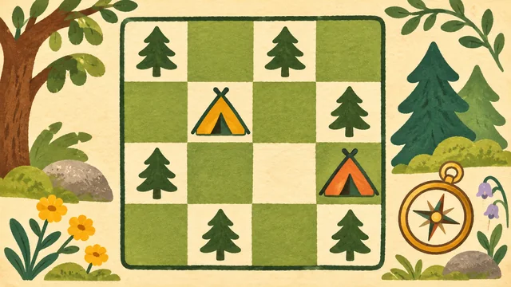
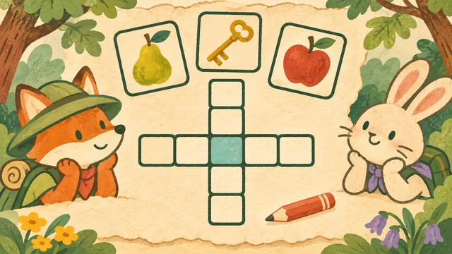
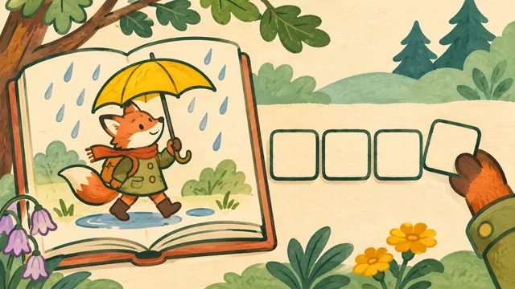

<!--
SPDX-FileCopyrightText: 2026 Milan Jankovec
SPDX-License-Identifier: EUPL-1.2
-->

# Junior Explorers

[Slovenčina](README.sk.md) · [English](README.en.md) · [Čeština](README.cs.md) · [Deutsch](README.de.md) · [Polski](README.pl.md) · [Magyar](README.hu.md) · [Français](README.fr.md) · [Español](README.es.md) · [Italiano](README.it.md) · **Português** · [Nederlands](README.nl.md) · [Română](README.ro.md) · [Українська](README.uk.md) · [Ελληνικά](README.el.md) · [Svenska](README.sv.md) · [简体中文](README.zh-Hans.md) · [繁體中文](README.zh-Hant.md) · [日本語](README.ja.md) · [한국어](README.ko.md) · [Bahasa Indonesia](README.id.md) · [Türkçe](README.tr.md) · [Tiếng Việt](README.vi.md) · [Português (Brasil)](README.pt-BR.md)

Junior Explorers é uma coleção gratuita e multilingue de 75 jogos para navegador, pensada para crianças dos 6 aos 9 anos, aproximadamente. Escolhe entre 23 idiomas da interface e três níveis de dificuldade. O idioma predefinido é o inglês. Joga com o rato, o ecrã tátil ou o teclado. Usa Tab para passar de um controlo para outro e Enter ou a barra de espaços para o ativar. Os jogos estão organizados por categoria no catálogo.

Caçador de Palavras, Talento de Códigos Secretos e Oficina de sílabas usam listas de palavras em eslovaco, checo e inglês. Se escolheres outro idioma para a interface, estes jogos usam a lista em inglês.

Usa a ligação de impressão no jogo ou no respetivo cartão do catálogo para abrir uma ficha do mesmo desafio. Podes incluir as páginas com as soluções. Na janela de impressão do navegador, escolhe «Guardar como PDF» ou imprime em formato A4. Imprime os tangrans à escala de 100%.

## Jogar sem ligação à Internet

Descarrega e extrai o ficheiro ZIP do repositório ou clona o repositório com Git. Faz duplo clique em [index.html](../index.html) para jogar ou abrir as fichas dos jogos. O site funciona no navegador sem ligação à Internet nem servidor local.

## Jogar online

Após a publicação, abre o [catálogo em português](https://milanjankovec.github.io/junior-explorers/?lang=pt) no GitHub Pages.

## Jogos

Pares de rimas e Palavras cruzadas com imagens têm listas de palavras em inglês, eslovaco e checo. Se a interface estiver noutro idioma, usam a lista em inglês.

### Lógica

<table role="presentation">
  <tr>
    <td align="center" valign="top"><a href="../games/smart-memory/index.html?lang=pt"> Memória inteligente</a></td>
    <td align="center" valign="top"><a href="../games/tangram/index.html?lang=pt"> Formas de tangramas</a></td>
  </tr>
  <tr>
    <td align="center" valign="top"><a href="../games/pattern-builder/index.html?lang=pt"> Conclui o padrão</a></td>
    <td align="center" valign="top"><a href="../games/picture-sudoku/index.html?lang=pt"> Imagens de Sudoku</a></td>
  </tr>
  <tr>
    <td align="center" valign="top"><a href="../games/logic-detective/index.html?lang=pt"> Quem sou eu?</a></td>
    <td align="center" valign="top"><a href="../games/river-crossing/index.html?lang=pt"> Cruzamento do rio</a></td>
  </tr>
  <tr>
    <td align="center" valign="top"><a href="../games/island-bridges/index.html?lang=pt"> Pontes entre ilhas</a></td>
    <td align="center" valign="top"><a href="../games/parking-puzzle/index.html?lang=pt"> Estacionamento bloqueado</a></td>
  </tr>
  <tr>
    <td align="center" valign="top"><a href="../games/one-stroke/index.html?lang=pt"> Num só traço</a></td>
    <td align="center" valign="top"><a href="../games/light-maze/index.html?lang=pt"> Labirinto de luz</a></td>
  </tr>
  <tr>
    <td align="center" valign="top"><a href="../games/trip-planner/index.html?lang=pt"> Planeia o passeio</a></td>
    <td align="center" valign="top"><a href="../games/nonograms/index.html?lang=pt"> Nonogramas</a></td>
  </tr>
  <tr>
    <td align="center" valign="top"><a href="../games/campsite-tents/index.html?lang=pt"> Tendas e árvores</a></td>
    <td align="center" valign="top"><a href="../games/cube-nets/index.html?lang=pt"> Planificações do cubo</a></td>
  </tr>
  <tr>
    <td align="center" valign="top"><a href="../games/property-circles/index.html?lang=pt"> Círculos de classificação</a></td>
  </tr>
</table>

### Matemática

<table role="presentation">
  <tr>
    <td align="center" valign="top"><a href="../games/math-pixel-art/index.html?lang=pt"> Matemática Arte de pixel</a></td>
    <td align="center" valign="top"><a href="../games/treasure-coordinates/index.html?lang=pt"> Coordenadas do Tesouro</a></td>
  </tr>
  <tr>
    <td align="center" valign="top"><a href="../games/clock-master/index.html?lang=pt"> Mestre do relógio</a></td>
    <td align="center" valign="top"><a href="../games/little-shop/index.html?lang=pt"> Pequeno Lojaireiro</a></td>
  </tr>
  <tr>
    <td align="center" valign="top"><a href="../games/number-pyramids/index.html?lang=pt"> Número de pirâmides</a></td>
    <td align="center" valign="top"><a href="../games/balance-scales/index.html?lang=pt"> Equilibra a balança</a></td>
  </tr>
  <tr>
    <td align="center" valign="top"><a href="../games/pizza-fractions/index.html?lang=pt"> Frações com piza</a></td>
    <td align="center" valign="top"><a href="../games/garden-fence/index.html?lang=pt"> Veda a horta</a></td>
  </tr>
  <tr>
    <td align="center" valign="top"><a href="../games/calendar-quest/index.html?lang=pt"> Aventura no calendário</a></td>
    <td align="center" valign="top"><a href="../games/picture-graphs/index.html?lang=pt"> Gráficos com imagens</a></td>
  </tr>
  <tr>
    <td align="center" valign="top"><a href="../games/cube-builder/index.html?lang=pt"> Construtor de cubos</a></td>
    <td align="center" valign="top"><a href="../games/measurement-workshop/index.html?lang=pt"> Oficina de medidas</a></td>
  </tr>
  <tr>
    <td align="center" valign="top"><a href="../games/tens-factory/index.html?lang=pt"> Fábrica das dezenas</a></td>
    <td align="center" valign="top"><a href="../games/number-elevator/index.html?lang=pt"> Elevador dos números</a></td>
  </tr>
  <tr>
    <td align="center" valign="top"><a href="../games/water-jugs/index.html?lang=pt"> Jarros de medição</a></td>
    <td align="center" valign="top"><a href="../games/multiplication-arrays/index.html?lang=pt"> Retângulos de multiplicação</a></td>
  </tr>
  <tr>
    <td align="center" valign="top"><a href="../games/chance-bag/index.html?lang=pt"> Sacos de probabilidades</a></td>
    <td align="center" valign="top"><a href="../games/snack-buffet/index.html?lang=pt"> Bufete do lanche</a></td>
  </tr>
</table>

### Idioma

<table role="presentation">
  <tr>
    <td align="center" valign="top"><a href="../games/secret-code/index.html?lang=pt"> Talento de Códigos Secretos</a></td>
    <td align="center" valign="top"><a href="../games/story-sequence/index.html?lang=pt"> Detetive do Tempo</a></td>
  </tr>
  <tr>
    <td align="center" valign="top"><a href="../games/word-search/index.html?lang=pt"> Caçador de Palavras</a></td>
    <td align="center" valign="top"><a href="../games/syllable-workshop/index.html?lang=pt"> Oficina de sílabas</a></td>
  </tr>
  <tr>
    <td align="center" valign="top"><a href="../games/read-and-draw/index.html?lang=pt"> Lê e desenha</a></td>
    <td align="center" valign="top"><a href="../games/rhyme-pairs/index.html?lang=pt"> Pares de rimas</a></td>
  </tr>
  <tr>
    <td align="center" valign="top"><a href="../games/picture-crossword/index.html?lang=pt"> Palavras cruzadas com imagens</a></td>
    <td align="center" valign="top"><a href="../games/word-ladder/index.html?lang=pt"> Escada de palavras</a></td>
  </tr>
  <tr>
    <td align="center" valign="top"><a href="../games/sentence-builder/index.html?lang=pt"> Constrói uma frase</a></td>
  </tr>
</table>

### Natureza

<table role="presentation">
  <tr>
    <td align="center" valign="top"><a href="../games/eco-sort/index.html?lang=pt"> Salvadores do Planeta</a></td>
    <td align="center" valign="top"><a href="../games/animal-food/index.html?lang=pt"> Quem come o quê?</a></td>
  </tr>
  <tr>
    <td align="center" valign="top"><a href="../games/life-cycles/index.html?lang=pt"> Explorador da Natureza</a></td>
    <td align="center" valign="top"><a href="../games/weather-lab/index.html?lang=pt"> Pequeno meteorologista</a></td>
  </tr>
  <tr>
    <td align="center" valign="top"><a href="../games/forest-tracks/index.html?lang=pt"> Pegadas na floresta</a></td>
    <td align="center" valign="top"><a href="../games/garden-experiment/index.html?lang=pt"> Experiência na horta</a></td>
  </tr>
  <tr>
    <td align="center" valign="top"><a href="../games/shadow-playground/index.html?lang=pt"> Sombras no parque infantil</a></td>
    <td align="center" valign="top"><a href="../games/magnet-workshop/index.html?lang=pt"> Oficina dos ímanes</a></td>
  </tr>
  <tr>
    <td align="center" valign="top"><a href="../games/rain-flow/index.html?lang=pt"> Para onde vai a água da chuva?</a></td>
    <td align="center" valign="top"><a href="../games/float-or-sink/index.html?lang=pt"> Flutua ou afunda?</a></td>
  </tr>
  <tr>
    <td align="center" valign="top"><a href="../games/day-and-night/index.html?lang=pt"> Dia e noite</a></td>
    <td align="center" valign="top"><a href="../games/light-a-bulb/index.html?lang=pt"> Acende uma lâmpada</a></td>
  </tr>
</table>

### Programação

<table role="presentation">
  <tr>
    <td align="center" valign="top"><a href="../games/robot-maze/index.html?lang=pt"> Robônios de volta para casa</a></td>
    <td align="center" valign="top"><a href="../games/spaceship-repair/index.html?lang=pt"> Reparação de naves espaciais</a></td>
  </tr>
  <tr>
    <td align="center" valign="top"><a href="../games/debug-the-robot/index.html?lang=pt"> Descargar o Robô</a></td>
    <td align="center" valign="top"><a href="../games/traffic-program/index.html?lang=pt"> Programa o semáforo</a></td>
  </tr>
  <tr>
    <td align="center" valign="top"><a href="../games/event-house/index.html?lang=pt"> Casa dos acontecimentos</a></td>
    <td align="center" valign="top"><a href="../games/seed-counter/index.html?lang=pt"> Contador de sementes</a></td>
  </tr>
  <tr>
    <td align="center" valign="top"><a href="../games/stamp-printer/index.html?lang=pt"> Impressora de carimbos</a></td>
    <td align="center" valign="top"><a href="../games/parallel-workshop/index.html?lang=pt"> Trabalho em equipa na oficina</a></td>
  </tr>
  <tr>
    <td align="center" valign="top"><a href="../games/sorting-line/index.html?lang=pt"> Linha de ordenação</a></td>
    <td align="center" valign="top"><a href="../games/ticket-machine/index.html?lang=pt"> Máquina de bilhetes</a></td>
  </tr>
</table>

### Criatividade

<table role="presentation">
  <tr>
    <td align="center" valign="top"><a href="../games/symmetry-studio/index.html?lang=pt"> Artista de espelho</a></td>
    <td align="center" valign="top"><a href="../games/story-studio/index.html?lang=pt"> Diretor de História</a></td>
  </tr>
  <tr>
    <td align="center" valign="top"><a href="../games/rhythm-master/index.html?lang=pt"> Mestre de ritmo</a></td>
    <td align="center" valign="top"><a href="../games/scene-changes/index.html?lang=pt"> O que mudou?</a></td>
  </tr>
  <tr>
    <td align="center" valign="top"><a href="../games/musical-steps/index.html?lang=pt"> Degraus musicais</a></td>
    <td align="center" valign="top"><a href="../games/frame-animation/index.html?lang=pt"> Animação fotograma a fotograma</a></td>
  </tr>
  <tr>
    <td align="center" valign="top"><a href="../games/layered-landscape/index.html?lang=pt"> Paisagem em camadas</a></td>
    <td align="center" valign="top"><a href="../games/stamp-patterns/index.html?lang=pt"> Padrões com carimbos</a></td>
  </tr>
  <tr>
    <td align="center" valign="top"><a href="../games/paper-puppets/index.html?lang=pt"> Fantoches de papel</a></td>
    <td align="center" valign="top"><a href="../games/expedition-badge/index.html?lang=pt"> Emblema da expedição</a></td>
  </tr>
  <tr>
    <td align="center" valign="top"><a href="../games/colour-lab/index.html?lang=pt"> Laboratório de cores</a></td>
  </tr>
</table>

### Pré-visualizações de impressão

Clica na imagem para ampliar a primeira página da ficha de cada jogo. Os exemplos estão em inglês e as soluções estão ocultas.

## Privacidade e licença

Joga sem registo, rastreadores, publicidade, serviços de rede ou funcionalidades pagas. O navegador pode guardar no dispositivo o idioma, as preferências, os jogos concluídos e o rascunho da banda desenhada. O fornecedor de alojamento pode processar os registos habituais de funcionamento.

© 2026 Milan Jankovec. O código-fonte original está sob a licença [EUPL-1.2](../LICENSE).
