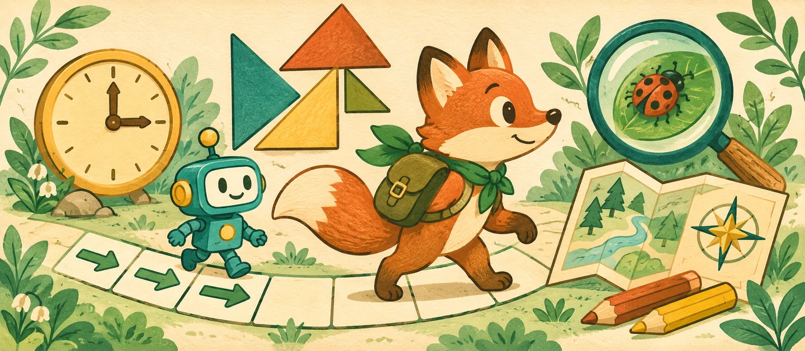
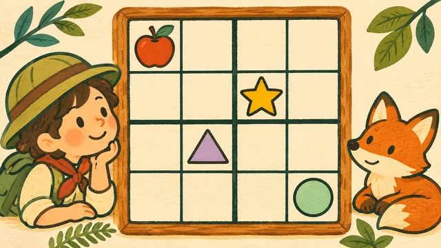
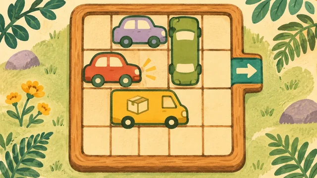
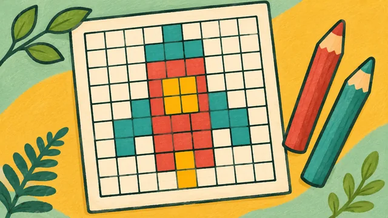

<!--
SPDX-FileCopyrightText: 2026 Milan Jankovec
SPDX-License-Identifier: EUPL-1.2
-->

# Junior Explorers

[Slovenčina](README.sk.md) · [English](README.en.md) · [Čeština](README.cs.md) · [Deutsch](README.de.md) · [Polski](README.pl.md) · [Magyar](README.hu.md) · [Français](README.fr.md) · [Español](README.es.md) · [Italiano](README.it.md) · [Português](README.pt.md) · [Nederlands](README.nl.md) · **Română** · [Українська](README.uk.md) · [Ελληνικά](README.el.md) · [Svenska](README.sv.md) · [简体中文](README.zh-Hans.md) · [繁體中文](README.zh-Hant.md) · [日本語](README.ja.md) · [한국어](README.ko.md) · [Bahasa Indonesia](README.id.md) · [Türkçe](README.tr.md) · [Tiếng Việt](README.vi.md) · [Português (Brasil)](README.pt-BR.md)

Junior Explorers este o colecție gratuită și multilingvă de 75 de jocuri în browser pentru copii de aproximativ 6–9 ani. Interfața este disponibilă în 23 de limbi, iar jocurile au trei niveluri de dificultate. Limba implicită este engleza. Poți juca folosind mouse-ul, ecranul tactil sau tastatura. Cu tasta Tab te deplasezi între comenzi, iar cu Enter sau bara de spațiu activezi comanda selectată. Jocurile sunt organizate în catalog pe categorii.

Jocurile Vânător de cuvinte, Atelierul Codului Secret și Atelier de silabe folosesc liste de cuvinte în slovacă, cehă și engleză. Pentru celelalte limbi ale interfeței, jocurile folosesc listele în engleză.

Folosește linkul de tipărire din joc sau de pe fișa jocului din catalog pentru a deschide fișa de lucru aferentă aceleiași sarcini. Paginile cu răspunsuri sunt opționale. În fereastra de tipărire a browserului, alege să salvezi ca PDF sau să tipărești pe hârtie A4. Tipărește tangramurile la scară de 100%.

## Joc fără internet

Descarcă și dezarhivează fișierul ZIP al depozitului sau clonează depozitul cu Git. Fă dublu clic pe [index.html](../index.html) pentru a deschide jocurile și fișele lor de lucru. Site-ul funcționează în browser fără conexiune la internet și fără server local.

## Joc online

După publicare, deschide [catalogul în limba română](https://milanjankovec.github.io/junior-explorers/?lang=ro) pe GitHub Pages.

## Jocuri

Perechi de rime și Rebus cu imagini au liste de cuvinte în engleză, slovacă și cehă. În celelalte limbi ale interfeței, jocurile folosesc lista în engleză.

### Logică

<table role="presentation">
  <tr>
    <td align="center" valign="top"><a href="../games/smart-memory/index.html?lang=ro"> Memorie inteligentă</a></td>
    <td align="center" valign="top"><a href="../games/tangram/index.html?lang=ro"> Formele tangramului</a></td>
  </tr>
  <tr>
    <td align="center" valign="top"><a href="../games/pattern-builder/index.html?lang=ro"> Termină modelul</a></td>
    <td align="center" valign="top"><a href="../games/picture-sudoku/index.html?lang=ro"> Imaginea Sudoku</a></td>
  </tr>
  <tr>
    <td align="center" valign="top"><a href="../games/logic-detective/index.html?lang=ro"> Cine sunt eu?</a></td>
    <td align="center" valign="top"><a href="../games/river-crossing/index.html?lang=ro"> Trecerea râului</a></td>
  </tr>
  <tr>
    <td align="center" valign="top"><a href="../games/island-bridges/index.html?lang=ro"> Poduri între insule</a></td>
    <td align="center" valign="top"><a href="../games/parking-puzzle/index.html?lang=ro"> Puzzle în parcare</a></td>
  </tr>
  <tr>
    <td align="center" valign="top"><a href="../games/one-stroke/index.html?lang=ro"> Dintr-o singură trasare</a></td>
    <td align="center" valign="top"><a href="../games/light-maze/index.html?lang=ro"> Labirint de lumină</a></td>
  </tr>
  <tr>
    <td align="center" valign="top"><a href="../games/trip-planner/index.html?lang=ro"> Planifică excursia</a></td>
    <td align="center" valign="top"><a href="../games/nonograms/index.html?lang=ro"> Nonograme</a></td>
  </tr>
  <tr>
    <td align="center" valign="top"><a href="../games/campsite-tents/index.html?lang=ro"> Corturi și copaci</a></td>
    <td align="center" valign="top"><a href="../games/cube-nets/index.html?lang=ro"> Desfășurări ale cubului</a></td>
  </tr>
  <tr>
    <td align="center" valign="top"><a href="../games/property-circles/index.html?lang=ro"> Cercuri de sortare</a></td>
  </tr>
</table>

### Matematică

<table role="presentation">
  <tr>
    <td align="center" valign="top"><a href="../games/math-pixel-art/index.html?lang=ro"> Matematica Arta Pixel</a></td>
    <td align="center" valign="top"><a href="../games/treasure-coordinates/index.html?lang=ro"> Coordonatele de comori</a></td>
  </tr>
  <tr>
    <td align="center" valign="top"><a href="../games/clock-master/index.html?lang=ro"> Maestru de ceas</a></td>
    <td align="center" valign="top"><a href="../games/little-shop/index.html?lang=ro"> Micul Magazinist</a></td>
  </tr>
  <tr>
    <td align="center" valign="top"><a href="../games/number-pyramids/index.html?lang=ro"> Numere de piramide</a></td>
    <td align="center" valign="top"><a href="../games/balance-scales/index.html?lang=ro"> Echilibrează balanța</a></td>
  </tr>
  <tr>
    <td align="center" valign="top"><a href="../games/pizza-fractions/index.html?lang=ro"> Fracții cu pizza</a></td>
    <td align="center" valign="top"><a href="../games/garden-fence/index.html?lang=ro"> Împrejmuiește grădina</a></td>
  </tr>
  <tr>
    <td align="center" valign="top"><a href="../games/calendar-quest/index.html?lang=ro"> Aventură în calendar</a></td>
    <td align="center" valign="top"><a href="../games/picture-graphs/index.html?lang=ro"> Grafice cu imagini</a></td>
  </tr>
  <tr>
    <td align="center" valign="top"><a href="../games/cube-builder/index.html?lang=ro"> Construiește din cuburi</a></td>
    <td align="center" valign="top"><a href="../games/measurement-workshop/index.html?lang=ro"> Atelierul de măsurare</a></td>
  </tr>
  <tr>
    <td align="center" valign="top"><a href="../games/tens-factory/index.html?lang=ro"> Fabrica de zeci</a></td>
    <td align="center" valign="top"><a href="../games/number-elevator/index.html?lang=ro"> Liftul numerelor</a></td>
  </tr>
  <tr>
    <td align="center" valign="top"><a href="../games/water-jugs/index.html?lang=ro"> Vase de măsurat</a></td>
    <td align="center" valign="top"><a href="../games/multiplication-arrays/index.html?lang=ro"> Dreptunghiurile înmulțirii</a></td>
  </tr>
  <tr>
    <td align="center" valign="top"><a href="../games/chance-bag/index.html?lang=ro"> Săculeți cu șanse</a></td>
    <td align="center" valign="top"><a href="../games/snack-buffet/index.html?lang=ro"> Bufet de gustări</a></td>
  </tr>
</table>

### Limbă

<table role="presentation">
  <tr>
    <td align="center" valign="top"><a href="../games/secret-code/index.html?lang=ro"> Atelierul Codului Secret</a></td>
    <td align="center" valign="top"><a href="../games/story-sequence/index.html?lang=ro"> Detectivul timpului</a></td>
  </tr>
  <tr>
    <td align="center" valign="top"><a href="../games/word-search/index.html?lang=ro"> Vânător de cuvinte</a></td>
    <td align="center" valign="top"><a href="../games/syllable-workshop/index.html?lang=ro"> Atelier de silabe</a></td>
  </tr>
  <tr>
    <td align="center" valign="top"><a href="../games/read-and-draw/index.html?lang=ro"> Citește și desenează</a></td>
    <td align="center" valign="top"><a href="../games/rhyme-pairs/index.html?lang=ro"> Perechi de rime</a></td>
  </tr>
  <tr>
    <td align="center" valign="top"><a href="../games/picture-crossword/index.html?lang=ro"> Rebus cu imagini</a></td>
    <td align="center" valign="top"><a href="../games/word-ladder/index.html?lang=ro"> Scara cuvintelor</a></td>
  </tr>
  <tr>
    <td align="center" valign="top"><a href="../games/sentence-builder/index.html?lang=ro"> Construiește o propoziție</a></td>
  </tr>
</table>

### Natură

<table role="presentation">
  <tr>
    <td align="center" valign="top"><a href="../games/eco-sort/index.html?lang=ro"> Salvatorul planetelor</a></td>
    <td align="center" valign="top"><a href="../games/animal-food/index.html?lang=ro"> Cine ce mănâncă?</a></td>
  </tr>
  <tr>
    <td align="center" valign="top"><a href="../games/life-cycles/index.html?lang=ro"> Exploratorul Natura</a></td>
    <td align="center" valign="top"><a href="../games/weather-lab/index.html?lang=ro"> Micul meteorolog</a></td>
  </tr>
  <tr>
    <td align="center" valign="top"><a href="../games/forest-tracks/index.html?lang=ro"> Urme în pădure</a></td>
    <td align="center" valign="top"><a href="../games/garden-experiment/index.html?lang=ro"> Experiment în grădină</a></td>
  </tr>
  <tr>
    <td align="center" valign="top"><a href="../games/shadow-playground/index.html?lang=ro"> Umbre la locul de joacă</a></td>
    <td align="center" valign="top"><a href="../games/magnet-workshop/index.html?lang=ro"> Atelierul de magneți</a></td>
  </tr>
  <tr>
    <td align="center" valign="top"><a href="../games/rain-flow/index.html?lang=ro"> Unde se duce apa de ploaie?</a></td>
    <td align="center" valign="top"><a href="../games/float-or-sink/index.html?lang=ro"> Plutește sau se scufundă?</a></td>
  </tr>
  <tr>
    <td align="center" valign="top"><a href="../games/day-and-night/index.html?lang=ro"> Zi și noapte</a></td>
    <td align="center" valign="top"><a href="../games/light-a-bulb/index.html?lang=ro"> Aprinde un bec</a></td>
  </tr>
</table>

### Programare

<table role="presentation">
  <tr>
    <td align="center" valign="top"><a href="../games/robot-maze/index.html?lang=ro"> Robotul se întoarce acasă</a></td>
    <td align="center" valign="top"><a href="../games/spaceship-repair/index.html?lang=ro"> Repararea navei spaţiale</a></td>
  </tr>
  <tr>
    <td align="center" valign="top"><a href="../games/debug-the-robot/index.html?lang=ro"> Debug-ul de robot</a></td>
    <td align="center" valign="top"><a href="../games/traffic-program/index.html?lang=ro"> Programează semaforul</a></td>
  </tr>
  <tr>
    <td align="center" valign="top"><a href="../games/event-house/index.html?lang=ro"> Casa magică a evenimentelor</a></td>
    <td align="center" valign="top"><a href="../games/seed-counter/index.html?lang=ro"> Numărător de semințe</a></td>
  </tr>
  <tr>
    <td align="center" valign="top"><a href="../games/stamp-printer/index.html?lang=ro"> Imprimantă cu ștampile</a></td>
    <td align="center" valign="top"><a href="../games/parallel-workshop/index.html?lang=ro"> Lucru în echipă la atelier</a></td>
  </tr>
  <tr>
    <td align="center" valign="top"><a href="../games/sorting-line/index.html?lang=ro"> Bandă de sortare</a></td>
    <td align="center" valign="top"><a href="../games/ticket-machine/index.html?lang=ro"> Automat de bilete</a></td>
  </tr>
</table>

### Creativitate

<table role="presentation">
  <tr>
    <td align="center" valign="top"><a href="../games/symmetry-studio/index.html?lang=ro"> Artistul oglinzii</a></td>
    <td align="center" valign="top"><a href="../games/story-studio/index.html?lang=ro"> Directorul de poveşti</a></td>
  </tr>
  <tr>
    <td align="center" valign="top"><a href="../games/rhythm-master/index.html?lang=ro"> Maestru al ritmului</a></td>
    <td align="center" valign="top"><a href="../games/scene-changes/index.html?lang=ro"> Ce s-a schimbat?</a></td>
  </tr>
  <tr>
    <td align="center" valign="top"><a href="../games/musical-steps/index.html?lang=ro"> Trepte muzicale</a></td>
    <td align="center" valign="top"><a href="../games/frame-animation/index.html?lang=ro"> Animație cadru cu cadru</a></td>
  </tr>
  <tr>
    <td align="center" valign="top"><a href="../games/layered-landscape/index.html?lang=ro"> Peisaj în straturi</a></td>
    <td align="center" valign="top"><a href="../games/stamp-patterns/index.html?lang=ro"> Modele cu ștampile</a></td>
  </tr>
  <tr>
    <td align="center" valign="top"><a href="../games/paper-puppets/index.html?lang=ro"> Păpuși de hârtie</a></td>
    <td align="center" valign="top"><a href="../games/expedition-badge/index.html?lang=ro"> Insigna expediției</a></td>
  </tr>
  <tr>
    <td align="center" valign="top"><a href="../games/colour-lab/index.html?lang=ro"> Laboratorul culorilor</a></td>
  </tr>
</table>

### Previzualizarea fișelor de lucru

Fă clic pe imagine pentru a mări prima pagină a fișei de lucru din fiecare joc. Exemplele sunt în engleză, cu paginile de răspunsuri ascunse.

## Confidențialitate și licență

Poți juca fără cont, instrumente de urmărire, reclame, servicii online sau funcții contra cost. Browserul poate păstra pe dispozitiv limba aleasă, preferințele, jocurile terminate și ciorna benzii desenate. Furnizorul de găzduire poate prelucra jurnalele operaționale obișnuite.

© 2026 Milan Jankovec. Codul sursă original este disponibil sub licența [EUPL-1.2](../LICENSE).
