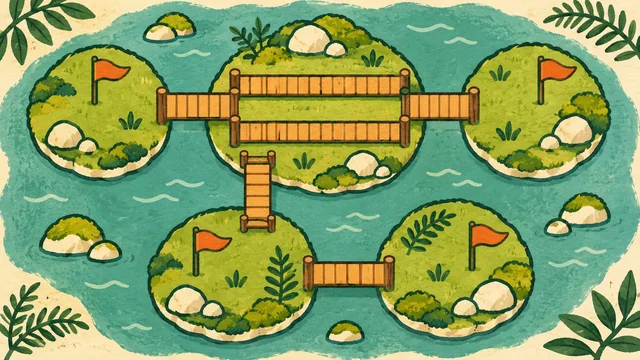
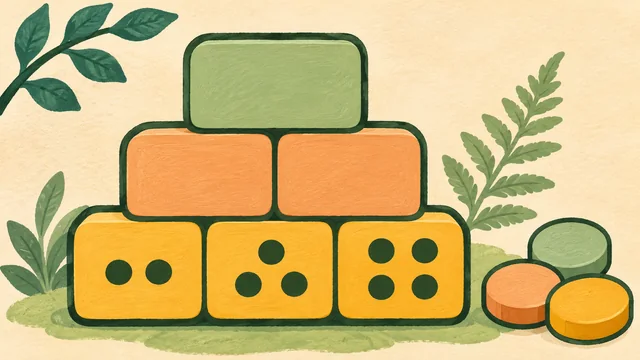
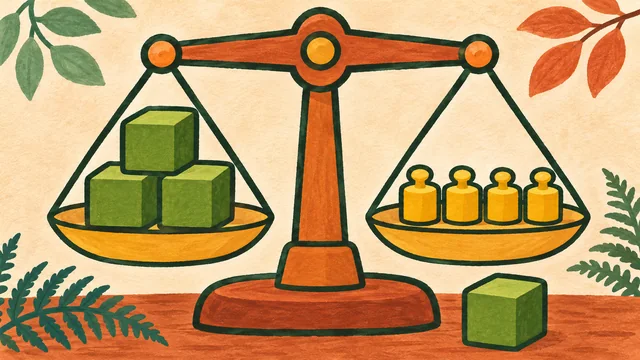
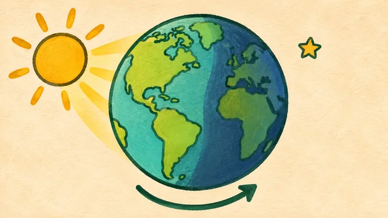

<!--
SPDX-FileCopyrightText: 2026 Milan Jankovec
SPDX-License-Identifier: EUPL-1.2
-->

# Junior Explorers

**Slovenčina** · [English](README.en.md) · [Čeština](README.cs.md) · [Deutsch](README.de.md) · [Polski](README.pl.md) · [Magyar](README.hu.md) · [Français](README.fr.md) · [Español](README.es.md) · [Italiano](README.it.md) · [Português](README.pt.md) · [Nederlands](README.nl.md) · [Română](README.ro.md) · [Українська](README.uk.md) · [Ελληνικά](README.el.md) · [Svenska](README.sv.md) · [简体中文](README.zh-Hans.md) · [繁體中文](README.zh-Hant.md) · [日本語](README.ja.md) · [한국어](README.ko.md) · [Bahasa Indonesia](README.id.md) · [Türkçe](README.tr.md) · [Tiếng Việt](README.vi.md) · [Português (Brasil)](README.pt-BR.md)

Junior Explorers je bezplatná viacjazyčná zbierka 75 hier pre deti približne od 6 do 9 rokov. Vyber si z 23 jazykov rozhrania a troch obtiažností. Predvolená je angličtina. Hraj myšou, dotykom alebo klávesnicou. Kláves Tab presúva výber, Enter alebo medzerník aktivuje ovládací prvok. Hry sú v katalógu usporiadané podľa kategórií.

Slovný lovec, Detektívna šifrovacia dielňa a Slabiková dielňa majú slovenské, české a anglické slovníky. Pri ostatných jazykoch rozhrania používajú anglické slová.

Odkaz na tlač pri hre alebo na jej karte otvorí pracovný list pre rovnaké zadanie. Strany s riešením sú voliteľné. V tlačovom dialógu vyber A4 alebo Uložiť ako PDF. Tangram tlač v mierke 100 %.

## Hranie bez internetu

Stiahni a rozbaľ ZIP repozitára alebo ho naklonuj cez Git. Dvakrát klikni na [index.html](../index.html) a otvor hry aj ich pracovné listy. Web funguje bez pripojenia či lokálneho servera.

## Hranie online

Po publikovaní otvor [katalóg v slovenčine](https://milanjankovec.github.io/junior-explorers/?lang=sk) na GitHub Pages.

## Hry

Rýmovacie dvojice a Obrázková krížovka majú slovenskú, českú a anglickú sadu slov. Pri ostatných jazykoch rozhrania používajú anglickú sadu.

### Logika

<table role="presentation">
  <tr>
    <td align="center" valign="top"><a href="../games/smart-memory/index.html?lang=sk"> Smart pexeso</a></td>
    <td align="center" valign="top"><a href="../games/tangram/index.html?lang=sk"> Geometrický tangram</a></td>
  </tr>
  <tr>
    <td align="center" valign="top"><a href="../games/pattern-builder/index.html?lang=sk"> Dokonči vzor</a></td>
    <td align="center" valign="top"><a href="../games/picture-sudoku/index.html?lang=sk"> Obrázkové sudoku</a></td>
  </tr>
  <tr>
    <td align="center" valign="top"><a href="../games/logic-detective/index.html?lang=sk"> Kto som?</a></td>
    <td align="center" valign="top"><a href="../games/river-crossing/index.html?lang=sk"> Most cez rieku</a></td>
  </tr>
  <tr>
    <td align="center" valign="top"><a href="../games/island-bridges/index.html?lang=sk"> Mosty medzi ostrovmi</a></td>
    <td align="center" valign="top"><a href="../games/parking-puzzle/index.html?lang=sk"> Zablokované parkovisko</a></td>
  </tr>
  <tr>
    <td align="center" valign="top"><a href="../games/one-stroke/index.html?lang=sk"> Jedným ťahom</a></td>
    <td align="center" valign="top"><a href="../games/light-maze/index.html?lang=sk"> Svetlo v bludisku</a></td>
  </tr>
  <tr>
    <td align="center" valign="top"><a href="../games/trip-planner/index.html?lang=sk"> Naplánuj výlet</a></td>
    <td align="center" valign="top"><a href="../games/nonograms/index.html?lang=sk"> Maľované krížovky</a></td>
  </tr>
  <tr>
    <td align="center" valign="top"><a href="../games/campsite-tents/index.html?lang=sk"> Kemp pod stromami</a></td>
    <td align="center" valign="top"><a href="../games/cube-nets/index.html?lang=sk"> Rozložená kocka</a></td>
  </tr>
  <tr>
    <td align="center" valign="top"><a href="../games/property-circles/index.html?lang=sk"> Kruhy vlastností</a></td>
  </tr>
</table>

### Matematika

<table role="presentation">
  <tr>
    <td align="center" valign="top"><a href="../games/math-pixel-art/index.html?lang=sk"> Matematické pixelové maľovanie</a></td>
    <td align="center" valign="top"><a href="../games/treasure-coordinates/index.html?lang=sk"> Lovci pokladov</a></td>
  </tr>
  <tr>
    <td align="center" valign="top"><a href="../games/clock-master/index.html?lang=sk"> Majster času</a></td>
    <td align="center" valign="top"><a href="../games/little-shop/index.html?lang=sk"> Malý obchodník</a></td>
  </tr>
  <tr>
    <td align="center" valign="top"><a href="../games/number-pyramids/index.html?lang=sk"> Číselné pyramídy</a></td>
    <td align="center" valign="top"><a href="../games/balance-scales/index.html?lang=sk"> Vyváž váhy</a></td>
  </tr>
  <tr>
    <td align="center" valign="top"><a href="../games/pizza-fractions/index.html?lang=sk"> Rozdeľ pizzu</a></td>
    <td align="center" valign="top"><a href="../games/garden-fence/index.html?lang=sk"> Oploť záhradku</a></td>
  </tr>
  <tr>
    <td align="center" valign="top"><a href="../games/calendar-quest/index.html?lang=sk"> Kalendárová výprava</a></td>
    <td align="center" valign="top"><a href="../games/picture-graphs/index.html?lang=sk"> Obrázkový graf</a></td>
  </tr>
  <tr>
    <td align="center" valign="top"><a href="../games/cube-builder/index.html?lang=sk"> Staviteľ z kociek</a></td>
    <td align="center" valign="top"><a href="../games/measurement-workshop/index.html?lang=sk"> Dielňa merania</a></td>
  </tr>
  <tr>
    <td align="center" valign="top"><a href="../games/tens-factory/index.html?lang=sk"> Továreň na desiatky</a></td>
    <td align="center" valign="top"><a href="../games/number-elevator/index.html?lang=sk"> Číselný výťah</a></td>
  </tr>
  <tr>
    <td align="center" valign="top"><a href="../games/water-jugs/index.html?lang=sk"> Nádoby a odmerky</a></td>
    <td align="center" valign="top"><a href="../games/multiplication-arrays/index.html?lang=sk"> Násobilkové obdĺžniky</a></td>
  </tr>
  <tr>
    <td align="center" valign="top"><a href="../games/chance-bag/index.html?lang=sk"> Vrecko náhody</a></td>
    <td align="center" valign="top"><a href="../games/snack-buffet/index.html?lang=sk"> Desiatový bufet</a></td>
  </tr>
</table>

### Jazyk

<table role="presentation">
  <tr>
    <td align="center" valign="top"><a href="../games/secret-code/index.html?lang=sk"> Detektívna šifrovacia dielňa</a></td>
    <td align="center" valign="top"><a href="../games/story-sequence/index.html?lang=sk"> Časový detektív</a></td>
  </tr>
  <tr>
    <td align="center" valign="top"><a href="../games/word-search/index.html?lang=sk"> Slovný lovec</a></td>
    <td align="center" valign="top"><a href="../games/syllable-workshop/index.html?lang=sk"> Slabiková dielňa</a></td>
  </tr>
  <tr>
    <td align="center" valign="top"><a href="../games/read-and-draw/index.html?lang=sk"> Čítaj a nakresli</a></td>
    <td align="center" valign="top"><a href="../games/rhyme-pairs/index.html?lang=sk"> Rýmovacie dvojice</a></td>
  </tr>
  <tr>
    <td align="center" valign="top"><a href="../games/picture-crossword/index.html?lang=sk"> Obrázková krížovka</a></td>
    <td align="center" valign="top"><a href="../games/word-ladder/index.html?lang=sk"> Písmenkový rebrík</a></td>
  </tr>
  <tr>
    <td align="center" valign="top"><a href="../games/sentence-builder/index.html?lang=sk"> Poskladaj vetu</a></td>
  </tr>
</table>

### Príroda

<table role="presentation">
  <tr>
    <td align="center" valign="top"><a href="../games/eco-sort/index.html?lang=sk"> Záchranári planéty</a></td>
    <td align="center" valign="top"><a href="../games/animal-food/index.html?lang=sk"> Kto čo papá?</a></td>
  </tr>
  <tr>
    <td align="center" valign="top"><a href="../games/life-cycles/index.html?lang=sk"> Prírodný bádateľ</a></td>
    <td align="center" valign="top"><a href="../games/weather-lab/index.html?lang=sk"> Malý meteorológ</a></td>
  </tr>
  <tr>
    <td align="center" valign="top"><a href="../games/forest-tracks/index.html?lang=sk"> Stopy v lese</a></td>
    <td align="center" valign="top"><a href="../games/garden-experiment/index.html?lang=sk"> Záhradník na pokus</a></td>
  </tr>
  <tr>
    <td align="center" valign="top"><a href="../games/shadow-playground/index.html?lang=sk"> Tiene na ihrisku</a></td>
    <td align="center" valign="top"><a href="../games/magnet-workshop/index.html?lang=sk"> Magnetická dielňa</a></td>
  </tr>
  <tr>
    <td align="center" valign="top"><a href="../games/rain-flow/index.html?lang=sk"> Kam stečie dážď?</a></td>
    <td align="center" valign="top"><a href="../games/float-or-sink/index.html?lang=sk"> Pláva či klesne?</a></td>
  </tr>
  <tr>
    <td align="center" valign="top"><a href="../games/day-and-night/index.html?lang=sk"> Deň a noc</a></td>
    <td align="center" valign="top"><a href="../games/light-a-bulb/index.html?lang=sk"> Rozsvieť žiarovku</a></td>
  </tr>
</table>

### Programovanie

<table role="presentation">
  <tr>
    <td align="center" valign="top"><a href="../games/robot-maze/index.html?lang=sk"> Robotia cesta domov</a></td>
    <td align="center" valign="top"><a href="../games/spaceship-repair/index.html?lang=sk"> Oprav vesmírnu loď</a></td>
  </tr>
  <tr>
    <td align="center" valign="top"><a href="../games/debug-the-robot/index.html?lang=sk"> Robotov pokazený program</a></td>
    <td align="center" valign="top"><a href="../games/traffic-program/index.html?lang=sk"> Semaforový program</a></td>
  </tr>
  <tr>
    <td align="center" valign="top"><a href="../games/event-house/index.html?lang=sk"> Čarovný domček</a></td>
    <td align="center" valign="top"><a href="../games/seed-counter/index.html?lang=sk"> Počítadlo semien</a></td>
  </tr>
  <tr>
    <td align="center" valign="top"><a href="../games/stamp-printer/index.html?lang=sk"> Pečiatková tlačiareň</a></td>
    <td align="center" valign="top"><a href="../games/parallel-workshop/index.html?lang=sk"> Dvaja v dielni</a></td>
  </tr>
  <tr>
    <td align="center" valign="top"><a href="../games/sorting-line/index.html?lang=sk"> Triediaca linka</a></td>
    <td align="center" valign="top"><a href="../games/ticket-machine/index.html?lang=sk"> Automat na lístky</a></td>
  </tr>
</table>

### Tvorivosť

<table role="presentation">
  <tr>
    <td align="center" valign="top"><a href="../games/symmetry-studio/index.html?lang=sk"> Zrkadlový umelec</a></td>
    <td align="center" valign="top"><a href="../games/story-studio/index.html?lang=sk"> Rozprávkový režisér</a></td>
  </tr>
  <tr>
    <td align="center" valign="top"><a href="../games/rhythm-master/index.html?lang=sk"> Rytmický majster</a></td>
    <td align="center" valign="top"><a href="../games/scene-changes/index.html?lang=sk"> Čo sa zmenilo?</a></td>
  </tr>
  <tr>
    <td align="center" valign="top"><a href="../games/musical-steps/index.html?lang=sk"> Hudobné schodíky</a></td>
    <td align="center" valign="top"><a href="../games/frame-animation/index.html?lang=sk"> Animácia po políčkach</a></td>
  </tr>
  <tr>
    <td align="center" valign="top"><a href="../games/layered-landscape/index.html?lang=sk"> Krajina z vrstiev</a></td>
    <td align="center" valign="top"><a href="../games/stamp-patterns/index.html?lang=sk"> Vzorkovňa pečiatok</a></td>
  </tr>
  <tr>
    <td align="center" valign="top"><a href="../games/paper-puppets/index.html?lang=sk"> Papierové bábky</a></td>
    <td align="center" valign="top"><a href="../games/expedition-badge/index.html?lang=sk"> Odznak výpravy</a></td>
  </tr>
  <tr>
    <td align="center" valign="top"><a href="../games/colour-lab/index.html?lang=sk"> Farebné laboratórium</a></td>
  </tr>
</table>

### Náhľady tlače

Kliknutím na obrázok zväčšíš prvú stranu pracovného listu každej hry. Ukážky sú v angličtine s vypnutým zobrazením riešení.

## Súkromie a licencia

Hrá sa bez registrácie, reklám, analytiky, platených funkcií a externých služieb. Prehliadač môže lokálne uložiť jazyk, nastavenia, dokončené hry a rozpracovaný komiks. Hosting môže spracovať bežné prevádzkové záznamy.

© 2026 Milan Jankovec. Pôvodný zdrojový kód je pod licenciou [EUPL-1.2](../LICENSE).
