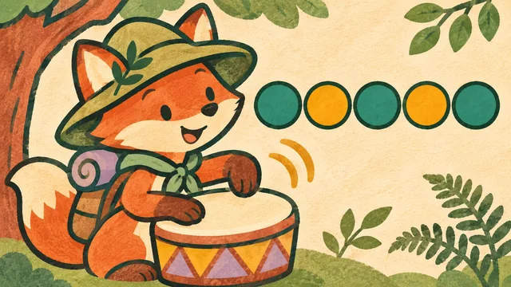

<!--
SPDX-FileCopyrightText: 2026 Milan Jankovec
SPDX-License-Identifier: EUPL-1.2
-->

# Junior Explorers

[Slovenčina](README.sk.md) · [English](README.en.md) · [Čeština](README.cs.md) · [Deutsch](README.de.md) · [Polski](README.pl.md) · [Magyar](README.hu.md) · [Français](README.fr.md) · [Español](README.es.md) · [Italiano](README.it.md) · [Português](README.pt.md) · [Nederlands](README.nl.md) · [Română](README.ro.md) · [Українська](README.uk.md) · [Ελληνικά](README.el.md) · **Svenska** · [简体中文](README.zh-Hans.md) · [繁體中文](README.zh-Hant.md) · [日本語](README.ja.md) · [한국어](README.ko.md) · [Bahasa Indonesia](README.id.md) · [Türkçe](README.tr.md) · [Tiếng Việt](README.vi.md) · [Português (Brasil)](README.pt-BR.md)

Junior Explorers är en kostnadsfri, flerspråkig samling med 75 webbläsarspel för barn i ungefär 6–9-årsåldern. Du kan välja mellan 23 språk och tre svårighetsgrader. Engelska är standardspråk. Spela med mus, pekskärm eller tangentbord. På tangentbordet flyttar Tab fokus och Enter eller mellanslag aktiverar det valda alternativet. Spelen är ordnade i kategorier i katalogen.

Ordjägare, spelet med hemliga koder och Stavelseverkstaden använder slovakiska, tjeckiska och engelska ordlistor. För övriga språk i gränssnittet använder de engelska ordlistor.

Använd utskriftslänken i spelet eller på spelkortet i katalogen för att öppna arbetsbladet med samma uppgift. Du kan välja om facitsidor ska ingå. Välj Spara som PDF i webbläsarens utskriftsfönster eller skriv ut på A4-papper. Skriv ut tangram i 100 % skala.

## Spela utan internet

Ladda ner och packa upp kodförrådets ZIP-fil eller klona kodförrådet med Git. Dubbelklicka på [index.html](../index.html) för att öppna spelen och arbetsbladen. Webbplatsen fungerar i webbläsaren utan internetanslutning och utan en lokal server.

## Spela på webben

När webbplatsen har publicerats kan du öppna [katalogen på svenska](https://milanjankovec.github.io/junior-explorers/?lang=sv) på GitHub Pages.

## Spel

Rimpar och Bildkorsord har engelska, slovakiska och tjeckiska ordlistor. För övriga språk i gränssnittet använder spelen engelska ordlistor.

### Logik

<table role="presentation">
  <tr>
    <td align="center" valign="top"><a href="../games/smart-memory/index.html?lang=sv"> Smarta minnen</a></td>
    <td align="center" valign="top"><a href="../games/tangram/index.html?lang=sv"> Tangramformar</a></td>
  </tr>
  <tr>
    <td align="center" valign="top"><a href="../games/pattern-builder/index.html?lang=sv"> Slutför mönstret</a></td>
    <td align="center" valign="top"><a href="../games/picture-sudoku/index.html?lang=sv"> Bilder av Sudoku</a></td>
  </tr>
  <tr>
    <td align="center" valign="top"><a href="../games/logic-detective/index.html?lang=sv"> - Vem är jag?</a></td>
    <td align="center" valign="top"><a href="../games/river-crossing/index.html?lang=sv"> Flodövergång</a></td>
  </tr>
  <tr>
    <td align="center" valign="top"><a href="../games/island-bridges/index.html?lang=sv"> Broar mellan öar</a></td>
    <td align="center" valign="top"><a href="../games/parking-puzzle/index.html?lang=sv"> Parkeringspussel</a></td>
  </tr>
  <tr>
    <td align="center" valign="top"><a href="../games/one-stroke/index.html?lang=sv"> I ett enda drag</a></td>
    <td align="center" valign="top"><a href="../games/light-maze/index.html?lang=sv"> Ljuslabyrinten</a></td>
  </tr>
  <tr>
    <td align="center" valign="top"><a href="../games/trip-planner/index.html?lang=sv"> Planera utflykten</a></td>
    <td align="center" valign="top"><a href="../games/nonograms/index.html?lang=sv"> Nonogram</a></td>
  </tr>
  <tr>
    <td align="center" valign="top"><a href="../games/campsite-tents/index.html?lang=sv"> Tält och träd</a></td>
    <td align="center" valign="top"><a href="../games/cube-nets/index.html?lang=sv"> Kubens nät</a></td>
  </tr>
  <tr>
    <td align="center" valign="top"><a href="../games/property-circles/index.html?lang=sv"> Sorteringscirklar</a></td>
  </tr>
</table>

### Matematik

<table role="presentation">
  <tr>
    <td align="center" valign="top"><a href="../games/math-pixel-art/index.html?lang=sv"> Matematik Pixel Art</a></td>
    <td align="center" valign="top"><a href="../games/treasure-coordinates/index.html?lang=sv"> Skatteförhållanden</a></td>
  </tr>
  <tr>
    <td align="center" valign="top"><a href="../games/clock-master/index.html?lang=sv"> Klockan mästare</a></td>
    <td align="center" valign="top"><a href="../games/little-shop/index.html?lang=sv"> Lilla Affärsmästaren</a></td>
  </tr>
  <tr>
    <td align="center" valign="top"><a href="../games/number-pyramids/index.html?lang=sv"> Numrerade pyramider</a></td>
    <td align="center" valign="top"><a href="../games/balance-scales/index.html?lang=sv"> Balansera vågen</a></td>
  </tr>
  <tr>
    <td align="center" valign="top"><a href="../games/pizza-fractions/index.html?lang=sv"> Bråktal med pizza</a></td>
    <td align="center" valign="top"><a href="../games/garden-fence/index.html?lang=sv"> Sätt staket runt trädgården</a></td>
  </tr>
  <tr>
    <td align="center" valign="top"><a href="../games/calendar-quest/index.html?lang=sv"> Kalenderäventyret</a></td>
    <td align="center" valign="top"><a href="../games/picture-graphs/index.html?lang=sv"> Bilddiagram</a></td>
  </tr>
  <tr>
    <td align="center" valign="top"><a href="../games/cube-builder/index.html?lang=sv"> Kubbyggaren</a></td>
    <td align="center" valign="top"><a href="../games/measurement-workshop/index.html?lang=sv"> Mätverkstaden</a></td>
  </tr>
  <tr>
    <td align="center" valign="top"><a href="../games/tens-factory/index.html?lang=sv"> Tiotalsfabriken</a></td>
    <td align="center" valign="top"><a href="../games/number-elevator/index.html?lang=sv"> Talhissen</a></td>
  </tr>
  <tr>
    <td align="center" valign="top"><a href="../games/water-jugs/index.html?lang=sv"> Mätkannor</a></td>
    <td align="center" valign="top"><a href="../games/multiplication-arrays/index.html?lang=sv"> Multiplikationsrektanglar</a></td>
  </tr>
  <tr>
    <td align="center" valign="top"><a href="../games/chance-bag/index.html?lang=sv"> Sannolikhetspåsar</a></td>
    <td align="center" valign="top"><a href="../games/snack-buffet/index.html?lang=sv"> Mellanmålsbuffé</a></td>
  </tr>
</table>

### Språk

<table role="presentation">
  <tr>
    <td align="center" valign="top"><a href="../games/secret-code/index.html?lang=sv"> Hemliga koder Workshop</a></td>
    <td align="center" valign="top"><a href="../games/story-sequence/index.html?lang=sv"> - Tidens detektiv.</a></td>
  </tr>
  <tr>
    <td align="center" valign="top"><a href="../games/word-search/index.html?lang=sv"> Ordjägare</a></td>
    <td align="center" valign="top"><a href="../games/syllable-workshop/index.html?lang=sv"> Stavelseverkstaden</a></td>
  </tr>
  <tr>
    <td align="center" valign="top"><a href="../games/read-and-draw/index.html?lang=sv"> Läs och rita</a></td>
    <td align="center" valign="top"><a href="../games/rhyme-pairs/index.html?lang=sv"> Rimpar</a></td>
  </tr>
  <tr>
    <td align="center" valign="top"><a href="../games/picture-crossword/index.html?lang=sv"> Bildkorsord</a></td>
    <td align="center" valign="top"><a href="../games/word-ladder/index.html?lang=sv"> Ordstegen</a></td>
  </tr>
  <tr>
    <td align="center" valign="top"><a href="../games/sentence-builder/index.html?lang=sv"> Bygg en mening</a></td>
  </tr>
</table>

### Natur

<table role="presentation">
  <tr>
    <td align="center" valign="top"><a href="../games/eco-sort/index.html?lang=sv"> Planeten räddare</a></td>
    <td align="center" valign="top"><a href="../games/animal-food/index.html?lang=sv"> Vem äter vad?</a></td>
  </tr>
  <tr>
    <td align="center" valign="top"><a href="../games/life-cycles/index.html?lang=sv"> Naturforskare</a></td>
    <td align="center" valign="top"><a href="../games/weather-lab/index.html?lang=sv"> Lilla meteorologen</a></td>
  </tr>
  <tr>
    <td align="center" valign="top"><a href="../games/forest-tracks/index.html?lang=sv"> Spår i skogen</a></td>
    <td align="center" valign="top"><a href="../games/garden-experiment/index.html?lang=sv"> Trädgårdsexperimentet</a></td>
  </tr>
  <tr>
    <td align="center" valign="top"><a href="../games/shadow-playground/index.html?lang=sv"> Skuggor på lekplatsen</a></td>
    <td align="center" valign="top"><a href="../games/magnet-workshop/index.html?lang=sv"> Magnetverkstaden</a></td>
  </tr>
  <tr>
    <td align="center" valign="top"><a href="../games/rain-flow/index.html?lang=sv"> Vart rinner regnet?</a></td>
    <td align="center" valign="top"><a href="../games/float-or-sink/index.html?lang=sv"> Flyter eller sjunker?</a></td>
  </tr>
  <tr>
    <td align="center" valign="top"><a href="../games/day-and-night/index.html?lang=sv"> Dag och natt</a></td>
    <td align="center" valign="top"><a href="../games/light-a-bulb/index.html?lang=sv"> Tänd en lampa</a></td>
  </tr>
</table>

### Programmering

<table role="presentation">
  <tr>
    <td align="center" valign="top"><a href="../games/robot-maze/index.html?lang=sv"> Robotar är på väg hem</a></td>
    <td align="center" valign="top"><a href="../games/spaceship-repair/index.html?lang=sv"> Rymdskips reparation</a></td>
  </tr>
  <tr>
    <td align="center" valign="top"><a href="../games/debug-the-robot/index.html?lang=sv"> Debugger robot</a></td>
    <td align="center" valign="top"><a href="../games/traffic-program/index.html?lang=sv"> Programmera trafikljuset</a></td>
  </tr>
  <tr>
    <td align="center" valign="top"><a href="../games/event-house/index.html?lang=sv"> Det magiska händelsehuset</a></td>
    <td align="center" valign="top"><a href="../games/seed-counter/index.html?lang=sv"> Fröräknaren</a></td>
  </tr>
  <tr>
    <td align="center" valign="top"><a href="../games/stamp-printer/index.html?lang=sv"> Stämpelskrivaren</a></td>
    <td align="center" valign="top"><a href="../games/parallel-workshop/index.html?lang=sv"> Lagjobb i verkstaden</a></td>
  </tr>
  <tr>
    <td align="center" valign="top"><a href="../games/sorting-line/index.html?lang=sv"> Sorteringsbandet</a></td>
    <td align="center" valign="top"><a href="../games/ticket-machine/index.html?lang=sv"> Biljettautomaten</a></td>
  </tr>
</table>

### Kreativitet

<table role="presentation">
  <tr>
    <td align="center" valign="top"><a href="../games/symmetry-studio/index.html?lang=sv"> Spegelkonstnär</a></td>
    <td align="center" valign="top"><a href="../games/story-studio/index.html?lang=sv"> Historiedirektör</a></td>
  </tr>
  <tr>
    <td align="center" valign="top"><a href="../games/rhythm-master/index.html?lang=sv"> Rytmmästare</a></td>
    <td align="center" valign="top"><a href="../games/scene-changes/index.html?lang=sv"> Vad har förändrats?</a></td>
  </tr>
  <tr>
    <td align="center" valign="top"><a href="../games/musical-steps/index.html?lang=sv"> Musiktrappan</a></td>
    <td align="center" valign="top"><a href="../games/frame-animation/index.html?lang=sv"> Bild för bild-animation</a></td>
  </tr>
  <tr>
    <td align="center" valign="top"><a href="../games/layered-landscape/index.html?lang=sv"> Landskap i lager</a></td>
    <td align="center" valign="top"><a href="../games/stamp-patterns/index.html?lang=sv"> Stämpelmönster</a></td>
  </tr>
  <tr>
    <td align="center" valign="top"><a href="../games/paper-puppets/index.html?lang=sv"> Pappersdockor</a></td>
    <td align="center" valign="top"><a href="../games/expedition-badge/index.html?lang=sv"> Expeditionsmärke</a></td>
  </tr>
  <tr>
    <td align="center" valign="top"><a href="../games/colour-lab/index.html?lang=sv"> Färglabbet</a></td>
  </tr>
</table>

### Förhandsvisning av arbetsblad

Klicka på bilden för att förstora förstasidan på varje spels arbetsblad. Exemplen är på engelska och facitsidorna är dolda.

## Integritet och licens

Du spelar utan registrering, spårning, annonser, nätverkstjänster eller betalfunktioner. Webbläsaren kan spara språkval, inställningar, avklarade spel och serieutkastet på enheten. Webbhotellet kan behandla vanliga driftloggar.

© 2026 Milan Jankovec. Den ursprungliga källkoden omfattas av licensen [EUPL-1.2](../LICENSE).
