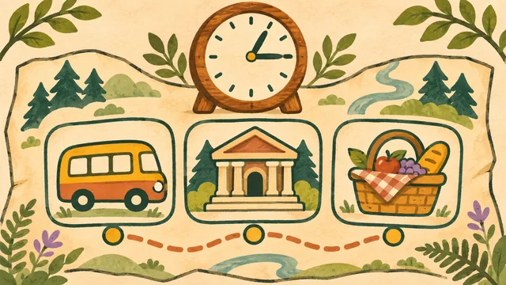
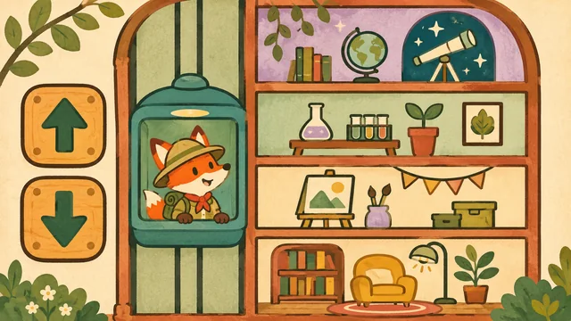
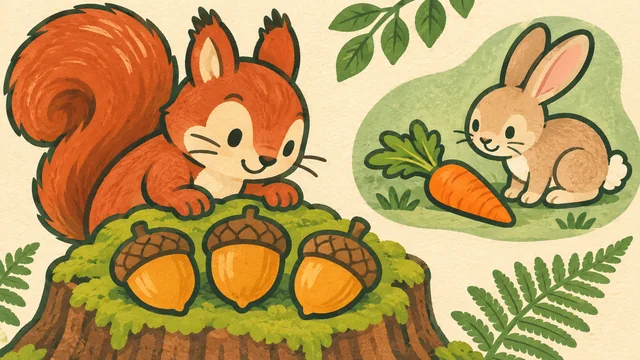
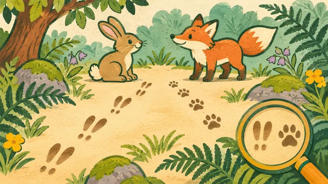
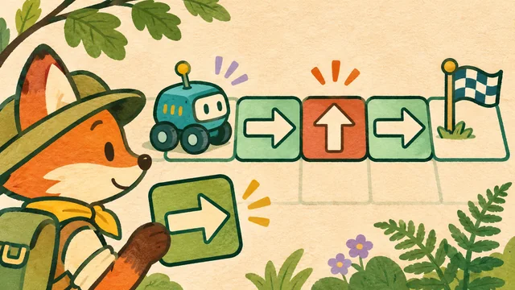
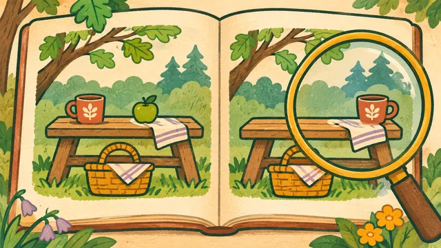
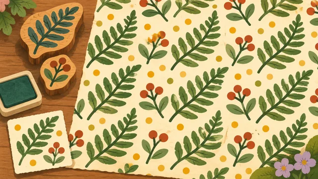

<!--
SPDX-FileCopyrightText: 2026 Milan Jankovec
SPDX-License-Identifier: EUPL-1.2
-->

# Junior Explorers

[Slovenčina](README.sk.md) · [English](README.en.md) · [Čeština](README.cs.md) · [Deutsch](README.de.md) · [Polski](README.pl.md) · [Magyar](README.hu.md) · [Français](README.fr.md) · [Español](README.es.md) · [Italiano](README.it.md) · [Português](README.pt.md) · [Nederlands](README.nl.md) · [Română](README.ro.md) · **Українська** · [Ελληνικά](README.el.md) · [Svenska](README.sv.md) · [简体中文](README.zh-Hans.md) · [繁體中文](README.zh-Hant.md) · [日本語](README.ja.md) · [한국어](README.ko.md) · [Bahasa Indonesia](README.id.md) · [Türkçe](README.tr.md) · [Tiếng Việt](README.vi.md) · [Português (Brasil)](README.pt-BR.md)

Junior Explorers — безкоштовна багатомовна збірка з 75 браузерної гри для дітей віком приблизно 6–9 років. Інтерфейс доступний 23 мовами, а в іграх є три рівні складності. Типова мова — англійська. Грати можна мишею, дотиком або клавіатурою. Клавіша Tab переміщує фокус, а Enter або пробіл активує вибраний елемент. У каталозі ігри згруповані за категоріями.

Ігри з пошуком слів, секретним кодом і складанням слів зі складів мають набори слів словацькою, чеською та англійською. Для інших мов інтерфейсу ці ігри використовують англійські набори.

Скористайся посиланням для друку в грі або на її картці в каталозі, щоб відкрити робочий аркуш із тим самим завданням. Сторінки з відповідями можна додати за потреби. У діалоговому вікні друку браузера вибери збереження у форматі PDF або друк на папері A4. Друкуй танграми в масштабі 100%.

## Гра без інтернету

Завантаж і розпакуй ZIP-архів репозиторію або клонуй репозиторій за допомогою Git. Відкрий [index.html](../index.html) подвійним натисканням, щоб перейти до ігор та їхніх робочих аркушів. Сайт працює в браузері без підключення до інтернету й без локального сервера.

## Гра онлайн

Після публікації відкрий [каталог українською](https://milanjankovec.github.io/junior-explorers/?lang=uk) на GitHub Pages.

## Ігри

Пари рим і Кросворд із малюнками мають набори слів англійською, словацькою та чеською. Для решти мов інтерфейсу ці ігри використовують англійські набори.

### Логіка

<table role="presentation">
  <tr>
    <td align="center" valign="top"><a href="../games/smart-memory/index.html?lang=uk"> Урочна пам'ять</a></td>
    <td align="center" valign="top"><a href="../games/tangram/index.html?lang=uk"> Форми танграму</a></td>
  </tr>
  <tr>
    <td align="center" valign="top"><a href="../games/pattern-builder/index.html?lang=uk"> Докінчить закономір</a></td>
    <td align="center" valign="top"><a href="../games/picture-sudoku/index.html?lang=uk"> Картина Судоку</a></td>
  </tr>
  <tr>
    <td align="center" valign="top"><a href="../games/logic-detective/index.html?lang=uk"> Хто я?</a></td>
    <td align="center" valign="top"><a href="../games/river-crossing/index.html?lang=uk"> Перехід річки</a></td>
  </tr>
  <tr>
    <td align="center" valign="top"><a href="../games/island-bridges/index.html?lang=uk"> Мости між островами</a></td>
    <td align="center" valign="top"><a href="../games/parking-puzzle/index.html?lang=uk"> Головоломка на парковці</a></td>
  </tr>
  <tr>
    <td align="center" valign="top"><a href="../games/one-stroke/index.html?lang=uk"> Одним розчерком</a></td>
    <td align="center" valign="top"><a href="../games/light-maze/index.html?lang=uk"> Світло в лабіринті</a></td>
  </tr>
  <tr>
    <td align="center" valign="top"><a href="../games/trip-planner/index.html?lang=uk"> Сплануй подорож</a></td>
    <td align="center" valign="top"><a href="../games/nonograms/index.html?lang=uk"> Японські кросворди</a></td>
  </tr>
  <tr>
    <td align="center" valign="top"><a href="../games/campsite-tents/index.html?lang=uk"> Намети й дерева</a></td>
    <td align="center" valign="top"><a href="../games/cube-nets/index.html?lang=uk"> Розгортки куба</a></td>
  </tr>
  <tr>
    <td align="center" valign="top"><a href="../games/property-circles/index.html?lang=uk"> Кола для сортування</a></td>
  </tr>
</table>

### Математика

<table role="presentation">
  <tr>
    <td align="center" valign="top"><a href="../games/math-pixel-art/index.html?lang=uk"> Математика Піксельний мистецтво</a></td>
    <td align="center" valign="top"><a href="../games/treasure-coordinates/index.html?lang=uk"> Координати скарбу</a></td>
  </tr>
  <tr>
    <td align="center" valign="top"><a href="../games/clock-master/index.html?lang=uk"> Голодок годинника</a></td>
    <td align="center" valign="top"><a href="../games/little-shop/index.html?lang=uk"> Маленький магазинчик</a></td>
  </tr>
  <tr>
    <td align="center" valign="top"><a href="../games/number-pyramids/index.html?lang=uk"> Кількість пірамід</a></td>
    <td align="center" valign="top"><a href="../games/balance-scales/index.html?lang=uk"> Урівноваж терези</a></td>
  </tr>
  <tr>
    <td align="center" valign="top"><a href="../games/pizza-fractions/index.html?lang=uk"> Дроби з піцою</a></td>
    <td align="center" valign="top"><a href="../games/garden-fence/index.html?lang=uk"> Обгороди сад</a></td>
  </tr>
  <tr>
    <td align="center" valign="top"><a href="../games/calendar-quest/index.html?lang=uk"> Календарна пригода</a></td>
    <td align="center" valign="top"><a href="../games/picture-graphs/index.html?lang=uk"> Діаграми з малюнками</a></td>
  </tr>
  <tr>
    <td align="center" valign="top"><a href="../games/cube-builder/index.html?lang=uk"> Будівник із кубиків</a></td>
    <td align="center" valign="top"><a href="../games/measurement-workshop/index.html?lang=uk"> Майстерня вимірювань</a></td>
  </tr>
  <tr>
    <td align="center" valign="top"><a href="../games/tens-factory/index.html?lang=uk"> Фабрика десятків</a></td>
    <td align="center" valign="top"><a href="../games/number-elevator/index.html?lang=uk"> Числовий ліфт</a></td>
  </tr>
  <tr>
    <td align="center" valign="top"><a href="../games/water-jugs/index.html?lang=uk"> Мірні глечики</a></td>
    <td align="center" valign="top"><a href="../games/multiplication-arrays/index.html?lang=uk"> Прямокутники множення</a></td>
  </tr>
  <tr>
    <td align="center" valign="top"><a href="../games/chance-bag/index.html?lang=uk"> Мішечки ймовірностей</a></td>
    <td align="center" valign="top"><a href="../games/snack-buffet/index.html?lang=uk"> Буфет перекусів</a></td>
  </tr>
</table>

### Мова

<table role="presentation">
  <tr>
    <td align="center" valign="top"><a href="../games/secret-code/index.html?lang=uk"> Семінар секретного коду</a></td>
    <td align="center" valign="top"><a href="../games/story-sequence/index.html?lang=uk"> Детектив часу</a></td>
  </tr>
  <tr>
    <td align="center" valign="top"><a href="../games/word-search/index.html?lang=uk"> Словоходар</a></td>
    <td align="center" valign="top"><a href="../games/syllable-workshop/index.html?lang=uk"> Майстерня складів</a></td>
  </tr>
  <tr>
    <td align="center" valign="top"><a href="../games/read-and-draw/index.html?lang=uk"> Читай і малюй</a></td>
    <td align="center" valign="top"><a href="../games/rhyme-pairs/index.html?lang=uk"> Пари рим</a></td>
  </tr>
  <tr>
    <td align="center" valign="top"><a href="../games/picture-crossword/index.html?lang=uk"> Кросворд із малюнками</a></td>
    <td align="center" valign="top"><a href="../games/word-ladder/index.html?lang=uk"> Драбинка слів</a></td>
  </tr>
  <tr>
    <td align="center" valign="top"><a href="../games/sentence-builder/index.html?lang=uk"> Склади речення</a></td>
  </tr>
</table>

### Природа

<table role="presentation">
  <tr>
    <td align="center" valign="top"><a href="../games/eco-sort/index.html?lang=uk"> Збавкувники планети</a></td>
    <td align="center" valign="top"><a href="../games/animal-food/index.html?lang=uk"> Хто що їсть?</a></td>
  </tr>
  <tr>
    <td align="center" valign="top"><a href="../games/life-cycles/index.html?lang=uk"> Вивхідник природи</a></td>
    <td align="center" valign="top"><a href="../games/weather-lab/index.html?lang=uk"> Маленький метеоролог</a></td>
  </tr>
  <tr>
    <td align="center" valign="top"><a href="../games/forest-tracks/index.html?lang=uk"> Сліди в лісі</a></td>
    <td align="center" valign="top"><a href="../games/garden-experiment/index.html?lang=uk"> Експеримент у саду</a></td>
  </tr>
  <tr>
    <td align="center" valign="top"><a href="../games/shadow-playground/index.html?lang=uk"> Тіні на майданчику</a></td>
    <td align="center" valign="top"><a href="../games/magnet-workshop/index.html?lang=uk"> Майстерня магнітів</a></td>
  </tr>
  <tr>
    <td align="center" valign="top"><a href="../games/rain-flow/index.html?lang=uk"> Куди тече дощова вода?</a></td>
    <td align="center" valign="top"><a href="../games/float-or-sink/index.html?lang=uk"> Плаває чи тоне?</a></td>
  </tr>
  <tr>
    <td align="center" valign="top"><a href="../games/day-and-night/index.html?lang=uk"> День і ніч</a></td>
    <td align="center" valign="top"><a href="../games/light-a-bulb/index.html?lang=uk"> Засвіти лампочку</a></td>
  </tr>
</table>

### Програмування

<table role="presentation">
  <tr>
    <td align="center" valign="top"><a href="../games/robot-maze/index.html?lang=uk"> Роботи повертаються додому</a></td>
    <td align="center" valign="top"><a href="../games/spaceship-repair/index.html?lang=uk"> Ремонт космічного корабля</a></td>
  </tr>
  <tr>
    <td align="center" valign="top"><a href="../games/debug-the-robot/index.html?lang=uk"> Виправляйте робот</a></td>
    <td align="center" valign="top"><a href="../games/traffic-program/index.html?lang=uk"> Запрограмуй світлофор</a></td>
  </tr>
  <tr>
    <td align="center" valign="top"><a href="../games/event-house/index.html?lang=uk"> Чарівний будиночок подій</a></td>
    <td align="center" valign="top"><a href="../games/seed-counter/index.html?lang=uk"> Лічильник насіння</a></td>
  </tr>
  <tr>
    <td align="center" valign="top"><a href="../games/stamp-printer/index.html?lang=uk"> Принтер зі штампами</a></td>
    <td align="center" valign="top"><a href="../games/parallel-workshop/index.html?lang=uk"> Командна робота в майстерні</a></td>
  </tr>
  <tr>
    <td align="center" valign="top"><a href="../games/sorting-line/index.html?lang=uk"> Сортувальна стрічка</a></td>
    <td align="center" valign="top"><a href="../games/ticket-machine/index.html?lang=uk"> Квитковий автомат</a></td>
  </tr>
</table>

### Творчість

<table role="presentation">
  <tr>
    <td align="center" valign="top"><a href="../games/symmetry-studio/index.html?lang=uk"> Візерні художник</a></td>
    <td align="center" valign="top"><a href="../games/story-studio/index.html?lang=uk"> Режисер історії</a></td>
  </tr>
  <tr>
    <td align="center" valign="top"><a href="../games/rhythm-master/index.html?lang=uk"> Мастер ритму</a></td>
    <td align="center" valign="top"><a href="../games/scene-changes/index.html?lang=uk"> Що змінилося?</a></td>
  </tr>
  <tr>
    <td align="center" valign="top"><a href="../games/musical-steps/index.html?lang=uk"> Музичні сходинки</a></td>
    <td align="center" valign="top"><a href="../games/frame-animation/index.html?lang=uk"> Покадрова анімація</a></td>
  </tr>
  <tr>
    <td align="center" valign="top"><a href="../games/layered-landscape/index.html?lang=uk"> Багатошаровий пейзаж</a></td>
    <td align="center" valign="top"><a href="../games/stamp-patterns/index.html?lang=uk"> Візерунки зі штампів</a></td>
  </tr>
  <tr>
    <td align="center" valign="top"><a href="../games/paper-puppets/index.html?lang=uk"> Паперові ляльки</a></td>
    <td align="center" valign="top"><a href="../games/expedition-badge/index.html?lang=uk"> Значок експедиції</a></td>
  </tr>
  <tr>
    <td align="center" valign="top"><a href="../games/colour-lab/index.html?lang=uk"> Лабораторія кольорів</a></td>
  </tr>
</table>

### Перегляд перед друком

Натисни на зображення, щоб збільшити першу сторінку робочого аркуша кожної гри. Зразки подано англійською, а сторінки з відповідями приховано.

## Конфіденційність і ліцензія

Грати можна без реєстрації, відстеження, реклами, мережевих служб і платних можливостей. Браузер може зберігати на пристрої вибрану мову, налаштування, завершені ігри й чернетку коміксу. Постачальник хостингу може обробляти стандартні журнали роботи.

© 2026 Milan Jankovec. Оригінальний вихідний код доступний за ліцензією [EUPL-1.2](../LICENSE).
