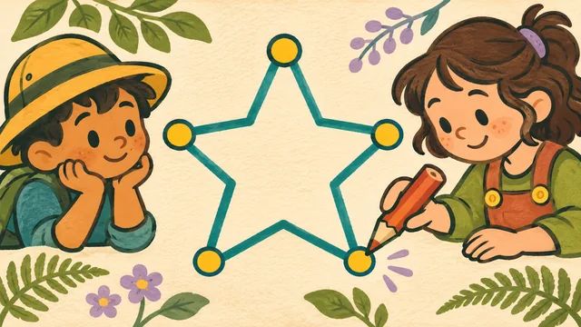
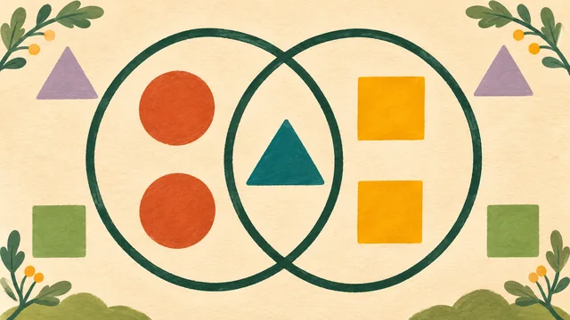
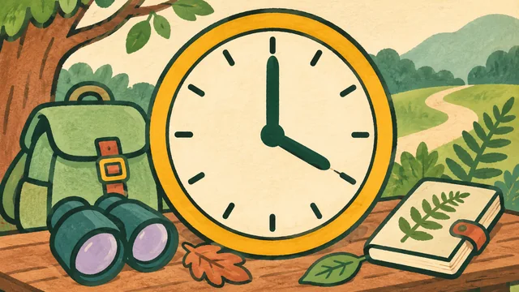
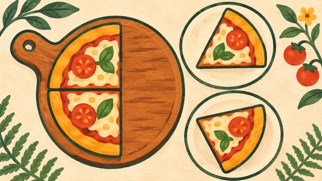
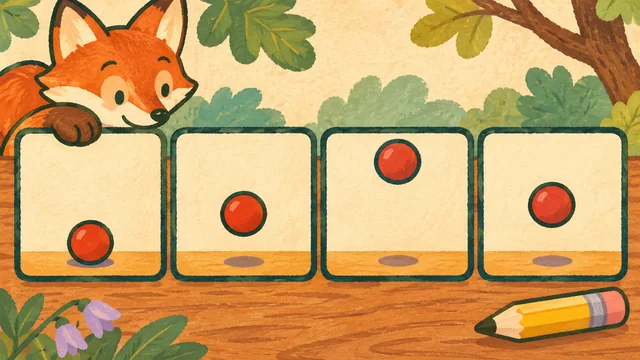

<!--
SPDX-FileCopyrightText: 2026 Milan Jankovec
SPDX-License-Identifier: EUPL-1.2
-->

# Junior Explorers

[Slovenčina](README.sk.md) · [English](README.en.md) · [Čeština](README.cs.md) · [Deutsch](README.de.md) · [Polski](README.pl.md) · [Magyar](README.hu.md) · [Français](README.fr.md) · [Español](README.es.md) · [Italiano](README.it.md) · [Português](README.pt.md) · [Nederlands](README.nl.md) · [Română](README.ro.md) · [Українська](README.uk.md) · [Ελληνικά](README.el.md) · [Svenska](README.sv.md) · [简体中文](README.zh-Hans.md) · [繁體中文](README.zh-Hant.md) · [日本語](README.ja.md) · [한국어](README.ko.md) · [Bahasa Indonesia](README.id.md) · [Türkçe](README.tr.md) · **Tiếng Việt** · [Português (Brasil)](README.pt-BR.md)

Junior Explorers là bộ sưu tập miễn phí gồm 75 trò chơi đa ngôn ngữ trên trình duyệt dành cho trẻ khoảng 6–9 tuổi. Em có thể chọn một trong 23 ngôn ngữ giao diện và ba mức độ khó. Ngôn ngữ mặc định là tiếng Anh. Em có thể chơi bằng chuột, màn hình cảm ứng hoặc bàn phím. Trên bàn phím, dùng phím Tab để di chuyển giữa các mục, rồi nhấn Enter hoặc phím cách để thao tác. Em có thể tìm trò chơi theo chủ đề.

Lời Hunter, Hội thảo mã bí mật và Xưởng âm tiết có kho từ tiếng Slovak, tiếng Séc và tiếng Anh. Khi chọn ngôn ngữ giao diện khác, các trò chơi này sử dụng kho từ tiếng Anh.

Dùng liên kết in trong trò chơi hoặc trên thẻ của trò chơi trong danh mục để mở phiếu bài tập có cùng đề bài. Em có thể chọn in hoặc bỏ qua trang đáp án. Trong hộp thoại in của trình duyệt, chọn Lưu dưới dạng PDF hoặc in trên giấy A4. Hãy in bộ xếp hình tangram ở tỷ lệ 100%.

## Chơi không cần mạng

Tải xuống rồi giải nén tệp ZIP của kho mã, hoặc dùng Git để sao chép kho mã. Nhấp đúp vào [index.html](../index.html) để chơi hoặc mở phiếu bài tập của từng trò chơi. Trang web hoạt động mà không cần kết nối Internet hay máy chủ cục bộ.

## Chơi trực tuyến

Sau khi trang được xuất bản, hãy mở [danh mục trò chơi tiếng Việt](https://milanjankovec.github.io/junior-explorers/?lang=vi) trên GitHub Pages.

## Trò chơi

Cặp từ gieo vần và Ô chữ bằng hình có các bộ từ tiếng Anh, tiếng Slovak và tiếng Séc. Khi chọn ngôn ngữ giao diện khác, hai trò chơi này sử dụng bộ từ tiếng Anh.

### Tư duy logic

<table role="presentation">
  <tr>
    <td align="center" valign="top"><a href="../games/smart-memory/index.html?lang=vi"> Khoảnh khắc thông minh</a></td>
    <td align="center" valign="top"><a href="../games/tangram/index.html?lang=vi"> Hình dạng tangram</a></td>
  </tr>
  <tr>
    <td align="center" valign="top"><a href="../games/pattern-builder/index.html?lang=vi"> Kết thúc mô hình</a></td>
    <td align="center" valign="top"><a href="../games/picture-sudoku/index.html?lang=vi"> Hình ảnh Sudoku</a></td>
  </tr>
  <tr>
    <td align="center" valign="top"><a href="../games/logic-detective/index.html?lang=vi"> Tôi là ai?</a></td>
    <td align="center" valign="top"><a href="../games/river-crossing/index.html?lang=vi"> Quay sông</a></td>
  </tr>
  <tr>
    <td align="center" valign="top"><a href="../games/island-bridges/index.html?lang=vi"> Cầu nối các đảo</a></td>
    <td align="center" valign="top"><a href="../games/parking-puzzle/index.html?lang=vi"> Câu đố bãi đỗ xe</a></td>
  </tr>
  <tr>
    <td align="center" valign="top"><a href="../games/one-stroke/index.html?lang=vi"> Vẽ một nét</a></td>
    <td align="center" valign="top"><a href="../games/light-maze/index.html?lang=vi"> Mê cung ánh sáng</a></td>
  </tr>
  <tr>
    <td align="center" valign="top"><a href="../games/trip-planner/index.html?lang=vi"> Lên kế hoạch chuyến đi</a></td>
    <td align="center" valign="top"><a href="../games/nonograms/index.html?lang=vi"> Ô chữ hình Nonogram</a></td>
  </tr>
  <tr>
    <td align="center" valign="top"><a href="../games/campsite-tents/index.html?lang=vi"> Lều và cây</a></td>
    <td align="center" valign="top"><a href="../games/cube-nets/index.html?lang=vi"> Hình khai triển của khối lập phương</a></td>
  </tr>
  <tr>
    <td align="center" valign="top"><a href="../games/property-circles/index.html?lang=vi"> Vòng tròn phân loại</a></td>
  </tr>
</table>

### Toán học

<table role="presentation">
  <tr>
    <td align="center" valign="top"><a href="../games/math-pixel-art/index.html?lang=vi"> Phương pháp toán học</a></td>
    <td align="center" valign="top"><a href="../games/treasure-coordinates/index.html?lang=vi"> Các điều phối về kho báu</a></td>
  </tr>
  <tr>
    <td align="center" valign="top"><a href="../games/clock-master/index.html?lang=vi"> Thợ đồng hồ</a></td>
    <td align="center" valign="top"><a href="../games/little-shop/index.html?lang=vi"> Người bán hàng nhỏ</a></td>
  </tr>
  <tr>
    <td align="center" valign="top"><a href="../games/number-pyramids/index.html?lang=vi"> Số Kim tự tháp</a></td>
    <td align="center" valign="top"><a href="../games/balance-scales/index.html?lang=vi"> Cân bằng hai đĩa cân</a></td>
  </tr>
  <tr>
    <td align="center" valign="top"><a href="../games/pizza-fractions/index.html?lang=vi"> Phân số với pizza</a></td>
    <td align="center" valign="top"><a href="../games/garden-fence/index.html?lang=vi"> Rào quanh khu vườn</a></td>
  </tr>
  <tr>
    <td align="center" valign="top"><a href="../games/calendar-quest/index.html?lang=vi"> Phiêu lưu cùng lịch</a></td>
    <td align="center" valign="top"><a href="../games/picture-graphs/index.html?lang=vi"> Biểu đồ tranh</a></td>
  </tr>
  <tr>
    <td align="center" valign="top"><a href="../games/cube-builder/index.html?lang=vi"> Xếp khối lập phương</a></td>
    <td align="center" valign="top"><a href="../games/measurement-workshop/index.html?lang=vi"> Xưởng đo độ dài</a></td>
  </tr>
  <tr>
    <td align="center" valign="top"><a href="../games/tens-factory/index.html?lang=vi"> Nhà máy hàng chục</a></td>
    <td align="center" valign="top"><a href="../games/number-elevator/index.html?lang=vi"> Thang máy số</a></td>
  </tr>
  <tr>
    <td align="center" valign="top"><a href="../games/water-jugs/index.html?lang=vi"> Bình đong nước</a></td>
    <td align="center" valign="top"><a href="../games/multiplication-arrays/index.html?lang=vi"> Hình chữ nhật phép nhân</a></td>
  </tr>
  <tr>
    <td align="center" valign="top"><a href="../games/chance-bag/index.html?lang=vi"> Túi xác suất</a></td>
    <td align="center" valign="top"><a href="../games/snack-buffet/index.html?lang=vi"> Tiệc tự chọn món ăn nhẹ</a></td>
  </tr>
</table>

### Ngôn ngữ

<table role="presentation">
  <tr>
    <td align="center" valign="top"><a href="../games/secret-code/index.html?lang=vi"> Hội thảo mã bí mật</a></td>
    <td align="center" valign="top"><a href="../games/story-sequence/index.html?lang=vi"> Time Detective</a></td>
  </tr>
  <tr>
    <td align="center" valign="top"><a href="../games/word-search/index.html?lang=vi"> Lời Hunter</a></td>
    <td align="center" valign="top"><a href="../games/syllable-workshop/index.html?lang=vi"> Xưởng âm tiết</a></td>
  </tr>
  <tr>
    <td align="center" valign="top"><a href="../games/read-and-draw/index.html?lang=vi"> Đọc và vẽ</a></td>
    <td align="center" valign="top"><a href="../games/rhyme-pairs/index.html?lang=vi"> Cặp từ gieo vần</a></td>
  </tr>
  <tr>
    <td align="center" valign="top"><a href="../games/picture-crossword/index.html?lang=vi"> Ô chữ bằng hình</a></td>
    <td align="center" valign="top"><a href="../games/word-ladder/index.html?lang=vi"> Bậc thang từ ngữ</a></td>
  </tr>
  <tr>
    <td align="center" valign="top"><a href="../games/sentence-builder/index.html?lang=vi"> Xếp thành câu</a></td>
  </tr>
</table>

### Thiên nhiên

<table role="presentation">
  <tr>
    <td align="center" valign="top"><a href="../games/eco-sort/index.html?lang=vi"> Những người cứu hành tinh</a></td>
    <td align="center" valign="top"><a href="../games/animal-food/index.html?lang=vi"> Ai ăn gì?</a></td>
  </tr>
  <tr>
    <td align="center" valign="top"><a href="../games/life-cycles/index.html?lang=vi"> Nhà thám hiểm thiên nhiên</a></td>
    <td align="center" valign="top"><a href="../games/weather-lab/index.html?lang=vi"> Tiểu tượng học</a></td>
  </tr>
  <tr>
    <td align="center" valign="top"><a href="../games/forest-tracks/index.html?lang=vi"> Dấu vết trong rừng</a></td>
    <td align="center" valign="top"><a href="../games/garden-experiment/index.html?lang=vi"> Thí nghiệm trong vườn</a></td>
  </tr>
  <tr>
    <td align="center" valign="top"><a href="../games/shadow-playground/index.html?lang=vi"> Bóng ở sân chơi</a></td>
    <td align="center" valign="top"><a href="../games/magnet-workshop/index.html?lang=vi"> Xưởng nam châm</a></td>
  </tr>
  <tr>
    <td align="center" valign="top"><a href="../games/rain-flow/index.html?lang=vi"> Nước mưa chảy về đâu?</a></td>
    <td align="center" valign="top"><a href="../games/float-or-sink/index.html?lang=vi"> Nổi hay chìm?</a></td>
  </tr>
  <tr>
    <td align="center" valign="top"><a href="../games/day-and-night/index.html?lang=vi"> Ngày và đêm</a></td>
    <td align="center" valign="top"><a href="../games/light-a-bulb/index.html?lang=vi"> Thắp sáng bóng đèn</a></td>
  </tr>
</table>

### Lập trình

<table role="presentation">
  <tr>
    <td align="center" valign="top"><a href="../games/robot-maze/index.html?lang=vi"> Robot về nhà</a></td>
    <td align="center" valign="top"><a href="../games/spaceship-repair/index.html?lang=vi"> Cửa chữa tàu vũ trụ</a></td>
  </tr>
  <tr>
    <td align="center" valign="top"><a href="../games/debug-the-robot/index.html?lang=vi"> Trình lỗi robot</a></td>
    <td align="center" valign="top"><a href="../games/traffic-program/index.html?lang=vi"> Lập trình đèn giao thông</a></td>
  </tr>
  <tr>
    <td align="center" valign="top"><a href="../games/event-house/index.html?lang=vi"> Ngôi nhà sự kiện kỳ diệu</a></td>
    <td align="center" valign="top"><a href="../games/seed-counter/index.html?lang=vi"> Máy đếm hạt giống</a></td>
  </tr>
  <tr>
    <td align="center" valign="top"><a href="../games/stamp-printer/index.html?lang=vi"> Máy in con dấu</a></td>
    <td align="center" valign="top"><a href="../games/parallel-workshop/index.html?lang=vi"> Cùng làm việc trong xưởng</a></td>
  </tr>
  <tr>
    <td align="center" valign="top"><a href="../games/sorting-line/index.html?lang=vi"> Băng chuyền sắp xếp</a></td>
    <td align="center" valign="top"><a href="../games/ticket-machine/index.html?lang=vi"> Máy bán vé</a></td>
  </tr>
</table>

### Sáng tạo

<table role="presentation">
  <tr>
    <td align="center" valign="top"><a href="../games/symmetry-studio/index.html?lang=vi"> Nghệ sĩ gương</a></td>
    <td align="center" valign="top"><a href="../games/story-studio/index.html?lang=vi"> Giám đốc câu chuyện</a></td>
  </tr>
  <tr>
    <td align="center" valign="top"><a href="../games/rhythm-master/index.html?lang=vi"> Thạc sĩ nhịp điệu</a></td>
    <td align="center" valign="top"><a href="../games/scene-changes/index.html?lang=vi"> Có gì thay đổi?</a></td>
  </tr>
  <tr>
    <td align="center" valign="top"><a href="../games/musical-steps/index.html?lang=vi"> Bậc thang âm nhạc</a></td>
    <td align="center" valign="top"><a href="../games/frame-animation/index.html?lang=vi"> Hoạt hình từng khung</a></td>
  </tr>
  <tr>
    <td align="center" valign="top"><a href="../games/layered-landscape/index.html?lang=vi"> Phong cảnh nhiều lớp</a></td>
    <td align="center" valign="top"><a href="../games/stamp-patterns/index.html?lang=vi"> Họa tiết con dấu</a></td>
  </tr>
  <tr>
    <td align="center" valign="top"><a href="../games/paper-puppets/index.html?lang=vi"> Rối giấy</a></td>
    <td align="center" valign="top"><a href="../games/expedition-badge/index.html?lang=vi"> Huy hiệu thám hiểm</a></td>
  </tr>
  <tr>
    <td align="center" valign="top"><a href="../games/colour-lab/index.html?lang=vi"> Phòng pha màu</a></td>
  </tr>
</table>

### Xem trước bản in

Nhấp vào ảnh để phóng to trang đầu tiên của phiếu bài tập cho từng trò chơi. Các bản mẫu bằng tiếng Anh và không hiển thị trang đáp án.

## Quyền riêng tư và giấy phép

Em có thể chơi mà không cần đăng ký. Các trò chơi không có trình theo dõi, quảng cáo, dịch vụ mạng hay tính năng trả phí. Trình duyệt có thể lưu ngôn ngữ đã chọn, các tùy chọn, trò chơi đã hoàn thành và bản nháp truyện tranh trên thiết bị. Nhà cung cấp dịch vụ lưu trữ có thể xử lý nhật ký vận hành thông thường.

© 2026 Milan Jankovec. Mã nguồn gốc được cấp phép theo [EUPL-1.2](../LICENSE).
