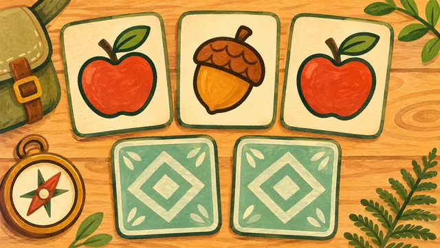
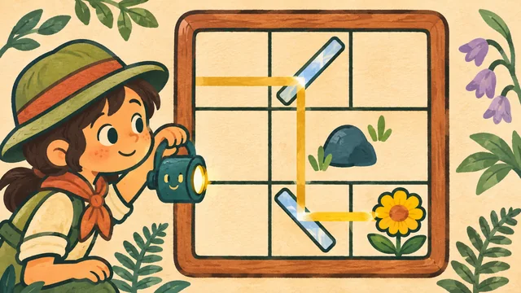
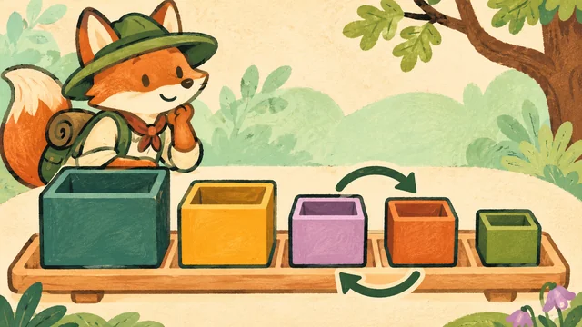
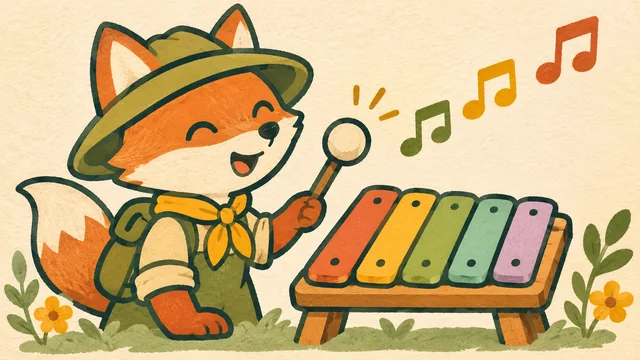

<!--
SPDX-FileCopyrightText: 2026 Milan Jankovec
SPDX-License-Identifier: EUPL-1.2
-->

# Junior Explorers

[Slovenčina](README.sk.md) · [English](README.en.md) · [Čeština](README.cs.md) · [Deutsch](README.de.md) · [Polski](README.pl.md) · [Magyar](README.hu.md) · [Français](README.fr.md) · [Español](README.es.md) · [Italiano](README.it.md) · [Português](README.pt.md) · [Nederlands](README.nl.md) · [Română](README.ro.md) · [Українська](README.uk.md) · [Ελληνικά](README.el.md) · [Svenska](README.sv.md) · **简体中文** · [繁體中文](README.zh-Hant.md) · [日本語](README.ja.md) · [한국어](README.ko.md) · [Bahasa Indonesia](README.id.md) · [Türkçe](README.tr.md) · [Tiếng Việt](README.vi.md) · [Português (Brasil)](README.pt-BR.md)

Junior Explorers 是一套面向 6 至 9 岁儿童的免费多语言浏览器游戏，共有 75 款。你可以选择 23 种界面语言和三个难度等级，默认语言为英语。游戏支持鼠标、触屏和键盘。按 Tab 键切换焦点，按 Enter 键或空格键操作选中的控件。你可以按类别浏览游戏。

「字猎人」「秘密代码研讨会」和「音节工坊」提供斯洛伐克语、捷克语和英语词库。选择其他界面语言时，这些游戏使用英语词库。

点击游戏内或目录卡片上的打印链接，即可打开对应关卡的练习单。你可以选择是否打印答案页。在浏览器的打印对话框中选择「另存为 PDF」，或用 A4 纸打印。打印七巧板时请将缩放比例设为 100%。

## 离线游玩

下载并解压此仓库的 ZIP 文件，或使用 Git 克隆仓库。双击 [index.html](../index.html) 即可玩游戏或打开各个游戏的练习单。网页在没有网络连接的情况下也能使用，无需运行本地服务器。

## 在线游玩

发布后，可以在 GitHub Pages 打开[简体中文游戏目录](https://milanjankovec.github.io/junior-explorers/?lang=zh-Hans)。

## 游戏

「押韵配对」和「看图填字」提供英语、斯洛伐克语和捷克语词库。选择其他界面语言时，这两款游戏使用英语词库。

### 逻辑

<table role="presentation">
  <tr>
    <td align="center" valign="top"><a href="../games/smart-memory/index.html?lang=zh-Hans"> 智能记忆</a></td>
    <td align="center" valign="top"><a href="../games/tangram/index.html?lang=zh-Hans"> 七巧板拼图</a></td>
  </tr>
  <tr>
    <td align="center" valign="top"><a href="../games/pattern-builder/index.html?lang=zh-Hans"> 完成模式</a></td>
    <td align="center" valign="top"><a href="../games/picture-sudoku/index.html?lang=zh-Hans"> 图片:苏多可</a></td>
  </tr>
  <tr>
    <td align="center" valign="top"><a href="../games/logic-detective/index.html?lang=zh-Hans"> 我是谁?</a></td>
    <td align="center" valign="top"><a href="../games/river-crossing/index.html?lang=zh-Hans"> 河流过境</a></td>
  </tr>
  <tr>
    <td align="center" valign="top"><a href="../games/island-bridges/index.html?lang=zh-Hans"> 岛屿连桥</a></td>
    <td align="center" valign="top"><a href="../games/parking-puzzle/index.html?lang=zh-Hans"> 停车解谜</a></td>
  </tr>
  <tr>
    <td align="center" valign="top"><a href="../games/one-stroke/index.html?lang=zh-Hans"> 一笔画</a></td>
    <td align="center" valign="top"><a href="../games/light-maze/index.html?lang=zh-Hans"> 光线迷宫</a></td>
  </tr>
  <tr>
    <td align="center" valign="top"><a href="../games/trip-planner/index.html?lang=zh-Hans"> 规划行程</a></td>
    <td align="center" valign="top"><a href="../games/nonograms/index.html?lang=zh-Hans"> 数字绘图谜题</a></td>
  </tr>
  <tr>
    <td align="center" valign="top"><a href="../games/campsite-tents/index.html?lang=zh-Hans"> 帐篷与树</a></td>
    <td align="center" valign="top"><a href="../games/cube-nets/index.html?lang=zh-Hans"> 正方体展开图</a></td>
  </tr>
  <tr>
    <td align="center" valign="top"><a href="../games/property-circles/index.html?lang=zh-Hans"> 分类圆圈</a></td>
  </tr>
</table>

### 数学

<table role="presentation">
  <tr>
    <td align="center" valign="top"><a href="../games/math-pixel-art/index.html?lang=zh-Hans"> 数学 像素艺术</a></td>
    <td align="center" valign="top"><a href="../games/treasure-coordinates/index.html?lang=zh-Hans"> 财富坐标</a></td>
  </tr>
  <tr>
    <td align="center" valign="top"><a href="../games/clock-master/index.html?lang=zh-Hans"> 钟表师</a></td>
    <td align="center" valign="top"><a href="../games/little-shop/index.html?lang=zh-Hans"> 商店小人</a></td>
  </tr>
  <tr>
    <td align="center" valign="top"><a href="../games/number-pyramids/index.html?lang=zh-Hans"> 数字金字塔</a></td>
    <td align="center" valign="top"><a href="../games/balance-scales/index.html?lang=zh-Hans"> 平衡天平</a></td>
  </tr>
  <tr>
    <td align="center" valign="top"><a href="../games/pizza-fractions/index.html?lang=zh-Hans"> 比萨分数</a></td>
    <td align="center" valign="top"><a href="../games/garden-fence/index.html?lang=zh-Hans"> 花园围栏</a></td>
  </tr>
  <tr>
    <td align="center" valign="top"><a href="../games/calendar-quest/index.html?lang=zh-Hans"> 日历探险</a></td>
    <td align="center" valign="top"><a href="../games/picture-graphs/index.html?lang=zh-Hans"> 图画统计图</a></td>
  </tr>
  <tr>
    <td align="center" valign="top"><a href="../games/cube-builder/index.html?lang=zh-Hans"> 方块搭建师</a></td>
    <td align="center" valign="top"><a href="../games/measurement-workshop/index.html?lang=zh-Hans"> 测量工坊</a></td>
  </tr>
  <tr>
    <td align="center" valign="top"><a href="../games/tens-factory/index.html?lang=zh-Hans"> 十进制工厂</a></td>
    <td align="center" valign="top"><a href="../games/number-elevator/index.html?lang=zh-Hans"> 数字电梯</a></td>
  </tr>
  <tr>
    <td align="center" valign="top"><a href="../games/water-jugs/index.html?lang=zh-Hans"> 量水壶</a></td>
    <td align="center" valign="top"><a href="../games/multiplication-arrays/index.html?lang=zh-Hans"> 乘法长方形</a></td>
  </tr>
  <tr>
    <td align="center" valign="top"><a href="../games/chance-bag/index.html?lang=zh-Hans"> 概率布袋</a></td>
    <td align="center" valign="top"><a href="../games/snack-buffet/index.html?lang=zh-Hans"> 点心自助餐</a></td>
  </tr>
</table>

### 语言

<table role="presentation">
  <tr>
    <td align="center" valign="top"><a href="../games/secret-code/index.html?lang=zh-Hans"> 秘密代码研讨会</a></td>
    <td align="center" valign="top"><a href="../games/story-sequence/index.html?lang=zh-Hans"> 时间侦探</a></td>
  </tr>
  <tr>
    <td align="center" valign="top"><a href="../games/word-search/index.html?lang=zh-Hans"> 字猎人</a></td>
    <td align="center" valign="top"><a href="../games/syllable-workshop/index.html?lang=zh-Hans"> 音节工坊</a></td>
  </tr>
  <tr>
    <td align="center" valign="top"><a href="../games/read-and-draw/index.html?lang=zh-Hans"> 读一读，画一画</a></td>
    <td align="center" valign="top"><a href="../games/rhyme-pairs/index.html?lang=zh-Hans"> 押韵配对</a></td>
  </tr>
  <tr>
    <td align="center" valign="top"><a href="../games/picture-crossword/index.html?lang=zh-Hans"> 看图填字</a></td>
    <td align="center" valign="top"><a href="../games/word-ladder/index.html?lang=zh-Hans"> 单词阶梯</a></td>
  </tr>
  <tr>
    <td align="center" valign="top"><a href="../games/sentence-builder/index.html?lang=zh-Hans"> 组句子</a></td>
  </tr>
</table>

### 自然

<table role="presentation">
  <tr>
    <td align="center" valign="top"><a href="../games/eco-sort/index.html?lang=zh-Hans"> 星球救援人员</a></td>
    <td align="center" valign="top"><a href="../games/animal-food/index.html?lang=zh-Hans"> 谁吃什么?</a></td>
  </tr>
  <tr>
    <td align="center" valign="top"><a href="../games/life-cycles/index.html?lang=zh-Hans"> 自然探险家</a></td>
    <td align="center" valign="top"><a href="../games/weather-lab/index.html?lang=zh-Hans"> 小天气学家</a></td>
  </tr>
  <tr>
    <td align="center" valign="top"><a href="../games/forest-tracks/index.html?lang=zh-Hans"> 森林足迹</a></td>
    <td align="center" valign="top"><a href="../games/garden-experiment/index.html?lang=zh-Hans"> 花园实验</a></td>
  </tr>
  <tr>
    <td align="center" valign="top"><a href="../games/shadow-playground/index.html?lang=zh-Hans"> 游乐场的影子</a></td>
    <td align="center" valign="top"><a href="../games/magnet-workshop/index.html?lang=zh-Hans"> 磁铁工坊</a></td>
  </tr>
  <tr>
    <td align="center" valign="top"><a href="../games/rain-flow/index.html?lang=zh-Hans"> 雨水流向哪里？</a></td>
    <td align="center" valign="top"><a href="../games/float-or-sink/index.html?lang=zh-Hans"> 浮还是沉？</a></td>
  </tr>
  <tr>
    <td align="center" valign="top"><a href="../games/day-and-night/index.html?lang=zh-Hans"> 白天和黑夜</a></td>
    <td align="center" valign="top"><a href="../games/light-a-bulb/index.html?lang=zh-Hans"> 点亮灯泡</a></td>
  </tr>
</table>

### 编程

<table role="presentation">
  <tr>
    <td align="center" valign="top"><a href="../games/robot-maze/index.html?lang=zh-Hans"> 机器人回家</a></td>
    <td align="center" valign="top"><a href="../games/spaceship-repair/index.html?lang=zh-Hans"> 航天器维修</a></td>
  </tr>
  <tr>
    <td align="center" valign="top"><a href="../games/debug-the-robot/index.html?lang=zh-Hans"> 调试机器人</a></td>
    <td align="center" valign="top"><a href="../games/traffic-program/index.html?lang=zh-Hans"> 给红绿灯编程</a></td>
  </tr>
  <tr>
    <td align="center" valign="top"><a href="../games/event-house/index.html?lang=zh-Hans"> 魔法事件小屋</a></td>
    <td align="center" valign="top"><a href="../games/seed-counter/index.html?lang=zh-Hans"> 种子计数器</a></td>
  </tr>
  <tr>
    <td align="center" valign="top"><a href="../games/stamp-printer/index.html?lang=zh-Hans"> 印章打印机</a></td>
    <td align="center" valign="top"><a href="../games/parallel-workshop/index.html?lang=zh-Hans"> 工坊双人合作</a></td>
  </tr>
  <tr>
    <td align="center" valign="top"><a href="../games/sorting-line/index.html?lang=zh-Hans"> 分拣流水线</a></td>
    <td align="center" valign="top"><a href="../games/ticket-machine/index.html?lang=zh-Hans"> 售票机</a></td>
  </tr>
</table>

### 创意

<table role="presentation">
  <tr>
    <td align="center" valign="top"><a href="../games/symmetry-studio/index.html?lang=zh-Hans"> 镜像艺术家</a></td>
    <td align="center" valign="top"><a href="../games/story-studio/index.html?lang=zh-Hans"> 故事导演</a></td>
  </tr>
  <tr>
    <td align="center" valign="top"><a href="../games/rhythm-master/index.html?lang=zh-Hans"> 节奏师</a></td>
    <td align="center" valign="top"><a href="../games/scene-changes/index.html?lang=zh-Hans"> 哪里变了？</a></td>
  </tr>
  <tr>
    <td align="center" valign="top"><a href="../games/musical-steps/index.html?lang=zh-Hans"> 音乐阶梯</a></td>
    <td align="center" valign="top"><a href="../games/frame-animation/index.html?lang=zh-Hans"> 逐帧动画</a></td>
  </tr>
  <tr>
    <td align="center" valign="top"><a href="../games/layered-landscape/index.html?lang=zh-Hans"> 分层风景</a></td>
    <td align="center" valign="top"><a href="../games/stamp-patterns/index.html?lang=zh-Hans"> 印章图案</a></td>
  </tr>
  <tr>
    <td align="center" valign="top"><a href="../games/paper-puppets/index.html?lang=zh-Hans"> 纸偶</a></td>
    <td align="center" valign="top"><a href="../games/expedition-badge/index.html?lang=zh-Hans"> 探险徽章</a></td>
  </tr>
  <tr>
    <td align="center" valign="top"><a href="../games/colour-lab/index.html?lang=zh-Hans"> 色彩实验室</a></td>
  </tr>
</table>

### 打印预览

点击图片可放大查看每款游戏练习单的第一页。示例使用英语，未显示答案页。

## 隐私和许可证

游戏无需注册，没有跟踪器、广告、网络服务或付费功能。浏览器可以在设备上保存语言选择、设置、已完成的游戏和漫画草稿。托管服务提供商可能会处理常规运行日志。

© 2026 Milan Jankovec。原始源代码采用 [EUPL-1.2](../LICENSE) 许可证。
