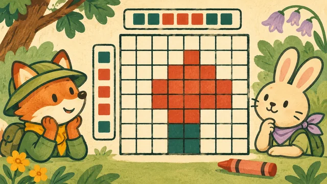
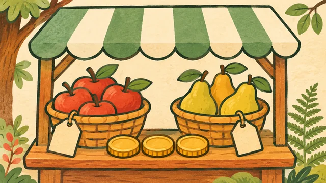
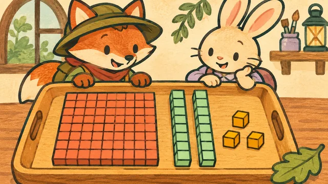

<!--
SPDX-FileCopyrightText: 2026 Milan Jankovec
SPDX-License-Identifier: EUPL-1.2
-->

# Junior Explorers

[Slovenčina](README.sk.md) · [English](README.en.md) · [Čeština](README.cs.md) · [Deutsch](README.de.md) · [Polski](README.pl.md) · [Magyar](README.hu.md) · [Français](README.fr.md) · [Español](README.es.md) · [Italiano](README.it.md) · [Português](README.pt.md) · [Nederlands](README.nl.md) · [Română](README.ro.md) · [Українська](README.uk.md) · [Ελληνικά](README.el.md) · [Svenska](README.sv.md) · [简体中文](README.zh-Hans.md) · **繁體中文** · [日本語](README.ja.md) · [한국어](README.ko.md) · [Bahasa Indonesia](README.id.md) · [Türkçe](README.tr.md) · [Tiếng Việt](README.vi.md) · [Português (Brasil)](README.pt-BR.md)

Junior Explorers 是一套適合 6 至 9 歲兒童的免費多語瀏覽器遊戲，共有 75 款。你可以選擇 23 種介面語言和三種難度，預設語言為英語。遊戲支援滑鼠、觸控和鍵盤。按 Tab 鍵切換焦點，按 Enter 鍵或空白鍵操作選取的控制項。你可以依類別瀏覽遊戲。

「語言獵人」、「秘密代碼研習會」及「音節工坊」提供斯洛伐克語、捷克語和英語字庫。選擇其他介面語言時，這些遊戲會使用英語字庫。

點選遊戲內或目錄卡片上的列印連結，即可開啟相同關卡的學習單。你可以選擇是否列印解答頁。在瀏覽器的列印對話框中選取「另存為 PDF」，或以 A4 紙張列印。列印七巧板時請將比例設為 100%。

## 離線遊玩

下載並解壓縮此儲存庫的 ZIP 檔，或使用 Git 複製儲存庫。按兩下 [index.html](../index.html)，即可遊玩或開啟各遊戲的學習單。網頁不需要網路連線或本機伺服器即可使用。

## 線上遊玩

發布後，可以在 GitHub Pages 開啟[繁體中文遊戲目錄](https://milanjankovec.github.io/junior-explorers/?lang=zh-Hant)。

## 遊戲

「押韻配對」和「看圖填字」提供英語、斯洛伐克語和捷克語字庫。選擇其他介面語言時，這兩款遊戲會使用英語字庫。

### 邏輯

<table role="presentation">
  <tr>
    <td align="center" valign="top"><a href="../games/smart-memory/index.html?lang=zh-Hant"> 智能記憶</a></td>
    <td align="center" valign="top"><a href="../games/tangram/index.html?lang=zh-Hant"> 七巧板拼圖</a></td>
  </tr>
  <tr>
    <td align="center" valign="top"><a href="../games/pattern-builder/index.html?lang=zh-Hant"> 完成這個模式</a></td>
    <td align="center" valign="top"><a href="../games/picture-sudoku/index.html?lang=zh-Hant"> 照片來自 蘇多可</a></td>
  </tr>
  <tr>
    <td align="center" valign="top"><a href="../games/logic-detective/index.html?lang=zh-Hant"> 我是誰?</a></td>
    <td align="center" valign="top"><a href="../games/river-crossing/index.html?lang=zh-Hant"> 河流過渡</a></td>
  </tr>
  <tr>
    <td align="center" valign="top"><a href="../games/island-bridges/index.html?lang=zh-Hant"> 島嶼連橋</a></td>
    <td align="center" valign="top"><a href="../games/parking-puzzle/index.html?lang=zh-Hant"> 停車解謎</a></td>
  </tr>
  <tr>
    <td align="center" valign="top"><a href="../games/one-stroke/index.html?lang=zh-Hant"> 一筆畫</a></td>
    <td align="center" valign="top"><a href="../games/light-maze/index.html?lang=zh-Hant"> 光線迷宮</a></td>
  </tr>
  <tr>
    <td align="center" valign="top"><a href="../games/trip-planner/index.html?lang=zh-Hant"> 規劃行程</a></td>
    <td align="center" valign="top"><a href="../games/nonograms/index.html?lang=zh-Hant"> 數字繪圖謎題</a></td>
  </tr>
  <tr>
    <td align="center" valign="top"><a href="../games/campsite-tents/index.html?lang=zh-Hant"> 帳篷與樹</a></td>
    <td align="center" valign="top"><a href="../games/cube-nets/index.html?lang=zh-Hant"> 正方體展開圖</a></td>
  </tr>
  <tr>
    <td align="center" valign="top"><a href="../games/property-circles/index.html?lang=zh-Hant"> 分類圓圈</a></td>
  </tr>
</table>

### 數學

<table role="presentation">
  <tr>
    <td align="center" valign="top"><a href="../games/math-pixel-art/index.html?lang=zh-Hant"> 數學的像素藝術</a></td>
    <td align="center" valign="top"><a href="../games/treasure-coordinates/index.html?lang=zh-Hant"> 財富的聯繫</a></td>
  </tr>
  <tr>
    <td align="center" valign="top"><a href="../games/clock-master/index.html?lang=zh-Hant"> 鐘頭師</a></td>
    <td align="center" valign="top"><a href="../games/little-shop/index.html?lang=zh-Hant"> 沒有任何問題</a></td>
  </tr>
  <tr>
    <td align="center" valign="top"><a href="../games/number-pyramids/index.html?lang=zh-Hant"> 數字金字塔</a></td>
    <td align="center" valign="top"><a href="../games/balance-scales/index.html?lang=zh-Hant"> 平衡天平</a></td>
  </tr>
  <tr>
    <td align="center" valign="top"><a href="../games/pizza-fractions/index.html?lang=zh-Hant"> 披薩分數</a></td>
    <td align="center" valign="top"><a href="../games/garden-fence/index.html?lang=zh-Hant"> 花園圍籬</a></td>
  </tr>
  <tr>
    <td align="center" valign="top"><a href="../games/calendar-quest/index.html?lang=zh-Hant"> 日曆探險</a></td>
    <td align="center" valign="top"><a href="../games/picture-graphs/index.html?lang=zh-Hant"> 圖像統計圖</a></td>
  </tr>
  <tr>
    <td align="center" valign="top"><a href="../games/cube-builder/index.html?lang=zh-Hant"> 方塊搭建師</a></td>
    <td align="center" valign="top"><a href="../games/measurement-workshop/index.html?lang=zh-Hant"> 測量工坊</a></td>
  </tr>
  <tr>
    <td align="center" valign="top"><a href="../games/tens-factory/index.html?lang=zh-Hant"> 十進位工廠</a></td>
    <td align="center" valign="top"><a href="../games/number-elevator/index.html?lang=zh-Hant"> 數字電梯</a></td>
  </tr>
  <tr>
    <td align="center" valign="top"><a href="../games/water-jugs/index.html?lang=zh-Hant"> 量水壺</a></td>
    <td align="center" valign="top"><a href="../games/multiplication-arrays/index.html?lang=zh-Hant"> 乘法長方形</a></td>
  </tr>
  <tr>
    <td align="center" valign="top"><a href="../games/chance-bag/index.html?lang=zh-Hant"> 機率布袋</a></td>
    <td align="center" valign="top"><a href="../games/snack-buffet/index.html?lang=zh-Hant"> 點心自助餐</a></td>
  </tr>
</table>

### 語言

<table role="presentation">
  <tr>
    <td align="center" valign="top"><a href="../games/secret-code/index.html?lang=zh-Hant"> 秘密代碼研習會</a></td>
    <td align="center" valign="top"><a href="../games/story-sequence/index.html?lang=zh-Hant"> 該如何解決?</a></td>
  </tr>
  <tr>
    <td align="center" valign="top"><a href="../games/word-search/index.html?lang=zh-Hant"> 語言獵人</a></td>
    <td align="center" valign="top"><a href="../games/syllable-workshop/index.html?lang=zh-Hant"> 音節工坊</a></td>
  </tr>
  <tr>
    <td align="center" valign="top"><a href="../games/read-and-draw/index.html?lang=zh-Hant"> 讀一讀，畫一畫</a></td>
    <td align="center" valign="top"><a href="../games/rhyme-pairs/index.html?lang=zh-Hant"> 押韻配對</a></td>
  </tr>
  <tr>
    <td align="center" valign="top"><a href="../games/picture-crossword/index.html?lang=zh-Hant"> 看圖填字</a></td>
    <td align="center" valign="top"><a href="../games/word-ladder/index.html?lang=zh-Hant"> 單字階梯</a></td>
  </tr>
  <tr>
    <td align="center" valign="top"><a href="../games/sentence-builder/index.html?lang=zh-Hant"> 組句子</a></td>
  </tr>
</table>

### 自然

<table role="presentation">
  <tr>
    <td align="center" valign="top"><a href="../games/eco-sort/index.html?lang=zh-Hant"> 拯救星球的人</a></td>
    <td align="center" valign="top"><a href="../games/animal-food/index.html?lang=zh-Hant"> 沒有人吃什麼?</a></td>
  </tr>
  <tr>
    <td align="center" valign="top"><a href="../games/life-cycles/index.html?lang=zh-Hant"> 探索自然</a></td>
    <td align="center" valign="top"><a href="../games/weather-lab/index.html?lang=zh-Hant"> 沒有任何樓盤符合您的搜尋</a></td>
  </tr>
  <tr>
    <td align="center" valign="top"><a href="../games/forest-tracks/index.html?lang=zh-Hant"> 森林足跡</a></td>
    <td align="center" valign="top"><a href="../games/garden-experiment/index.html?lang=zh-Hant"> 花園實驗</a></td>
  </tr>
  <tr>
    <td align="center" valign="top"><a href="../games/shadow-playground/index.html?lang=zh-Hant"> 遊樂場的影子</a></td>
    <td align="center" valign="top"><a href="../games/magnet-workshop/index.html?lang=zh-Hant"> 磁鐵工坊</a></td>
  </tr>
  <tr>
    <td align="center" valign="top"><a href="../games/rain-flow/index.html?lang=zh-Hant"> 雨水流向哪裡？</a></td>
    <td align="center" valign="top"><a href="../games/float-or-sink/index.html?lang=zh-Hant"> 浮還是沉？</a></td>
  </tr>
  <tr>
    <td align="center" valign="top"><a href="../games/day-and-night/index.html?lang=zh-Hant"> 白天和黑夜</a></td>
    <td align="center" valign="top"><a href="../games/light-a-bulb/index.html?lang=zh-Hant"> 點亮燈泡</a></td>
  </tr>
</table>

### 程式設計

<table role="presentation">
  <tr>
    <td align="center" valign="top"><a href="../games/robot-maze/index.html?lang=zh-Hant"> 機器人回家</a></td>
    <td align="center" valign="top"><a href="../games/spaceship-repair/index.html?lang=zh-Hant"> 維修航天器</a></td>
  </tr>
  <tr>
    <td align="center" valign="top"><a href="../games/debug-the-robot/index.html?lang=zh-Hant"> 幫機器人除錯</a></td>
    <td align="center" valign="top"><a href="../games/traffic-program/index.html?lang=zh-Hant"> 編寫紅綠燈程式</a></td>
  </tr>
  <tr>
    <td align="center" valign="top"><a href="../games/event-house/index.html?lang=zh-Hant"> 魔法事件小屋</a></td>
    <td align="center" valign="top"><a href="../games/seed-counter/index.html?lang=zh-Hant"> 種子計數器</a></td>
  </tr>
  <tr>
    <td align="center" valign="top"><a href="../games/stamp-printer/index.html?lang=zh-Hant"> 印章印表機</a></td>
    <td align="center" valign="top"><a href="../games/parallel-workshop/index.html?lang=zh-Hant"> 工坊雙人合作</a></td>
  </tr>
  <tr>
    <td align="center" valign="top"><a href="../games/sorting-line/index.html?lang=zh-Hant"> 排序生產線</a></td>
    <td align="center" valign="top"><a href="../games/ticket-machine/index.html?lang=zh-Hant"> 售票機</a></td>
  </tr>
</table>

### 創意

<table role="presentation">
  <tr>
    <td align="center" valign="top"><a href="../games/symmetry-studio/index.html?lang=zh-Hant"> 鏡頭藝術家</a></td>
    <td align="center" valign="top"><a href="../games/story-studio/index.html?lang=zh-Hant"> 故事導演</a></td>
  </tr>
  <tr>
    <td align="center" valign="top"><a href="../games/rhythm-master/index.html?lang=zh-Hant"> 節奏師</a></td>
    <td align="center" valign="top"><a href="../games/scene-changes/index.html?lang=zh-Hant"> 哪裡變了？</a></td>
  </tr>
  <tr>
    <td align="center" valign="top"><a href="../games/musical-steps/index.html?lang=zh-Hant"> 音樂階梯</a></td>
    <td align="center" valign="top"><a href="../games/frame-animation/index.html?lang=zh-Hant"> 逐格動畫</a></td>
  </tr>
  <tr>
    <td align="center" valign="top"><a href="../games/layered-landscape/index.html?lang=zh-Hant"> 分層風景</a></td>
    <td align="center" valign="top"><a href="../games/stamp-patterns/index.html?lang=zh-Hant"> 印章圖案</a></td>
  </tr>
  <tr>
    <td align="center" valign="top"><a href="../games/paper-puppets/index.html?lang=zh-Hant"> 紙偶</a></td>
    <td align="center" valign="top"><a href="../games/expedition-badge/index.html?lang=zh-Hant"> 探險徽章</a></td>
  </tr>
  <tr>
    <td align="center" valign="top"><a href="../games/colour-lab/index.html?lang=zh-Hant"> 色彩實驗室</a></td>
  </tr>
</table>

### 列印預覽

點選圖片，可放大查看每款遊戲學習單的第一頁。範例使用英語，並隱藏解答頁。

## 隱私權與授權

遊戲不需註冊，沒有追蹤器、廣告、網路服務或付費功能。瀏覽器可以在裝置上儲存語言偏好、設定、已完成的遊戲和漫畫草稿。網站代管服務供應商可能會處理一般營運紀錄。

© 2026 Milan Jankovec。原始程式碼以 [EUPL-1.2](../LICENSE) 授權。
