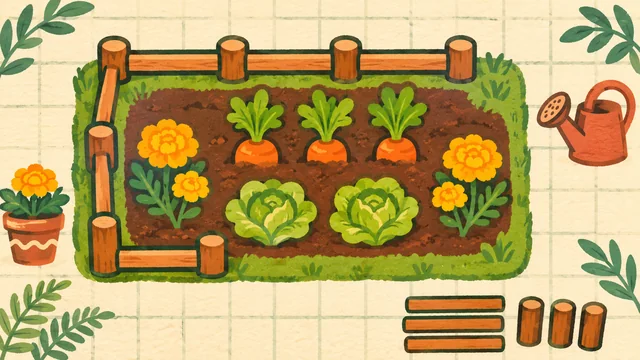
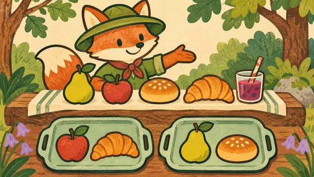
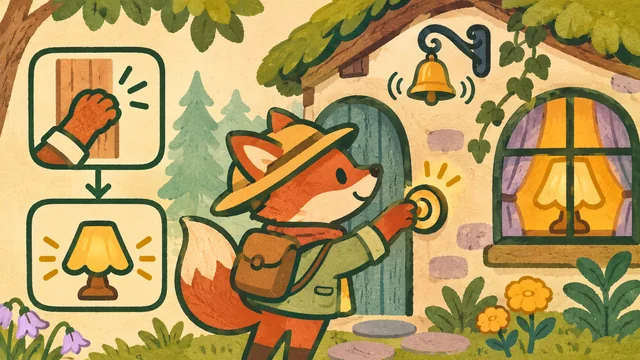
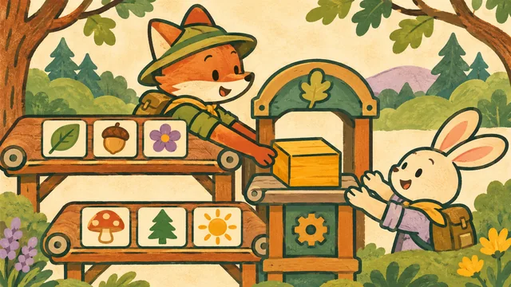
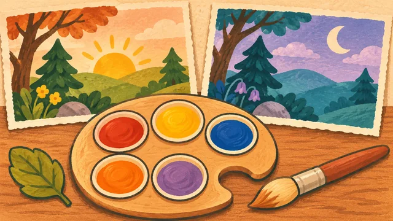

<!--
SPDX-FileCopyrightText: 2026 Milan Jankovec
SPDX-License-Identifier: EUPL-1.2
-->

# Junior Explorers

[Slovenčina](.docs/README.sk.md) · **English** · [Čeština](.docs/README.cs.md) · [Deutsch](.docs/README.de.md) · [Polski](.docs/README.pl.md) · [Magyar](.docs/README.hu.md) · [Français](.docs/README.fr.md) · [Español](.docs/README.es.md) · [Italiano](.docs/README.it.md) · [Português](.docs/README.pt.md) · [Nederlands](.docs/README.nl.md) · [Română](.docs/README.ro.md) · [Українська](.docs/README.uk.md) · [Ελληνικά](.docs/README.el.md) · [Svenska](.docs/README.sv.md) · [简体中文](.docs/README.zh-Hans.md) · [繁體中文](.docs/README.zh-Hant.md) · [日本語](.docs/README.ja.md) · [한국어](.docs/README.ko.md) · [Bahasa Indonesia](.docs/README.id.md) · [Türkçe](.docs/README.tr.md) · [Tiếng Việt](.docs/README.vi.md) · [Português (Brasil)](.docs/README.pt-BR.md)

Junior Explorers is a free, multilingual collection of 75 browser games for children around ages 6–9. Choose from 23 interface languages and three difficulty levels. English is the default. Use a mouse, touch or keyboard. On the keyboard, use Tab to navigate and Enter or Space to activate controls. Browse the games by category.

Word Hunter, Secret Code and Syllable Workshop use Slovak, Czech and English word banks. These games use the English word bank when another interface language is selected.

Use the print link on a game or its catalogue card to open a worksheet for that challenge. Answer pages are optional. Select Save as PDF in your browser’s print dialog or print on A4. Print tangrams at 100%.

## Play offline

Download and extract a ZIP of the repository, or clone it with Git. Double-click [index.html](index.html) to play or open each game’s worksheet. The site runs in your browser without an internet connection or a local server.

## Play online

After publication, open the [English catalogue](https://milanjankovec.github.io/junior-explorers/?lang=en) on GitHub Pages.

## Games

Rhyming Pairs and Picture Crossword have English, Slovak and Czech word sets. In the other interface languages, the games use the English word set.

### Logic

<table role="presentation">
  <tr>
    <td align="center" valign="top"><a href="games/smart-memory/index.html?lang=en"> Smart Memory</a></td>
    <td align="center" valign="top"><a href="games/tangram/index.html?lang=en"> Tangram Shapes</a></td>
  </tr>
  <tr>
    <td align="center" valign="top"><a href="games/pattern-builder/index.html?lang=en"> Finish the Pattern</a></td>
    <td align="center" valign="top"><a href="games/picture-sudoku/index.html?lang=en"> Picture Sudoku</a></td>
  </tr>
  <tr>
    <td align="center" valign="top"><a href="games/logic-detective/index.html?lang=en"> Who Am I?</a></td>
    <td align="center" valign="top"><a href="games/river-crossing/index.html?lang=en"> River Crossing</a></td>
  </tr>
  <tr>
    <td align="center" valign="top"><a href="games/island-bridges/index.html?lang=en"> Island Bridges</a></td>
    <td align="center" valign="top"><a href="games/parking-puzzle/index.html?lang=en"> Parking Puzzle</a></td>
  </tr>
  <tr>
    <td align="center" valign="top"><a href="games/one-stroke/index.html?lang=en"> One Stroke</a></td>
    <td align="center" valign="top"><a href="games/light-maze/index.html?lang=en"> Light Maze</a></td>
  </tr>
  <tr>
    <td align="center" valign="top"><a href="games/trip-planner/index.html?lang=en"> Plan the Trip</a></td>
    <td align="center" valign="top"><a href="games/nonograms/index.html?lang=en"> Picture Logic Puzzles</a></td>
  </tr>
  <tr>
    <td align="center" valign="top"><a href="games/campsite-tents/index.html?lang=en"> Tents and Trees</a></td>
    <td align="center" valign="top"><a href="games/cube-nets/index.html?lang=en"> Cube Nets</a></td>
  </tr>
  <tr>
    <td align="center" valign="top"><a href="games/property-circles/index.html?lang=en"> Sorting Circles</a></td>
  </tr>
</table>

### Maths

<table role="presentation">
  <tr>
    <td align="center" valign="top"><a href="games/math-pixel-art/index.html?lang=en"> Maths Pixel Art</a></td>
    <td align="center" valign="top"><a href="games/treasure-coordinates/index.html?lang=en"> Treasure Coordinates</a></td>
  </tr>
  <tr>
    <td align="center" valign="top"><a href="games/clock-master/index.html?lang=en"> Clock Master</a></td>
    <td align="center" valign="top"><a href="games/little-shop/index.html?lang=en"> Little Shopkeeper</a></td>
  </tr>
  <tr>
    <td align="center" valign="top"><a href="games/number-pyramids/index.html?lang=en"> Number Pyramids</a></td>
    <td align="center" valign="top"><a href="games/balance-scales/index.html?lang=en"> Balance the Scales</a></td>
  </tr>
  <tr>
    <td align="center" valign="top"><a href="games/pizza-fractions/index.html?lang=en"> Pizza Fractions</a></td>
    <td align="center" valign="top"><a href="games/garden-fence/index.html?lang=en"> Fence the Garden</a></td>
  </tr>
  <tr>
    <td align="center" valign="top"><a href="games/calendar-quest/index.html?lang=en"> Calendar Quest</a></td>
    <td align="center" valign="top"><a href="games/picture-graphs/index.html?lang=en"> Picture Graphs</a></td>
  </tr>
  <tr>
    <td align="center" valign="top"><a href="games/cube-builder/index.html?lang=en"> Cube Builder</a></td>
    <td align="center" valign="top"><a href="games/measurement-workshop/index.html?lang=en"> Measurement Workshop</a></td>
  </tr>
  <tr>
    <td align="center" valign="top"><a href="games/tens-factory/index.html?lang=en"> Tens Factory</a></td>
    <td align="center" valign="top"><a href="games/number-elevator/index.html?lang=en"> Number Elevator</a></td>
  </tr>
  <tr>
    <td align="center" valign="top"><a href="games/water-jugs/index.html?lang=en"> Measuring Jugs</a></td>
    <td align="center" valign="top"><a href="games/multiplication-arrays/index.html?lang=en"> Multiplication Rectangles</a></td>
  </tr>
  <tr>
    <td align="center" valign="top"><a href="games/chance-bag/index.html?lang=en"> Chance Bags</a></td>
    <td align="center" valign="top"><a href="games/snack-buffet/index.html?lang=en"> Snack Buffet</a></td>
  </tr>
</table>

### Language

<table role="presentation">
  <tr>
    <td align="center" valign="top"><a href="games/secret-code/index.html?lang=en"> Secret Code Workshop</a></td>
    <td align="center" valign="top"><a href="games/story-sequence/index.html?lang=en"> Time Detective</a></td>
  </tr>
  <tr>
    <td align="center" valign="top"><a href="games/word-search/index.html?lang=en"> Word Hunter</a></td>
    <td align="center" valign="top"><a href="games/syllable-workshop/index.html?lang=en"> Syllable Workshop</a></td>
  </tr>
  <tr>
    <td align="center" valign="top"><a href="games/read-and-draw/index.html?lang=en"> Read and Draw</a></td>
    <td align="center" valign="top"><a href="games/rhyme-pairs/index.html?lang=en"> Rhyming Pairs</a></td>
  </tr>
  <tr>
    <td align="center" valign="top"><a href="games/picture-crossword/index.html?lang=en"> Picture Crossword</a></td>
    <td align="center" valign="top"><a href="games/word-ladder/index.html?lang=en"> Word Ladder</a></td>
  </tr>
  <tr>
    <td align="center" valign="top"><a href="games/sentence-builder/index.html?lang=en"> Build a Sentence</a></td>
  </tr>
</table>

### Nature

<table role="presentation">
  <tr>
    <td align="center" valign="top"><a href="games/eco-sort/index.html?lang=en"> Planet Rescuers</a></td>
    <td align="center" valign="top"><a href="games/animal-food/index.html?lang=en"> Who Eats What?</a></td>
  </tr>
  <tr>
    <td align="center" valign="top"><a href="games/life-cycles/index.html?lang=en"> Nature Explorer</a></td>
    <td align="center" valign="top"><a href="games/weather-lab/index.html?lang=en"> Little Meteorologist</a></td>
  </tr>
  <tr>
    <td align="center" valign="top"><a href="games/forest-tracks/index.html?lang=en"> Forest Tracks</a></td>
    <td align="center" valign="top"><a href="games/garden-experiment/index.html?lang=en"> Garden Experiment</a></td>
  </tr>
  <tr>
    <td align="center" valign="top"><a href="games/shadow-playground/index.html?lang=en"> Playground Shadows</a></td>
    <td align="center" valign="top"><a href="games/magnet-workshop/index.html?lang=en"> Magnet Workshop</a></td>
  </tr>
  <tr>
    <td align="center" valign="top"><a href="games/rain-flow/index.html?lang=en"> Where Does Rain Go?</a></td>
    <td align="center" valign="top"><a href="games/float-or-sink/index.html?lang=en"> Float or Sink?</a></td>
  </tr>
  <tr>
    <td align="center" valign="top"><a href="games/day-and-night/index.html?lang=en"> Day and Night</a></td>
    <td align="center" valign="top"><a href="games/light-a-bulb/index.html?lang=en"> Light a Bulb</a></td>
  </tr>
</table>

### Coding

<table role="presentation">
  <tr>
    <td align="center" valign="top"><a href="games/robot-maze/index.html?lang=en"> Robot’s Way Home</a></td>
    <td align="center" valign="top"><a href="games/spaceship-repair/index.html?lang=en"> Spaceship Repair</a></td>
  </tr>
  <tr>
    <td align="center" valign="top"><a href="games/debug-the-robot/index.html?lang=en"> Debug the Robot</a></td>
    <td align="center" valign="top"><a href="games/traffic-program/index.html?lang=en"> Traffic Light Program</a></td>
  </tr>
  <tr>
    <td align="center" valign="top"><a href="games/event-house/index.html?lang=en"> Magic Event House</a></td>
    <td align="center" valign="top"><a href="games/seed-counter/index.html?lang=en"> Seed Counter</a></td>
  </tr>
  <tr>
    <td align="center" valign="top"><a href="games/stamp-printer/index.html?lang=en"> Stamp Printer</a></td>
    <td align="center" valign="top"><a href="games/parallel-workshop/index.html?lang=en"> Workshop Teamwork</a></td>
  </tr>
  <tr>
    <td align="center" valign="top"><a href="games/sorting-line/index.html?lang=en"> Sorting Line</a></td>
    <td align="center" valign="top"><a href="games/ticket-machine/index.html?lang=en"> Ticket Machine</a></td>
  </tr>
</table>

### Creativity

<table role="presentation">
  <tr>
    <td align="center" valign="top"><a href="games/symmetry-studio/index.html?lang=en"> Mirror Artist</a></td>
    <td align="center" valign="top"><a href="games/story-studio/index.html?lang=en"> Story Director</a></td>
  </tr>
  <tr>
    <td align="center" valign="top"><a href="games/rhythm-master/index.html?lang=en"> Rhythm Master</a></td>
    <td align="center" valign="top"><a href="games/scene-changes/index.html?lang=en"> What Changed?</a></td>
  </tr>
  <tr>
    <td align="center" valign="top"><a href="games/musical-steps/index.html?lang=en"> Musical Steps</a></td>
    <td align="center" valign="top"><a href="games/frame-animation/index.html?lang=en"> Frame-by-Frame Animation</a></td>
  </tr>
  <tr>
    <td align="center" valign="top"><a href="games/layered-landscape/index.html?lang=en"> Layered Landscape</a></td>
    <td align="center" valign="top"><a href="games/stamp-patterns/index.html?lang=en"> Stamp Patterns</a></td>
  </tr>
  <tr>
    <td align="center" valign="top"><a href="games/paper-puppets/index.html?lang=en"> Paper Puppets</a></td>
    <td align="center" valign="top"><a href="games/expedition-badge/index.html?lang=en"> Expedition Badge</a></td>
  </tr>
  <tr>
    <td align="center" valign="top"><a href="games/colour-lab/index.html?lang=en"> Colour Lab</a></td>
  </tr>
</table>

### Print previews

Click the image to enlarge the first worksheet page for each game. The examples are in English, with answer pages turned off.

## Privacy and licence

Play without registration, trackers, ads, network services or paid features. The browser can keep your language choice, preferences, completed games and comic draft on the device. The hosting provider may process standard operational logs.

© 2026 Milan Jankovec. The original source is licensed under [EUPL-1.2](LICENSE).
